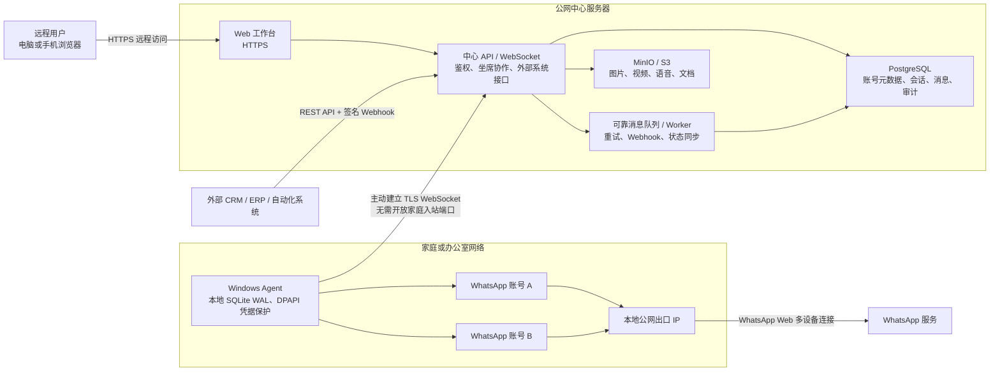

# RelayDesk

## 会话时间线合并

在统一收件箱按住 Shift 点击单人会话即可进入多选，之后直接点击其他会话切换选中状态。选中至少两个会话后，点击列表上方的“合并”，选择主会话并确认；“取消”可退出多选。每次最多选择 50 个会话。

仅允许同一个 channel（严格相同的渠道账号 `account_id`）内的单人会话合并，前后端都会校验；群会话不支持。合并后列表仅显示主会话，所有成员消息按原始消息时间排列，相同时间用消息 ID 稳定排序并分页。源会话后续收到的消息及未读数也会汇总到主会话。

此功能建立独立的时间线关联，不删除、搬移或改写原消息，也不合并联系人身份、访客凭证和发送队列。客户资料及会话操作仍以主会话为准。LiveChat 人工回复默认选择最近来信的原访客（按原始时间及消息 ID 判断，不受历史分页影响），输入区“回复给”可手动切换合并成员；编辑文字、准备图片或确认翻译期间不会自动切换，手动选择在当前页面保持。引用消息时回复其原访客，文字、图片、附件和重试均使用对应原会话，消息气泡标明原访客或发送对象。带客户变量的快捷回复使用接收人的资料。其他渠道的人工新消息仍发送给主会话，不支持跨原会话引用。LiveChat 访客仍只能读取自身会话，不会获得其他访客的历史，也不会收到向其他成员发送的消息。

LiveChat 合并回复修复需要同时更新工作台和 API，并重启 API；不需要重新合并，不新增数据库迁移，也不自动转发或补发此前已发给其他成员的消息。可运行 `node scripts/test-timeline-reply-browser.mjs` 检查桌面和手机上的接收人选择、编辑期间目标冻结及隔离收信（模拟 API，不连接业务数据库）；需要 Playwright 及 Chromium，截图位于 `outputs/timeline-merge/reply-*.png`。

合并后的 AI 接管模式和“回复时切换为”设置统一由主会话控制，成员的新入站消息按主会话模式触发 AI；自动回复及审批草稿仍发送给该消息所属的原联系人，不会发送给其他成员。AI 聊天上下文、记忆、任务归属和身份保持独立；主会话的 AI 面板汇总成员草稿与运行记录。人工发送消息或暂停 AI 会暂停整组的自动回复，并取消成员待执行的回复与跟进任务。已有合并关系无需重新合并，部署并重启 API 和 Worker 后生效，不自动补发历史消息。原有完全接管后的模式切换规则保持不变；需要持续完全接管时，将“回复时切换为”也设为完全接管。

已有主会话可以继续参与时间线合并。已参与时间线合并的成员不能删除、转移账号或通过旧入口合并联系人身份；本功能暂不提供拆分入口。API 和 Worker 启动时自动执行 `102_conversation_timeline_merges.sql`，上线时需部署并重启这两个服务，不应仅更新前端。新部署仍需按现有流程初始化完整数据库。

验证：根目录 `npm test` 包含多选交互及查询边界回归测试；`services/api` 下运行 `npm test` 和 `npm run build`。可选浏览器检查 `node scripts/test-timeline-merge-browser.mjs` 需要本机可解析 Playwright 及 Chromium，使用模拟 API 验证桌面和手机布局，截图位于 `outputs/timeline-merge/`。可选真实数据库测试在 `services/api` 下设置 `TIMELINE_PG_BIN` 为 PostgreSQL 的 bin 目录，再运行 `node --import tsx --test test/timeline-merge.postgres.test.ts`；测试仅创建临时数据库实例并自动清理，不连接业务数据库。以上不能替代真实账号收发联调。

## LiveChat 网站渠道

LiveChat 与 WhatsApp、Messenger 共用账号权限、统一收件箱、客户资料、认领与关闭、翻译、订单、AI Agent 和知识库配置，但使用独立的网站访客收发通道。每个 LiveChat 渠道都对应一个独立账号，可分别分配坐席、Agent 和知识库。首版支持匿名文字、图片和文件，不支持音视频、WhatsApp 模板、黑名单、跨账号转移或匿名身份合并。

### 创建与嵌入

1. 管理员进入 **系统设置 → LiveChat → 新增渠道**，填写名称、自定义图标（可选的 HTTPS 图片地址）、访客界面语言、欢迎语、主题色、左下角或右下角入口位置，以及允许嵌入的域名。各渠道可独立选择简体中文、繁体中文、英语、日语、西班牙语或葡萄牙语，覆盖访客按钮、输入提示、状态、错误提示和时间显示；不会更改工作台语言或自动翻译消息。欢迎语留空时使用对应语言的默认欢迎语，已填写的欢迎语和渠道名称保持原文。未设置语言时默认英语，已有明确语言配置保持不变；修改语言后，访客刷新网站即可应用，无需更换嵌入代码。
聊天窗口左上角优先显示该渠道的自定义图标；未设置、清除配置或图片加载失败时，使用渠道名称去除首尾空白后的首字母（英文字母转大写），不再固定显示 RelayDesk 的 R。图片应使用可公开访问的 HTTPS 地址，不能包含账号密码；访客浏览器直接加载图片且不发送 Referer，部署方需确保图片服务可用并考虑其访问日志。修改后刷新嵌入页面生效，无需更换嵌入代码。

2. 白名单按完整 origin 精确匹配，例如 `https://example.com`、`https://shop.example.com`；不同协议、子域名或端口需要分别配置。不能填写路径、通配符或普通公网 HTTP 地址；仅本机 `localhost`、`127.0.0.1` 和 `[::1]` 允许 HTTP 开发测试。
3. 点击渠道的“嵌入代码”，将生成的脚本加入网站公共模板或自定义 HTML 区域。WordPress、Shopify 或自建网站均可使用同一段 JavaScript，不需要安装专用插件。框架客户端动态注入脚本时，应在页面挂载完成后执行；同一页面重复加载同一渠道脚本只创建一个窗口，不同渠道仍可独立加载。
4. 在现有账号权限中给坐席分配该 LiveChat 账号；在 **AI Agent** 中选择该账号并分别指定知识库、自动回复权限和新会话的默认接管模式。仅启用 Agent 并不等于允许自动回复，仍遵循现有人工接管与审批规则。

```html
<script async src="https://客服域名/livechat/embed.js" data-channel="复制得到的公开渠道UUID"></script>
```

脚本地址默认使用工作台当前 origin；前后端分开部署时，前端构建应设置 `NEXT_PUBLIC_RELAY_API_URL` 为公网 API origin。公开渠道 UUID 不是密钥。脚本使用 Shadow DOM 和独立 iframe 隔离样式；网络请求由宿主页面发起，访客凭证不会放入 iframe URL。若宿主网站有 CSP，需要在 `script-src`、`connect-src`、`frame-src` 中允许客服服务的 HTTPS origin。禁止反向代理为 `/livechat/` 增加 `X-Frame-Options: DENY/SAMEORIGIN` 或覆盖 API 返回的 `frame-ancestors` 白名单。

### 访客会话与消息

- 客服消息左侧沿用窗口左上角的渠道图标（未设置或加载失败时显示渠道名称首字母）；访客消息的 `Me` 头像位于消息右侧最外侧，发送中和失败消息保持相同位置。客服消息的回复按钮紧邻气泡右侧，访客消息的回复按钮紧邻气泡左侧；表情、图片和附件工具位于消息输入框上方。
- 消息气泡在头像所在方向显示同色尖角（客服向左、访客向右），尖角的竖直位置对齐头像中心，长文本、引用和附件不会改变其位置。
- 选择回复消息后，引用预览显示在输入区域内、表情/图片/附件工具栏正上方，位于结束会话按钮下方；可通过预览右侧按钮取消回复。
- 收起聊天窗口后再次展开，消息列表自动滚动到最新消息；窗口保持打开时仍可向上翻阅历史，首次聊天的资料表单不会被自动滚动跳过。
- 窗口顶部右侧提供放大全屏／还原图标和 `×` 收起按钮。放大时填满浏览器可视区域并保留 8px 边距，还原后恢复浮窗尺寸；`×` 仅收起窗口，不结束会话。当前页面收起后再打开保留放大状态，刷新后恢复普通浮窗，渠道主题色和界面语言保持不变。
- 发送按钮与消息输入框顶部对齐。窗口展开/收起状态保存在宿主网站的 `localStorage`，同一浏览器、同一网站 origin、同一渠道跨页面跳转和刷新后保持；首次访问默认收起，不同网站或渠道互不影响。浏览器禁止或清理本地存储后无法恢复该状态。
- 访客无需注册。首次聊天需填写姓名、有效邮箱和首条消息（必填），公司名、WhatsApp 为选填；点击“开始对话”后在同一个事务中创建独立客户、保存资料并发送首条消息，附件在开始会话后可用。已有会话刷新后直接恢复聊天，不反复要求填写资料，也不会按邮箱自动合并联系人或覆盖坐席编辑过的资料。消息进入统一收件箱和现有 Agent 流程。
- 服务端记录首次及最近发消息时的 IP、浏览器 User-Agent；宿主脚本随消息提交浏览器语言、IANA 时区和页面 origin/路径，不采集页面查询参数、片段或 Cookie。后台对话右侧“网站访客信息”显示这些资料；公司、邮箱和选填 WhatsApp 同时进入客户资料。浏览器语言和时区不覆盖坐席设置的客户偏好语言或时区。环境信息为浏览器自报，IP 也可能为代理出口，均不能作为身份验证依据。
- 随机访客凭证保存在宿主网站的 `localStorage`，服务端只保存 SHA-256 摘要；按渠道、宿主 origin 和访客隔离，不依赖第三方 Cookie。凭证有效期为创建后 180 天，过期后可在窗口开始新匿名会话；原记录仍由客服保留。
- 同一浏览器刷新可恢复历史，清理站点数据、隐私模式、换浏览器、换网站 origin 或换设备会产生独立身份，不自动合并。不要把访客凭证作为公开配置或加入日志。
- 结束会话后点击“开始新会话”，有效访客凭证保持不变，直接进入消息输入界面，不再填写姓名、邮箱、公司或 WhatsApp；新消息仍归属后台原客户，不覆盖坐席修改过的资料。窗口从新的展示分界开始，不再显示之前的聊天，刷新、跨页面和历史分页也不会重新显示旧消息；后台完整历史与现有 transcript 生成逻辑保留。展示分界仅用于前端呈现，不是数据删除或新增权限边界，按宿主 origin 和渠道保存在本地，不额外缓存客户资料。凭证过期时才创建新身份并重新填写资料；网络错误不会直接更换身份。
- 窗口支持展开、收起、未读数量、历史分页、常用表情、图片与附件发送、粘贴或拖放文件、发送前预览和说明文字、图片消息内联预览/放大/下载、普通附件授权下载，以及发送失败重试。选择附件后不会立即发送，访客可先移除或补充说明，再点击发送。每 4 秒增量同步，恢复网络后补齐消息；未确认消息在宿主网站本地保存，刷新后可用原消息 ID 重试并在服务端去重。本地存储被浏览器禁用时，刷新恢复不可用。
- 访客发送立即请求 API，不等待上述 4 秒轮询。工作台通过现有 WebSocket 接收入站会话更新，当前会话消息与列表摘要并行加载；连接不可用时每 5 秒兜底校准（正常连接下仍每 60 秒校准），连接建立或页面恢复可见时立即补齐，且不会重叠执行校准请求。此间隔不是实际送达时间保证；若仍有明显延迟，应检查 `/api/v1/events/ws` 的代理升级、API 请求耗时、数据库锁与连接池以及 Worker/AI Provider 状态，区分收件箱显示和 AI 回复耗时。
- 访客可分别选择“结束会话”或“结束会话并发送记录”。前者直接关闭当前会话，不依赖邮件配置；后者确认后由服务端按时间生成安全的纯文本/HTML transcript（包含已接收及已发布的聊天消息、附件文件名，不附带文件或重复收入邮件记录），通过已启用的邮件 Provider 异步发送到客户当前主邮箱，并在邮件成功入队后关闭会话。窗口提示“已入队”而非“已送达”，实际结果以后台邮件发送状态为准；邮件 Provider 未配置或入队失败时不会关闭。普通消息发送不依赖邮件配置。有待重试消息或正在上传附件时不能结束会话。两个动作都使用按访客和模式隔离的幂等请求 ID，网络确认丢失或刷新后重试不会重复关会话或重复入队；结束状态及模式在当前浏览器保存，刷新仍可查看原记录。关闭后可通过“开始新会话”重新接入，客服保留原历史。
- 坐席和 AI 回复都进入持久出站队列，由 API Worker 发布到访客消息流；“已发送”表示已发布，不代表访客已读。访客发新消息会重新打开已关闭会话；LiveChat 没有 WhatsApp/Messenger 的 24 小时回复窗口限制。
- 双向附件限定 PNG、JPEG、WebP、PDF 和纯文本，单文件不超过 10 MB。访客上传还检查文件签名；文件读取要求有效访客凭证及当前会话中的消息引用，不提供公开对象存储地址。未发送附件仍占对象存储空间，运维需监控并安排孤立对象清理；`delete_after` 标记本身不会删除对象。
- 停用渠道立即阻止公开接入和新消息，重新启用后原凭证仍受有效期约束。归档需要二次确认，归档后不能通过设置界面恢复；保留原账号、历史客户、会话和审计记录，但停止嵌入访问及发送，已有待发消息由 Worker 标为失败。

### 安全与部署

API 和 Worker 启动时执行 `097_livechat_schema.sql`、`098_livechat_language.sql`、`099_livechat_visitor_profile.sql`、`100_livechat_icon.sql` 和 `101_livechat_end_requests.sql`，使用数据库会话锁串行化启动迁移；迁移新增渠道枚举及渠道、访客、限流、幂等结束请求表，并为旧渠道补充默认界面语言、访客环境字段及可选渠道图标，不删除原渠道数据。旧访客仍可直接聊天，环境信息在下次发消息时补充，不追溯历史 IP。新部署仍需执行现有完整数据库初始化流程。生产环境需要可供宿主网站访问的 HTTPS 地址、PostgreSQL、私有 S3/MinIO 存储，以及持续运行的 API 和 Worker。仓库 Nginx 已代理 `/livechat/`，允许 11 MB 请求体以容纳 multipart 开销。

公开 API 同时校验 origin、渠道状态及独立访客凭证。来源白名单防止浏览器从未授权网站嵌入，但不等同于用户认证，不能防止脚本客户端伪造 Origin，因此还需边缘防滥用和容量监控。默认按每渠道 IP 每分钟 600 次、每访客历史读取每分钟 120 次、每访客附件操作与结束会话合计每分钟 120 次、每访客发送每分钟 30 次、每渠道 IP 发消息每分钟 120 次、每访客上传每分钟 10 次且每天 100 次限流；文字最多 10,000 字符。历史读取与附件额度独立，但仍受渠道 IP 总额度约束，附件故障不会单独耗尽访客收信额度。

图片预览下载失败后停止自动重试，在图片位置显示点击重试入口；其他消息仍正常轮询，不会因每轮重绘反复下载失败图片。上传失败保留所选附件和说明，访客可重试或移除附件。网络恢复或历史读取限流解除后，轮询继续补齐消息并清除对应的收信错误提示，不更换访客身份、不删除聊天记录。部署需更新并重启 API；宿主脚本缓存最长 5 分钟，访客刷新嵌入页面后使用新的窗口资源。

反向代理后应配置 `TRUSTED_PROXY_CIDRS` 为实际代理的 IP/CIDR（逗号分隔），保证按真实客户端 IP 限流；默认留空不信任转发头。不要设为任意地址或无条件信任全部代理，也不要仅凭请求头判断客户端 IP。Docker 网络部署应固定或限制代理所在网段并限制 API 直连访问，再填写对应 CIDR；如有 CDN，应由入口代理校验 CDN 来源并规范化转发头。`CORS_ORIGIN` 继续用于工作台，LiveChat 的跨域来源单独从各渠道白名单读取。

访客环境及联系方式仅通过现有身份验证和账号权限下的客户/会话详情接口提供，不放入公开配置、历史消息或附件接口。未确认的首条消息及联系方式会随待发消息短暂保存在宿主网站本地存储，确认发送后清除；部署方应在网站隐私声明中说明联系方式及环境信息的收集用途、保存期限和处理流程，并根据适用要求取得必要同意。归档渠道保留历史资料，不等于删除个人数据。

### 验证

后端测试：在 `services/api` 运行 `npm test` 和 `npm run build`。前端构建：在根目录运行 `npm run build`。可选浏览器验收脚本为 `node scripts/test-livechat-browser.mjs`，需要先构建 API，并在本机提供 Playwright 和 Chromium；脚本使用两个临时网站及模拟 API 验证真实嵌入资源，截图写入 `outputs/livechat/`。模拟测试不能替代真实数据库、对象存储、权限分配和 AI Provider 的端到端验收，上线前应另行验证这些连接以及原 WhatsApp/Messenger 收发。

## 系统特色与核心能力

RelayDesk 是一套面向跨境销售、外贸客服和私域客户运营团队的自托管消息与成交工作台。系统把 WhatsApp、Facebook Messenger、客户资料、产品目录、报价订单、AI 翻译、素材、支付与跟进任务放在同一个界面中，帮助坐席从“收到咨询”一路完成“理解客户、推荐产品、发送目录、创建订单、发起收款和持续跟进”，减少在翻译工具、表格、图片编辑器和多个聊天窗口之间反复切换。

### 1. 快速合成并发送产品目录

- **团队共享产品库**：集中维护产品名称、唯一 SKU、描述、品牌、分类、供应商链接、内部备注、图片、重量、币种、Shipping Class、标签、规格变体及按采购数量变化的阶梯价格。产品资料可被所有有权限的坐席复用，修改产品库不会反向改写已经保存的历史订单。
- **批量导入、导出与维护**：支持通过 CSV 一键导入和导出产品；可批量调整价格、标签、分类、Shipping Class、标题和 SKU，适合快速整理规模化商品目录。
- **产品卡片即时生成**：坐席可在当前会话中搜索并多选产品，把实时产品资料合成为适合发送给客户的 PNG 产品卡片。卡片可包含产品图、名称、SKU、价格、阶梯价格、描述等信息，发送前仍可调整本次图片说明。
- **可视化卡片模板**：管理员或主管可配置产品卡片的画布尺寸、组件、顺序、样式和默认说明模板，使用 `{{productCount}}`、`{{productNames}}`、`{{productName}}`、`{{sku}}` 等变量统一团队输出，同时保留每次发送时的灵活性。
- **拼图式产品目录**：批量勾选产品后，可按可视化拼图模板自动排版并生成多页产品目录素材。模板支持产品图片、产品文字、自定义文字和背景等图层，能够调整位置、尺寸、层级及页面布局，无需坐席临时使用外部制图软件。
- **共享素材库**：生成后的目录图片会进入团队素材库，记录模板、产品快照、页数、创建人和创建时间，可预览单页、下载单图或打包下载 ZIP，方便团队长期复用同一套销售物料。
- **灵活发送方式**：从会话内打开素材库后，可跨多个素材批次选择最多 10 张图片，选择“逐个发送”，或按横向/竖向“拼接发送”；系统会保持素材库及页码顺序，并在进入可靠消息队列前确认处理结果。
- **多渠道交付**：产品卡片与目录既可通过 WhatsApp 发送，也可根据联系人保存的邮箱加入邮件发送队列；启用会话翻译后，随图说明可先自动翻译、预览确认，再与图片一起发给客户。

### 2. AI 双向翻译与多语言沟通

- **按会话独立设置语言**：每位坐席可为不同客户分别设置“客户语言”和“坐席语言”，偏好保存在服务端并跨浏览器同步，适合一个团队同时服务多个国家和地区。
- **来信保留原文并显示译文**：收到的文本、媒体说明和语音消息可翻译为坐席熟悉的语言；界面保留客户原文，并在其下方展示译文，便于核对语气、专有名词和上下文。
- **发信先预览、后发送**：坐席输入自己的语言后，系统先生成目标语言译文并允许人工修改；只有确认译文后，消息才会进入发送队列，避免未经检查的 AI 内容直接发给客户。
- **语音转写与翻译**：支持对收到的 WhatsApp 语音进行转写并翻译；OGG/Opus 等语音会在服务端临时转换为 Provider 支持的格式，原始媒体保持不变。转写原文和不同目标语言的译文会缓存，减少重复调用。
- **图片说明与业务内容翻译**：普通文字、产品卡片说明、素材目录说明、订单发送内容和 WhatsApp Status 文案都可以复用翻译预览流程，让多语言能力真正进入销售操作，而不只是单独的翻译窗口。
- **可替换 AI Provider**：管理员可配置 OpenAI 或同时兼容 `/chat/completions`、`/audio/transcriptions` 的服务，分别指定文字翻译与语音转写模型；API Key 使用系统数据加密密钥保存。
- **AI 文字转语音**：支持 OpenAI、ElevenLabs、Azure Speech 及 OpenAI-compatible TTS，将坐席输入的文字生成语音并作为 WhatsApp 语音消息发送；可配置模型、音色、语速和语气。若同时启用翻译，可先确认译文，再基于确认后的内容生成语音。

### 3. 从会话直接创建和发送订单

- **聊天内创建订单**：坐席无需离开客户会话即可创建订单草稿，可从团队产品库搜索商品，也可按需添加临时商品；支持多个商品、数量、阶梯单价、附加费用、客户可见说明和团队内部备注。
- **历史订单快照**：订单保存产品名称、SKU、单价等快照，后续产品库修改不会改变历史订单，便于追溯当时发送给客户的报价和成交条件。
- **地址与运费计算**：联系人可保存多个收货地址，创建订单时直接选择；系统可按产品重量、Shipping Class、目的国家或地区和运费模板计算建议运费，并允许坐席确认或调整。
- **多币种支持**：工作区可配置可用币种、基准币种和汇率，也可从公共汇率服务刷新汇率，为跨境报价和订单金额计算提供统一基础。
- **可配置订单编号**：管理员可以使用年份、月份、日期和当日序号变量定义订单编号规则，并指定业务时区；编号在订单创建时固化，规则变化不会影响历史订单。
- **多种订单发送格式**：订单可按文字、完整图片或 PDF 发送到会话，支持发送和重新发送。管理员可分别维护三种格式的模板、字段顺序、状态标题和展示内容，使报价单与订单通知保持统一品牌样式。
- **订单全局管理**：除联系人详情中的订单记录外，系统还提供集中订单列表，可搜索、筛选、查看详情、编辑订单、更新业务状态，并按最新订单状态筛选会话，例如未创建订单、待付款、已付款、处理中、已发货、已完成或已取消。
- **付款请求闭环**：可配置多个付款方式及付款 Profile。PayPal 订单能够生成付款链接、发送到 WhatsApp、刷新付款状态或按最新模板重新生成；手动付款方式可向客户发送预设付款说明，形成从报价到收款的连续流程。

### 4. 统一收件箱与客户关系管理

- **多账号、多渠道统一接待**：在同一个工作台处理本地 WhatsApp Web 账号、Meta WhatsApp Business Cloud API 账号和 Facebook Messenger Pages，会话仍按渠道及账号隔离权限和数据。
- **完整消息形态**：支持文本、图片、视频、语音和文件等媒体消息，并提供引用回复、发送中/已发送/已送达/已读/失败/待确认状态、失败消息人工重发及异常消息清理。
- **高效会话操作**：支持分页与实时增量更新、关键词搜索、日期范围、账号、标签、客户阶段和最新订单状态筛选；可收藏、认领、关闭、标记已读，并在同渠道账号之间转移会话及联系人关联。
- **客户 360° 资料**：联系人详情集中展示别名、电话和邮箱联系方式、主要邮箱、语言、标签、团队共享备注、个人提醒、生日、特殊日期、收货地址、订单历史、邮件活动、AI 会话摘要和已提取客户事实。
- **团队协作与权限**：提供管理员、主管和坐席角色、账号级访问范围、会话认领、共享标签与备注、个人提醒及审计记录，降低多人同时服务同一客户时的信息断层。
- **快捷回复与媒体复用**：快捷回复支持搜索、文本和媒体类型，可插入联系人等上下文变量；团队还可复用账号媒体库、产品卡、目录素材和订单模板，加快高频回复。

### 5. AI Agent、知识库与聊天记忆

- **按账号配置销售或客服 Agent**：可为每个 WhatsApp 账号单独设置人设、工作语言、营业时间、置信度阈值、跟进规则及允许使用的知识库。
- **企业知识库**：支持上传 PDF、DOCX、TXT、Markdown 和结构化常见问答；文档解析后通过 PostgreSQL/pgvector 建立混合检索索引，只有状态为可用的内容才会进入 Agent 上下文。
- **上下文感知回复**：Agent 可读取联系人资料、团队备注、聊天记忆、近期消息、订单摘要和授权知识，生成更贴近客户与当前交易阶段的回复或草稿。
- **人工接管与风险控制**：退款、支付、投诉升级、订单修改或置信度不足等情形不会自动回复；坐席发送消息后会进入人工接管，需明确恢复 Agent。自动发送能力按工具权限单独授权，默认优先采用人工审批。
- **持续客户记忆**：系统维护滚动会话摘要和带来源的客户事实；坐席可以修正、删除或重新整理记忆，同时完整历史消息仍保留在原始消息表中。

### 6. 任务、提醒与自动跟进

- **统一任务中心**：普通待办和定时消息共用列表、甘特图以及月/周/日历视图，可设置负责人、开始时间、截止时间、进度、重复规则和前置任务。
- **AI 个性化消息草稿**：定时消息可在执行前读取联系人资料、聊天记忆、近期消息、订单摘要和知识库，根据任务要求生成个性化草稿。
- **审批优先的自动化**：消息任务默认进入人工审批；只有主管或管理员明确授予 `queue_message` 工具权限后才允许自动加入发送队列。
- **生日、纪念日和节日运营**：Worker 可根据联系人生日、特殊日期和账号启用的内置节日提前创建任务，并在草稿生成时读取最新上下文，避免长期预生成文案过时。
- **个人提醒与客户跟进**：坐席可直接在会话中设置个人提醒，任务状态会与“我的提醒”协同展示，帮助团队持续跟进未付款、待确认或需要再次联系的客户。

### 7. 状态内容、素材与邮件触达

- **WhatsApp Status 管理**：可使用账号媒体库中的图片或视频创建状态内容，编写或翻译文案并安排发布时间，由后台 Worker 按计划发布和记录执行状态。
- **素材集中管理**：媒体文件统一进入对象存储，产品图片、拼图目录、会话附件、订单文件和状态素材可在对应业务流程中复用。
- **邮件补充触达**：系统支持 SMTP 与 Resend Provider，产品卡片或订单可发送到联系人一个或多个邮箱，并在会话资料中查看邮件活动，适合同时通过聊天和邮件交付正式资料。

### 8. 可靠发送、开放集成与自托管

- **离线可恢复的可靠队列**：发送请求会先持久化到 PostgreSQL，再派发给在线 Agent。Agent 或网络离线时消息保留在队列中，恢复后继续处理；`clientMessageId`、事件 ID 和 WhatsApp 消息 ID 用于幂等与去重。
- **明确处理不确定状态**：如果连接在 WhatsApp 可能已经接受消息、但 Agent 尚未取得确认的窗口中断，系统会标记为 `uncertain` 并停止自动重试，交由人工确认，避免客户收到重复消息。
- **边缘 Agent 架构**：Windows Agent 或 Linux Docker Agent 主动通过加密 HTTPS/WSS 连接中心服务器，家庭或办公室网络通常不需要公网 IP、端口映射或内网穿透；WhatsApp 会话凭据保留在 Agent 本地并受到平台加密机制保护。
- **REST API 与签名 Webhook**：外部 CRM、ERP 或自动化系统可使用 API Key 调用 `/api/v1`，消息发送支持稳定的客户端幂等 ID；Webhook 使用 HMAC-SHA256 签名、事件 ID 去重和失败重试机制。
- **自托管与数据掌控**：中心平台由 Web、API、Worker、PostgreSQL、Redis 和 MinIO/S3 组成，可通过 Docker Compose 部署；账号元数据、客户资料、消息、订单、任务、审计与媒体均由部署方自行管理。
- **安全配置**：Provider API Key、Meta 凭据和支付凭据加密保存，敏感值不会通过常规读取接口返回明文；系统提供角色权限、账号访问范围、设备凭据撤销、审计日志和受签名保护的 Webhook。

### 典型成交工作流

1. 客户通过 WhatsApp 或 Messenger 发来咨询，消息进入统一收件箱。
2. 系统按当前会话设置显示 AI 译文；坐席查看客户资料、历史摘要、标签、订单和提醒。
3. 坐席从产品库选择相关商品，快速生成产品卡片或多页拼图目录，并将说明翻译为客户语言后发送。
4. 客户确认商品后，坐席在会话内创建包含商品、数量、费用、地址、运费和付款方式的订单。
5. 系统按配置模板生成文字、图片或 PDF 订单并发送；需要在线收款时生成并发送 PayPal 付款链接。
6. 订单状态、付款进度和后续提醒持续保存在客户会话中；任务中心负责待办、定时跟进、生日和节日触达。

## 任务中心

RelayDesk 现在提供统一的普通任务与定时消息中心，包含列表、甘特图和月/周日历视图。消息任务可使用联系人资料、备注标签、聊天记忆、近期消息、订单摘要与已授权知识库生成个性化草稿；默认需要人工审批，只有主管或管理员明确授予 `queue_message` 权限后才可自动发送。

生日、联系人特殊日期及账号启用的内置节日会由 Worker 提前创建任务，并在草稿提前期到达后读取最新上下文。所有任务仍归属 WhatsApp 账号并使用 PostgreSQL、现有 Worker 和可靠出站队列；数据库升级由 `034_task_center.sql` 在 API 启动时自动应用。

> Windows Agent 的安装包发布、注册、扫码和断网恢复验收见 [`docs/windows-agent.md`](docs/windows-agent.md)。VPS 已上线后，建议先按该文档用测试 WhatsApp 账号完成一轮端到端验证，再接入正式账号。

## Docker Relay Agent

RelayDesk 也提供带浏览器管理界面的 Linux Docker Agent。每个容器只绑定一个 WhatsApp 账号，二维码、连接状态和重新配对操作可在本地网页完成；会话凭据和待同步事件会持久化在 Docker volume 中。

1. 在 RelayDesk 的 **设置 → Agent 管理** 生成一个 15 分钟有效的一次性注册码。
2. 在服务器上复制 `apps/agent/compose.yaml` 和 `apps/agent/.env.docker.example`，然后把示例文件另存为本地私有的 `.env`。不要直接修改仓库里的示例文件；`.env` 里至少填写 `RELAY_CENTRAL_URL`、`RELAY_ENROLLMENT_CODE`、`RELAY_ACCOUNT_ID` 和 `RELAY_MASTER_KEY`。
3. 执行 `docker compose pull && docker compose up -d`。
4. 管理界面默认只绑定服务器本机 `127.0.0.1:8788`。如果你不打算把 8788 端口直接暴露到公网，建议先建立 SSH 隧道，再在本机浏览器访问本机地址：

   ```bash
   ssh -L 8788:127.0.0.1:8788 <user>@<server>
   ```

   隧道建立后，在本机浏览器打开 `http://127.0.0.1:8788` 扫码。

完整部署、升级、代理和安全访问说明见 [`docs/docker-agent.md`](docs/docker-agent.md)。镜像由 GitHub Actions 发布到 `ghcr.io/samlau0086/relaydesk-agent:latest`。

## 远程连接方式与部署架构

RelayDesk 采用“公网中心服务器 + 家庭/办公室 Windows Agent”的边缘执行架构。你在外部访问中心服务器上的 Web 工作台，中心服务器负责身份验证、消息存储、API、队列和坐席协作；真正连接 WhatsApp 并执行收发操作的是家里或办公室电脑上的 Windows Agent。

Windows Agent 会主动向中心服务器建立加密的 HTTPS/WSS 出站连接，因此家庭网络通常不需要公网 IP、端口映射或内网穿透。只需确保 Windows Agent 能访问中心服务器，并保持后台运行。



### 消息流向

发送消息时：

1. 远程用户或外部系统把发送请求提交到中心 API。
2. 中心服务器先将消息和发送命令持久化，再通过 WSS 派发给对应的 Windows Agent。
3. Windows Agent 使用目标账号的本地 WhatsApp 会话完成发送，并把发送、送达、已读或失败状态同步回中心服务器。
4. 如果 Agent 或家庭网络离线，命令保留在中心队列；Agent 恢复连接后继续按顺序处理。

接收消息时：

1. WhatsApp 消息先到达运行对应账号的 Windows Agent。
2. Agent 先写入本地 SQLite WAL，再同步到中心服务器。
3. 中心服务器事务落库后确认同步游标，并实时更新 Web 工作台及签名 Webhook。
4. 如果中心服务器暂时不可达，Agent 会保留未确认事件并在恢复后重传；中心通过事件 ID 和 WhatsApp 消息 ID 去重。

### IP 归属

- WhatsApp 连接使用 Windows Agent 所在网络的公网出口 IP，而不是中心服务器 IP。
- 多个 WhatsApp 账号运行在同一台 Windows Agent 上时，通常共用该电脑所在网络的公网出口 IP。
- 账号分布在不同电脑、不同住宅或不同办公室网络时，会分别使用各自网络的出口 IP。
- 如需更强隔离，可以为不同账号部署独立 Agent、Windows 虚拟机或稳定的独立网络出口。
- 不建议频繁切换代理、地区或出口 IP；账号网络环境应尽量稳定并符合实际使用地点，以降低 WhatsApp 风控风险。

### 安全边界

- WhatsApp 会话凭据保存在 Windows Agent 本地，通过 Windows DPAPI 保护，不上传到中心服务器。
- Agent 只主动连接中心服务器，不监听公网端口；中心使用一次性注册码登记 Agent，并换取可撤销的设备凭据。
- 公网只需暴露经过 HTTPS/WSS 反向代理的 Web/API；PostgreSQL、Redis 和 MinIO 不应直接暴露到互联网。
- 中心服务器故障不会改变 WhatsApp 账号的网络出口，但会暂时影响远程操作；Agent 会继续保存待同步事件。
- Windows Agent 关机、退出登录或家庭断网期间无法实时收发；恢复后会处理仍可由 WhatsApp 多设备协议交付的事件和中心待发送队列。

### 推荐部署示例

```text
云服务器（固定域名 + HTTPS）
├─ RelayDesk Web / API / Worker
├─ PostgreSQL
├─ Redis
└─ MinIO

家里 Windows 电脑
└─ RelayDesk Agent
   ├─ WhatsApp 账号 A
   ├─ WhatsApp 账号 B
   └─ 主动连接 wss://relay.example.com/agent/ws

远程访问
└─ https://relay.example.com
```

RelayDesk 是一个自托管的 WhatsApp 与 Facebook Messenger 多账号消息聚合平台。它由中心 Web/API、持久任务 Worker、PostgreSQL、Redis、对象存储以及运行在 Windows 上的本地 WhatsApp Agent 组成。

> RelayDesk 同时支持本地 WhatsApp Web 多设备账号和 Meta 官方 Cloud API 账号。请只用于获得授权的业务会话，不要发送垃圾消息或未经同意的营销内容。

### Meta WhatsApp Business Cloud API

管理员可在“系统设置 → WhatsApp API”填写 WABA ID、Phone Number ID、长期 Access Token 和 Meta App Secret。凭据在 PostgreSQL 中加密保存，保存后不会通过 API 返回明文。

1. 在部署环境设置 `META_GRAPH_API_VERSION`（例如 `.env.example` 中的版本），生产环境缺少该变量时 API 会拒绝启动。
2. 添加账号后复制一次性显示的 Verify Token。
3. 在 Meta App 中将 Callback URL 设置为 `https://你的域名/api/v1/meta/whatsapp/webhook`，并订阅 WhatsApp 消息事件。
4. 完成 Webhook challenge 后，在设置页测试凭据并同步已审核模板。

Cloud API 新会话必须通过已审核模板发起。客户回复后会开启 24 小时服务窗口，窗口内可发送普通文本和媒体；窗口关闭后，RelayDesk 会在入队前阻止普通消息并引导坐席选择模板。

### Facebook Messenger Pages

推荐使用“系统设置 → Messenger Pages → 使用 Facebook 连接 Pages”的 OAuth 流程。管理员登录 Facebook 后可一次勾选多个 Page；RelayDesk 会读取并加密保存对应 Page Token、验证 Page 身份，并自动调用 `/{PAGE_ID}/subscribed_apps` 订阅消息事件。每个 Page 仍会成为独立渠道账号，拥有独立联系人、会话、权限和回复窗口，但会与 WhatsApp 一起显示在统一收件箱。

#### 准备条件

- 登录 [Meta for Developers](https://developers.facebook.com/apps/)，创建或选择一个已启用 Messenger 与 Facebook Login for Business 的 Meta App。
- 操作人必须拥有目标 Facebook Page 的管理权限，并能授权该 App 管理 Page 消息。
- 生产接收普通客户消息前，App 需要切换到 Live 模式，并按 Meta 要求完成业务验证、隐私政策及 `pages_messaging` 等权限审核。Development 模式通常只允许 App 角色和测试人员使用。
- RelayDesk API 必须能通过公网 HTTPS 访问；Meta 无法回调 `localhost`、内网地址或需要登录的 URL。

#### 首次配置 Facebook OAuth

1. 在 Meta App Dashboard 添加 **Facebook Login for Business**，创建一个 Login Configuration。
2. 在该 Configuration 中请求以下权限：
   - `pages_show_list`
   - `pages_messaging`
   - `pages_manage_metadata`
   - `pages_read_engagement`
3. 在 Facebook Login for Business 的 Valid OAuth Redirect URIs 中添加 RelayDesk 设置页显示的 OAuth Redirect URI，例如：
   - `https://你的 API 域名/api/v1/meta/messenger/oauth/callback`
4. 在 Meta App 的 Messenger Webhooks 中选择 `Page` 对象，填写 RelayDesk 显示的：
   - Callback URL：`https://你的 API 域名/api/v1/meta/messenger/webhook`
   - Verify Token：保存 OAuth 应用配置时 RelayDesk 一次性显示的值
5. 在 RelayDesk 的“系统设置 → Messenger Pages”填写：
   - **Meta App ID**：来自“App settings → Basic”
   - **Meta App Secret**：同一页面点击 Show 后取得
   - **Login for Business Configuration ID**：来自 Facebook Login for Business 的 Configuration
6. 保存后点击“使用 Facebook 连接 Pages”，使用拥有目标 Page 管理权限的 Facebook 账号登录，勾选一个或多个 Page，再在 RelayDesk 确认连接。

OAuth 回调只短暂使用 User Access Token 来读取 `/me/accounts`，不会长期保存它。候选 Page Token 在短期授权会话中加密保存，选定后才写入渠道账号；授权会话会过期并被清理。Page echo 通过 `messages` 字段返回，因此自动订阅的字段是 `messages`、`message_deliveries` 和 `message_reads`，不需要单独订阅已不适用的 `message_echoes` 字段。

#### Meta App 审核与上线

- App 处于 Development 模式时，通常只有 App 角色、测试人员及其可管理 Page 能完成授权和测试。
- 对外上线前，将 App 切换到 Live，完成 Meta 要求的业务验证、数据处理说明、隐私政策、服务条款和用户数据删除页面。
- 为上述 Page 权限申请 Advanced Access/App Review，并在审核说明中展示“Facebook 登录 → 选择 Page → 收发 Messenger 消息”的完整录屏。
- OAuth 不能替你在 Meta Dashboard 首次登记 Webhook Callback URL 和 Verify Token；这是 App 级别的一次性配置。后续新增 Page 会由 RelayDesk 自动完成 Page 订阅。

#### 手动凭据（仅作兼容回退）

如果 Meta App 暂时无法启用 Facebook Login for Business，可展开设置页中的“高级：手动添加 Page 凭据”，按以下方法逐 Page 添加。

1. **Page ID**
   - 打开目标 Facebook Page，在 Page 的“关于/About”或“Page transparency/主页透明度”区域查找数字 Page ID。
   - 也可以在 Meta App 的“Messenger → Messenger API Settings（Messenger API 设置）→ Access Tokens”区域连接 Page 后查看其 Page ID。
   - Page ID 是纯数字标识，不是 Page 用户名，也不是浏览器地址中的自定义短名称。

2. **Page Access Token**
   - 在 [Meta App Dashboard](https://developers.facebook.com/apps/) 打开对应 App。
   - 进入“Messenger → Messenger API Settings → Access Tokens”。
   - 点击“Add or remove Pages”，选择目标 Page 并完成 Facebook 授权。
   - 在目标 Page 行点击“Generate Token/生成 Token”，确认所需权限后立即复制生成的 **Page Access Token**。
   - 不要填写普通 User Access Token、App Access Token 或 WhatsApp Token。若 Meta 只签发短期 Token，应按 [Meta Access Token 文档](https://developers.facebook.com/docs/facebook-login/guides/access-tokens/)换成长效凭据后再用于生产。

3. **Meta App Secret**
   - 在同一个 Meta App 中进入“App settings/应用设置 → Basic/基本”。
   - 在“App Secret”旁点击“Show/显示”，通过账号验证后复制。
   - 多个 Page 使用同一个 Meta App 时可以使用同一个 App Secret；它用于验证 `X-Hub-Signature-256`，不能使用 App ID 代替。

4. **Webhook Verify Token**
   - Verify Token 不是从 Meta 获取的凭证。登录 RelayDesk 后进入“系统设置 → Messenger Pages → 高级：手动添加 Page 凭据”，填写渠道显示名称、Page ID、Page Access Token 和 Meta App Secret，然后点击添加。
   - RelayDesk 会生成并且只显示一次 Verify Token，请立即保存。遗失后可在该 Page 的管理项中重置，并同步更新 Meta Webhook 配置。

#### 配置 Meta Webhook

1. 在 RelayDesk 添加 Page 后，先点击“测试凭据”；确认 Page ID、Token 和 App Secret 属于同一 App/Page 配置。
2. 回到 Meta App Dashboard，进入 Messenger 的 Webhooks 设置并选择 `Page` 对象。
3. 填写以下内容：
   - Callback URL：`https://你的 API 域名/api/v1/meta/messenger/webhook`
   - Verify Token：RelayDesk 添加 Page 时一次性显示的 Verify Token
4. 点击“Verify and Save/验证并保存”，然后订阅 `messages`、`message_deliveries` 和 `message_reads`；message echo 会作为 `messages` 事件中的 `message.is_echo` 返回。
5. 确认目标 Page 已订阅到该 App；每个要接入的 Page 都需要授权、在 RelayDesk 中单独添加并完成 Page 订阅。
6. 从非管理员/非测试账号向 Page 发送一条消息，确认 RelayDesk 的“最近 Webhook 时间”已更新且统一收件箱出现 `Facebook · Page 名称` 会话。

凭据保存后 RelayDesk 不会通过 API 返回 Token 或 App Secret 明文。若 Page 管理员权限被移除、账号修改密码、App 权限被撤销或 Token 失效，请在 Meta 重新生成 Page Access Token，并在 RelayDesk 的 Page 设置中更新后再次测试。官方流程如有界面变化，以 [Messenger Platform 文档](https://developers.facebook.com/docs/messenger-platform/)和 [Meta Webhooks 文档](https://developers.facebook.com/docs/graph-api/webhooks/)为准。

Messenger 不允许 RelayDesk 主动创建客户会话。首版支持文本、图片、视频、音频、文件、引用回复和送达/已读状态；不处理 quick reply、postback、reaction 或 referral。

## 已实现能力

- 中文四栏共享收件箱，会话筛选、搜索、联系人详情、新建单个号码会话、离线状态与发送排队反馈。
- 多坐席角色、账号权限、联系人、会话、消息、回执、标签、备注和审计数据模型。
- `/api/v1` 登录、账号/会话/消息查询、幂等发送、媒体上传、API Key、Webhook 和 Agent 注册接口。
- Web 左侧 Agent 管理页可查看设备版本、协议、在线状态、同步游标与绑定账号，并支持注册、重命名、撤销和删除。
- 中心与 Agent 的版本化 WebSocket 协议；PostgreSQL 发件箱与本地 SQLite WAL 共同提供至少一次传输和幂等落库。
- Windows Electron Agent、DPAPI 保护的本地主密钥、按账号子进程、扫码配对、断网重连和串行发送。
- Webhook HMAC-SHA256 签名、24 小时重试、人工重放；不确定发送会停止自动重试以避免重复消息。
- Docker Compose 单节点部署、健康检查、PostgreSQL/MinIO 持久卷和备份脚本。

## 本地启动

### 工作台预览

工作台不再注入演示账号、联系人或消息。页面必须登录中心 API，并只展示 PostgreSQL 中由 Windows Agent 同步的真实数据；没有会话时会显示真实空状态。若 Web 与 API 不同域，请在构建 Web 时设置 `NEXT_PUBLIC_RELAY_API_URL`，同时确保 API 的 `CORS_ORIGIN` 指向工作台域名。

历史版本曾通过 `002_seed_demo.sql` 写入 `Pharah House` 等演示记录。当前版本已移除该种子，并在中心 API 启动时自动删除这些固定 ID 的旧记录；不会删除真实账号或消息。

```powershell
npm install
npm run dev
```

访问 `http://localhost:3000`。

### 完整中心平台

复制 `.env.example` 为 `.env`，替换所有密码和密钥，然后执行：

```powershell
docker compose up --build -d
```

- 工作台：`http://localhost:3200`
- API：`http://localhost:8080`
- 健康检查：`http://localhost:8080/health`
- OpenAPI：`http://localhost:8080/api/v1/openapi.json`

首次启动会使用 `.env` 中的 `ADMIN_EMAIL` 和 `ADMIN_PASSWORD` 创建管理员。

### AI Agent、知识库与聊天记忆

管理员可在“系统设置 → AI Agent”中配置独立的 OpenAI/OpenAI-compatible Provider，并为每个 WhatsApp 账号设置人设、语言、营业时间、置信度阈值、24/72 小时跟进规则和可用知识库。功能默认关闭；只有完成 Provider 与知识库配置并明确开启账号后才会运行。

“系统设置 → 知识库”支持 PDF、DOCX、TXT、Markdown 和结构化常见问答。原始文档保存在 MinIO，后台 Worker 解析并通过 PostgreSQL/pgvector 建立混合检索索引。状态显示为“可用于回答”后，文档才会进入 Agent 上下文；删除文档或问答会同步移除检索内容。

Agent 只会在置信度达标、引用有效知识且不涉及退款、支付、投诉升级或订单修改时自动发送。其余结果会作为坐席草稿展示。坐席发送任何消息后，该会话进入人工接管并取消待跟进任务，必须在会话顶部手动点击“恢复 Agent”。客户回复、会话关闭/归档、成交或流失也会取消后续跟进。

联系人详情会展示滚动会话摘要和带来源的客户事实。事实可由坐席修改或删除；“重新整理”会排队重建摘要。完整消息历史仍保存在原有 `messages` 表中。

数据库升级会在 API 启动时自动应用 `014_ai_agent.sql`。部署使用带 pgvector 的 PostgreSQL 17 镜像；现有数据库卷会原地新增表和索引，不会清除历史会话。

### AI 双向翻译

管理员进入“系统设置 → AI 翻译”后，可配置 OpenAI 或同时实现 `/chat/completions`、`/audio/transcriptions` 的 OpenAI 兼容服务，并分别指定文字翻译与语音转写模型。OpenAI 的默认语音转写模型为 `gpt-4o-mini-transcribe`。翻译与文字转语音 Provider 相互独立；翻译服务同一时间只允许启用一个 Provider，API Key 使用 `DATA_ENCRYPTION_KEY` 加密保存，仅经过身份验证的管理员可在设置页重新载入、显示或复制。

坐席可在会话输入区附件按钮右侧为当前会话开启 AI 翻译，并分别选择“收到消息译为”和“发送消息译为”的语言。每个会话拥有独立配置，偏好按“坐席 + 会话”保存在 PostgreSQL 中，会随同一坐席账号跨浏览器同步。收到的纯文本保留原文并在下方显示译文；收到的语音可从播放器下方手动触发转写与翻译，WhatsApp 的 OGG/Opus 语音会在服务端临时转为 Provider 支持的 MP3，原始媒体保持不变。文字译文按“消息 + 目标语言”缓存，语音转写按消息缓存且译文同样按目标语言缓存，跨浏览器不会重复调用已生成结果。发出文本先生成可编辑预览，只有确认后才会进入可靠消息队列。附件说明、图片 OCR 和新建会话首条消息不会自动翻译。

### AI 文字转语音

管理员登录 Web 工作台后，进入左下角“系统设置 → AI 语音 Provider”配置服务。当前支持 OpenAI、ElevenLabs、Azure Speech，以及实现 `/audio/speech` 的 OpenAI 兼容接口。API Key 使用 `DATA_ENCRYPTION_KEY` 加密保存到 PostgreSQL，仅经过身份验证的管理员可在设置页重新载入、显示或复制；不需要在 `.env` 中保存 Provider API Key。

进入任意会话后，点击输入框右侧的麦克风按钮，可以输入最多 4096 个字符并设置语速和语气。中心 API 会通过当前启用的 Provider 生成 OGG/Opus 或 MP3 音频、保存到媒体库，再通过现有的可靠消息队列交给 Windows Agent；Agent 会将它作为 WhatsApp 语音消息发送。系统同一时间只允许启用一个 Provider。

### Windows Agent

Agent 安装包以 `apps/agent/package.json` 的版本为准。版本文件合入 `main` 后，GitHub Actions 会构建并校验安装包内的版本徽标、renderer、preload 桥接和固定用户数据目录，然后自动创建对应的 `agent-v*` GitHub Release。不要从旧 Release 下载 `v0.1.0/v0.1.1`；已注册设备的 SQLite、凭据和账号数据固定保存在 `%APPDATA%\@relaydesk\windows-agent`，覆盖升级不会清除。

```powershell
cd apps/agent
npm install
npm run dev
```

管理员登录 Web 工作台后，点击左下角“设置”，即可创建 15 分钟有效的一次性注册码。也可以直接调用 `POST /api/v1/agents/enrollment`。把注册码粘贴到 Agent，注册后即可添加 WhatsApp 账号并扫码。

生成 Windows 安装包：

```powershell
cd apps/agent
npm ci
npm run package:win
```

安装包输出到 `apps/agent/release/`。推送 `agent-v<package.json version>` 标签会由 GitHub Actions 构建安装包、生成 SHA-256 校验文件并创建 GitHub Release；详细发布和测试流程见 [`docs/windows-agent.md`](docs/windows-agent.md)。

## 外部系统调用

创建 API Key 后，以 `Authorization: Bearer rdk_...` 调用接口。发送消息必须提供已有账号、已有会话和稳定的 `clientMessageId`：

```bash
curl -X POST http://localhost:8080/api/v1/messages \
  -H "Authorization: Bearer $RELAY_API_KEY" \
  -H "Content-Type: application/json" \
  -d '{
    "accountId":"10000000-0000-4000-8000-000000000001",
    "conversationId":"30000000-0000-4000-8000-000000000001",
    "clientMessageId":"crm-order-20260713-001",
    "type":"text",
    "text":"您好，您的订单已经发出。"
  }'
```

成功返回 `202 Accepted`。相同账号和 `clientMessageId` 重试时返回同一平台消息，不会重复排队。

Web 工作台点击“消息中心”标题右侧的 `+` 可以新建单个号码会话。号码必须包含国家或地区代码；中心会创建或复用联系人与会话，并将首条文本消息写入可靠发送队列。该入口不支持一次提交多个号码。

Webhook 请求包含：

- `x-relay-event-id`：全局事件 ID；接收方应据此去重。
- `x-relay-timestamp`：Unix 时间戳。
- `x-relay-signature`：`sha256=HMAC(secret, timestamp + "." + rawBody)`。

## 可靠性边界

Agent 收到的 WhatsApp 事件先写入本地 SQLite WAL，中心事务提交后才确认游标；每条事件携带原始游标，重复批次通过 Agent 游标、事件 ID 以及 `(account_id, whatsapp_message_id)` 唯一约束消除。发送命令先写 PostgreSQL，只有 Agent 与对应 WhatsApp 账号都在线时才派发；断线前明确未执行的命令会恢复为 `queued`，不会标记失败。若进程在 WhatsApp 可能已经接受消息后中断，则标记为 `uncertain` 并要求人工确认。

中心按事件逐条事务提交并返回连续确认游标，单条异常不会回滚整批或阻塞后续回复；无正文的 WhatsApp 协议占位事件会被安全忽略。Agent 会在本机加密保存近期已发送消息内容，供 WhatsApp 的消息重试请求使用，避免接收端长期显示“正在等待此消息，这可能需要一段时间”。

首次扫码的历史消息只按 WhatsApp 多设备协议实际提供的范围尽力导入。系统无法保证 WhatsApp 从未向关联设备投递的消息，也无法保证完整旧历史。

## 目录

- `app/`：Web 工作台。
- `services/api/`：中心 API、Agent WebSocket 与后台 Worker。
- `apps/agent/`：Windows Electron Agent。
- `packages/protocol/`：中心与 Agent 的版本化协议类型。
- `infra/postgres/`：数据库迁移。
- `compose.yaml`：单节点生产部署。

## 备份、恢复与更换宿主机

以下命令用于 Linux 服务器的 Bash，请使用具有目录访问权限和 Docker 权限的账号。默认中心部署目录为 `/opt/relaydesk/current`，Compose 项目名为 `relaydesk`；Docker Agent 部署目录为 `/opt/relaydesk-agent`，项目名为 `relaydesk-agent`。实际路径、项目名、数据卷名或端口不同，必须先替换。命令需按顺序执行，任一步失败后先排查，不要继续恢复或启动。

### 备份范围与容量规划

| 内容 | 默认位置或名称 | 用途 |
| --- | --- | --- |
| 中心部署文件 | `/opt/relaydesk` | 当前及历史代码、Compose、`shared/.env`、版本软链接 |
| PostgreSQL | `relaydesk_postgres-data` | 用户、联系人、消息、订单、任务及系统配置 |
| MinIO | `relaydesk_minio-data` | 图片、语音、附件、产品及知识库素材 |
| Redis | `relaydesk_redis-data` | Redis 持久化状态 |
| Docker Agent 配置 | `/opt/relaydesk-agent` | `.env`、`compose.yaml`、代理等本地配置 |
| Docker Agent 数据 | `relaydesk-agent_relay-agent-data` | 设备凭据、WhatsApp 会话、SQLite 与待同步事件 |

- 保留原来的 `DATA_ENCRYPTION_KEY` 和 Agent 的 `RELAY_MASTER_KEY`，否则对应加密数据可能无法解密。迁移时同时保留数据库、JWT、MinIO/S3 凭据，稳定后再单独安排密钥轮换。
- 外部 S3、其他位置的绑定挂载、额外 Agent、宿主机反向代理、HTTPS 证书、Cloudflare Tunnel、1Panel 配置、防火墙和其他应用数据需另行备份；此处不是整机备份。
- 按未压缩数据大小规划备份空间，图片、视频和压缩附件不要预期明显缩小。备份不会释放原数据占用；同盘备份还会额外占空间。新机还需预留数据解压、镜像拉取和构建空间。
- 备份含密钥和客户数据，目录权限应为 `0700`，传输使用 SSH，并在受控或加密存储中另留离机副本，不得提交到 Git。
- `docker export` 不能替代业务数据卷备份；无需复制整个 `/var/lib/docker` 或 `/var/lib/containerd`。

先检查空间、卷名和实际挂载；命令均为只读：

```bash
df -h /opt /var/lib/docker
sudo du -sh /opt/relaydesk /opt/relaydesk/current/ /opt/relaydesk/shared/ /opt/relaydesk-agent
docker volume ls
docker ps -a --format 'table {{.Names}}\t{{.Status}}'
docker inspect relaydesk-postgres-1 relaydesk-minio-1 relaydesk-redis-1 relaydesk-agent-agent-1 \
  --format '{{.Name}} {{json .Mounts}}'

docker volume ls -q | while IFS= read -r volume; do
  path="$(docker volume inspect --format '{{.Mountpoint}}' "$volume")"
  printf '\n数据卷：%s\n' "$volume"
  sudo du -sh "$path"
done
```

### 旧服务器停机冷备

适用于同 CPU 架构、兼容系统环境、相同 PostgreSQL 主版本的迁移。优先保持原应用版本及数据库、MinIO、Redis、Agent 镜像版本，不要同时升级。迁移前记录实际镜像 ID/digest；尤其不要默认新机拉到的 Agent `latest` 与旧机相同。需要完全保留本地镜像时可另外用 `docker image save` 导出、在新机 `docker image load` 导入，并计入容量。

先暂停自动部署和业务写入，确认 Agent 待同步事件已同步，等待正在发送的消息结束。停止 Agent 后再停止中心，禁止直接打包正在写入的 PostgreSQL 或 SQLite 数据目录。中心停机后也不应有外部程序继续写入数据库或对象存储。

下列代码默认中心和 Docker Agent 都在旧机。没有本机 Docker Agent 时，删去 Agent 的检查、停止、目录打包及卷名；多个 Agent 需逐一处理。在同一个 Bash 会话中执行，记下打印的备份目录。

```bash
set -euo pipefail
umask 077
BACKUP_DIR="$(mktemp -d /var/tmp/relaydesk-backup-XXXXXXXX)"
echo "备份目录：$BACKUP_DIR"

docker pull alpine:3.22
test -f /opt/relaydesk/current/compose.yaml
test -f /opt/relaydesk-agent/compose.yaml
for volume in relaydesk_postgres-data relaydesk_redis-data relaydesk_minio-data relaydesk-agent_relay-agent-data; do
  docker volume inspect "$volume" >/dev/null
done

# 仅记录镜像引用与 ID，不导出包含环境密钥的完整 inspect
docker ps -a --format '{{.Names}} {{.Image}}' > "$BACKUP_DIR/container-images.txt"
docker image ls --digests --no-trunc > "$BACKUP_DIR/image-manifest.txt"
readlink -f /opt/relaydesk/current > "$BACKUP_DIR/current-release.txt"

(cd /opt/relaydesk-agent && docker compose -p relaydesk-agent stop)
(cd /opt/relaydesk/current && docker compose -p relaydesk stop)

# 将自定义 WEB_PORT 等启动参数另外记入私有运维记录
# 完整备份保留 current 和各版本的软链接；不要给 tar 添加 -h
tar -czpf "$BACKUP_DIR/deployment.tar.gz" -C /opt relaydesk
tar -czpf "$BACKUP_DIR/agent-deployment.tar.gz" -C /opt relaydesk-agent

for volume in relaydesk_postgres-data relaydesk_redis-data relaydesk_minio-data relaydesk-agent_relay-agent-data; do
  docker run --rm \
    --mount "type=volume,src=$volume,dst=/source,readonly" \
    --mount "type=bind,src=$BACKUP_DIR,dst=/backup" \
    alpine:3.22 \
    sh -ec "cd /source && tar -czpf /backup/$volume.tar.gz ."
done

(
  cd "$BACKUP_DIR"
  sha256sum ./*.tar.gz container-images.txt image-manifest.txt current-release.txt > SHA256SUMS
  sha256sum -c SHA256SUMS
)
du -sh "$BACKUP_DIR"
```

复制整个备份目录到新机，再单独留存离机副本。以下目标账号和 IP 需替换，目标目录应为专用私有目录：

```bash
scp -r "$BACKUP_DIR" 用户名@新服务器IP:/var/tmp/
```

正式迁移时旧机保持停止，防止快照之后再产生写入。仅做日常备份而不换机时，校验成功后先启动中心、健康检查通过后再启动 Agent：

```bash
cd /opt/relaydesk/current
# 按原部署值设置；默认是 3200
export WEB_PORT=3200
docker compose -p relaydesk up -d --wait --wait-timeout 180
curl -fsS "http://127.0.0.1:$WEB_PORT/health"
(cd /opt/relaydesk-agent && docker compose -p relaydesk-agent up -d)
```

### 旧机空间不足时通过 SSH 流式导出

可以用下面方式替代上述落盘导出：先完成版本记录与停机步骤，将部署归档、Agent 配置和四个数据卷直接输出到新机。下面示例在旧机 Bash 执行，目标使用具有写权限的真实 SSH 账号；确认 SSH 主机指纹及身份认证正常后再开始。

```bash
set -euo pipefail
REMOTE=用户名@新服务器IP
REMOTE_BACKUP="/var/tmp/relaydesk-backup-$(date -u +%Y%m%dT%H%M%SZ)"
ssh "$REMOTE" "umask 077; mkdir '$REMOTE_BACKUP'"
tar -czpf - -C /opt relaydesk | ssh "$REMOTE" "umask 077; cat > '$REMOTE_BACKUP/deployment.tar.gz'"
tar -czpf - -C /opt relaydesk-agent | ssh "$REMOTE" "umask 077; cat > '$REMOTE_BACKUP/agent-deployment.tar.gz'"

for volume in relaydesk_postgres-data relaydesk_redis-data relaydesk_minio-data relaydesk-agent_relay-agent-data; do
  docker volume inspect "$volume" >/dev/null
  docker run --rm \
    --mount "type=volume,src=$volume,dst=/source,readonly" \
    alpine:3.22 sh -ec 'cd /source && tar -czpf - .' \
    | ssh "$REMOTE" "umask 077; cat > '$REMOTE_BACKUP/$volume.tar.gz'"
done

scp "$BACKUP_DIR/container-images.txt" "$BACKUP_DIR/image-manifest.txt" \
  "$BACKUP_DIR/current-release.txt" "$REMOTE:$REMOTE_BACKUP/"
ssh "$REMOTE" "cd '$REMOTE_BACKUP' && sha256sum ./*.tar.gz container-images.txt image-manifest.txt current-release.txt > SHA256SUMS && sha256sum -c SHA256SUMS"
echo "新机备份目录：$REMOTE_BACKUP"
```

该方式沿用前面停机准备阶段创建的 `BACKUP_DIR`；只保存很小的版本记录，不在旧机落地大归档。所有管道必须成功；中断后产生的文件不能视为完整备份，需要重新导出。新机生成的校验和用于后续完整性核验，不等于独立比对了旧机源文件；恢复前还应对每个归档执行 `tar -tzf 归档文件 >/dev/null` 检查可读性。

### 新服务器恢复

先安装 Docker Engine、Compose、`tar` 和 `curl`，核对版本兼容性。暂停自动部署，不要先启动一个空的生产系统。下面命令要求 `/opt/relaydesk`、`/opt/relaydesk-agent` 和四个目标卷均不存在；若存在则停止核对，不能覆盖已有数据。只恢复可信的自有备份。

```bash
set -euo pipefail
BACKUP_DIR=/var/tmp/relaydesk-backup-实际编号
cd "$BACKUP_DIR"
sha256sum -c SHA256SUMS
for archive in ./*.tar.gz; do
  tar -tzf "$archive" >/dev/null
done

test ! -e /opt/relaydesk && test ! -L /opt/relaydesk
test ! -e /opt/relaydesk-agent && test ! -L /opt/relaydesk-agent
for volume in relaydesk_postgres-data relaydesk_redis-data relaydesk_minio-data relaydesk-agent_relay-agent-data; do
  if docker volume inspect "$volume" >/dev/null 2>&1; then
    echo "目标数据卷已存在，请停止并检查：$volume" >&2
    exit 1
  fi
done

docker pull alpine:3.22
tar -xzpf "$BACKUP_DIR/deployment.tar.gz" -C /opt
tar -xzpf "$BACKUP_DIR/agent-deployment.tar.gz" -C /opt
test -f /opt/relaydesk/current/.env
test -f /opt/relaydesk-agent/.env

for volume in relaydesk_postgres-data relaydesk_redis-data relaydesk_minio-data relaydesk-agent_relay-agent-data; do
  if [ "$volume" = relaydesk-agent_relay-agent-data ]; then
    project=relaydesk-agent
    logical_volume=relay-agent-data
  else
    project=relaydesk
    logical_volume="${volume#relaydesk_}"
  fi
  docker volume create \
    --label "com.docker.compose.project=$project" \
    --label "com.docker.compose.volume=$logical_volume" "$volume"
  docker run --rm \
    --mount "type=volume,src=$volume,dst=/target" \
    --mount "type=bind,src=$BACKUP_DIR,dst=/backup,readonly" \
    alpine:3.22 \
    sh -ec "cd /target && tar -xzpf /backup/$volume.tar.gz"
done

cd /opt/relaydesk/current
# 使用原部署端口，不能直接假设一定是 3200
export WEB_PORT=3200
docker compose -p relaydesk config --quiet
docker compose -p relaydesk up -d --build --wait --wait-timeout 180
docker compose -p relaydesk ps
curl -fsS "http://127.0.0.1:$WEB_PORT/health"
```

中心验证通过并确认旧 Agent 已停止后，在 Agent 的 `compose.yaml` 中使用之前记录的兼容镜像版本或 digest（必要时先导入镜像），再启动：

```bash
cd /opt/relaydesk-agent
docker compose -p relaydesk-agent config --quiet
docker compose -p relaydesk-agent up -d
docker compose -p relaydesk-agent ps
docker compose -p relaydesk-agent logs --tail=100 agent
```

恢复失败时保留备份和报错日志，不要盲目删除数据卷重试。若新机已产生业务写入，不能直接启动旧机当作无损回退，应先停写并核对数据差异。

### 数据库逻辑备份及现有脚本

跨 CPU 架构迁移或计划升级 PostgreSQL 时，不使用上述 PostgreSQL 原始卷恢复，应另用 `pg_dump` / `pg_restore`，并验证扩展和版本兼容。数据库逻辑备份不包含媒体、Agent 数据及配置密钥，它们仍需单独备份。

以下示例在旧中心目录执行，可在 PostgreSQL 在线时导出；迁移最终快照仍需停止 API、Worker、Agent 和其他写入方，保持数据库与媒体的业务一致性。自定义格式可用 `pg_restore` 恢复：

```bash
umask 077
cd /opt/relaydesk/current
docker compose -p relaydesk exec -T postgres sh -ec \
  'pg_dump -U "$POSTGRES_USER" -d "$POSTGRES_DB" --format=custom --no-owner' \
  > /var/tmp/relaydesk-postgres.dump

# 先检查归档目录可读取，不能替代实际恢复演练
docker compose -p relaydesk exec -T postgres pg_restore --list \
  < /var/tmp/relaydesk-postgres.dump
```

逻辑恢复必须使用单独准备的空数据库，目标已安装兼容的 pgvector，且 API/Worker 未启动。默认 Compose 的首次初始化会执行迁移，不能把它已建表的业务数据库当成空库。确认目标库为空后，在目标中心目录执行：

```bash
docker compose -p relaydesk exec -T postgres sh -ec \
  'pg_restore -U "$POSTGRES_USER" -d "$POSTGRES_DB" --no-owner --no-privileges --exit-on-error --single-transaction' \
  < /var/tmp/relaydesk-postgres.dump
```

仓库已有 [`infra/backup/backup.sh`](infra/backup/backup.sh)：使用 `pg_dump` 生成数据库自定义格式备份，通过 `mc mirror` 复制当前 Bucket，并删除超过 30 天的脚本备份。它需要运行环境预装 `pg_dump`、`mc`，正确配置数据库/S3 环境变量及持久化 `/backup`。该脚本尚未接入默认 Compose 调度，不包含 `.env`、Redis 和 Agent 数据，也不是跨数据库和媒体的原子快照；不能单独作为完整换机备份。不要在唯一备份副本上未经核对就执行带保留期删除的脚本。

### 切换与恢复验收

1. 配置新机 HTTPS 代理、证书、Tunnel 和防火墙，优先保留原域名；切换 DNS/Tunnel 前先验证新机。若更换域名，更新 `PUBLIC_API_URL`、`CORS_ORIGIN`、OAuth 回调及外部 Webhook 配置，并单独安排 Agent 重新接入。当前 Docker Agent 会校验中心地址与注册时保存的地址一致，仅修改 `RELAY_CENTRAL_URL` 会拒绝启动，不能视为已完成地址迁移。
2. 更新 GitHub production 的 VPS 地址、SSH 用户/密钥、端口及部署路径；核对 Secrets 与恢复的 `.env` 一致，尤其是 `DATA_ENCRYPTION_KEY`，避免下次部署覆盖正确配置。
3. 验证登录、客户/消息/订单数据、历史媒体、加密 Provider 配置、Agent 在线状态和测试账号收发。检查积压消息、定时任务、自动回复和 Webhook；Worker 启动后可能处理积压任务。
4. 确认稳定前保留旧机停机状态和离机备份，禁止新旧两套生产实例及同一 Agent 身份同时运行。健康检查成功不等于完整业务恢复成功。
5. Windows Agent 需退出应用后备份 `%APPDATA%\@relaydesk\windows-agent`。其密钥受 Windows DPAPI 保护，复制到其他电脑或用户不能保证解密；换机前同步待发送事件，准备重新注册和扫码，不能把中心备份当成 Windows 会话备份。

## 磁盘占用排查与清理

部署目录大小不等于项目总占用。镜像、构建缓存、容器日志、业务卷、宿主机绑定目录及系统日志可能位于不同位置；同一服务器上的其他应用也需按归属检查。

### 只读定位大目录和 Docker 占用

```bash
df -h /
sudo du -xhd1 / 2>/dev/null | sort -h
sudo du -xhd1 /var /var/lib /opt /root /home /usr /tmp 2>/dev/null | sort -h
sudo du -xhd1 /opt/relaydesk /opt/1panel /var/log 2>/dev/null | sort -h
sudo journalctl --disk-usage

docker system df
# 详细列表可能很长，需要时再执行
docker system df -v
docker ps -a --size --format 'table {{.Names}}\t{{.Image}}\t{{.Status}}\t{{.Size}}'
docker_root="$(docker info --format '{{.DockerRootDir}}')"
printf '\nDocker 数据目录：%s\n' "$docker_root"
sudo du -xhd1 "$docker_root" 2>/dev/null | sort -h
sudo du -xhd1 /var/lib/containerd 2>/dev/null | sort -h
```

使用 containerd image store 的安装可能将镜像内容和快照存放在 `/var/lib/containerd`，只检查 `/var/lib/docker` 会漏掉大头。Docker 镜像共享层及构建缓存可能重叠，不能简单相加各镜像 SIZE、缓存和可回收量；实际释放量以清理前后的 `df` 为准。`docker ps --size` 不包含数据卷和容器日志全部占用。若 `df` 与目录统计仍有较大差异，可在安装了 `lsof` 的环境用 `sudo lsof +L1` 检查已删除但仍被进程打开的文件，再按对应服务处理。

### 按类别清理

先确保没有自动部署、镜像拉取或构建任务运行，再按需执行以下命令。保留交互确认，逐项查看结果，不需要为了清缓存停止业务容器。

```bash
# 优先清理超过七天未使用的构建缓存
docker builder prune -a --filter 'until=168h'

# 若仍需释放空间，可改为清理全部未使用构建缓存
# 与上一条是按需选择的范围，不必固定重复执行
docker builder prune -a
```

构建缓存可以重新生成，但后续构建可能变慢、重新下载依赖，需要保证构建依赖仍可取得。如果有其他独立 Buildx builder，需要分别核对其缓存和清理范围。

```bash
# 删除创建超过七天、没有任何运行或停止容器引用的镜像
docker image prune -a --filter 'until=168h'
```

镜像的七天按创建时间计算，不是最后使用时间。该命令保留被容器引用的镜像，不删除业务卷，但会删除符合条件的旧版本本地回退镜像；无法重新拉取或构建的镜像应先导出留存。不要把清理范围扩大成删除运行中的其他项目。

若旧系统 journal 日志无需保留，可先另存需要的排障记录，然后执行以下命令。它会不可逆地删除较旧的归档日志；活动日志和元数据会使最终占用与设定容量存在差异：

```bash
sudo journalctl --rotate --vacuum-size=500M
sudo journalctl --disk-usage
```

容器日志应通过 Docker 日志轮转限制容量，配置变更需要安排容器重建后生效；不要直接删除或手动修改 Docker 管理中的日志文件。历史发布目录应先核对 `readlink -f /opt/relaydesk/current`，保留当前和必要的回退版本；1Panel 网站、备份、数据库和绑定挂载必须确认归属后单独处理，不提供按目录大小直接删除的命令。

不要手动删除 `/var/lib/docker`、`/var/lib/containerd`，不要将 `docker compose down -v`、`docker volume prune` 或 `docker system prune -a --volumes` 作为日常清理步骤。停止容器、未挂载的数据卷仍可能保存唯一的业务数据；`minio-init` 成功退出属于正常初始化行为。

清理后检查空间和服务状态，再进行实际业务验证：

```bash
df -h /
docker system df
docker ps --format 'table {{.Names}}\t{{.Status}}'
```

定期检查磁盘容量、构建缓存、镜像保留策略和日志轮转；清理频率按实际增长速度安排，不应以固定可释放容量作为保证。

## 上线检查

GitHub Actions 自动部署到 VPS 的准备步骤、Secrets 配置、HTTPS 反向代理和回退说明见 [`docs/vps-deployment.md`](docs/vps-deployment.md)。

### Outlook / Live / Hotmail 邮箱 OAuth 配置

会话邮箱支持通过 Microsoft OAuth 连接 Outlook.com、Live 和 Hotmail 个人邮箱。Microsoft Entra 应用注册、OAuth 授权和邮件收发本身通常不需要购买付费版 Entra；只需注册应用并创建客户端密码。详细说明见 [`docs/microsoft-mailbox-oauth.md`](docs/microsoft-mailbox-oauth.md)。

1. 打开 [Microsoft Entra 管理中心](https://entra.microsoft.com/)，进入 **Entra ID → 应用注册 → 新注册**。
2. “支持的账户类型”选择 **任何组织目录中的账户和个人 Microsoft 账户**，以支持 Outlook.com、Live 和 Hotmail 个人账号。
3. 在“重定向 URI”中选择 **Web**，填写部署后的完整地址：

   ```text
   https://你的域名/api/v1/mailboxes/microsoft/callback
   ```

4. 创建应用后，在“概览”复制 **应用程序（客户端）ID**；在 **证书和密码 → 新建客户端密码** 中创建密码，并只复制密码的“值”。
5. 在应用的 API 权限中添加 Microsoft Graph/Exchange OAuth 所需的委托权限：`IMAP.AccessAsUser.All`、`SMTP.Send` 和 `offline_access`。邮箱本身还需要允许 IMAP。
6. 在 Outlook.com 中允许 IMAP：
   - 登录 [Outlook.com](https://outlook.live.com/) 并打开右上角 **设置**（齿轮）。
   - 进入 **邮件 → 转发和 IMAP**。
   - 在 **POP 和 IMAP** 区域，将 **允许设备和应用使用 IMAP** 切换为开启，然后点击 **保存**。
   - 如果看不到“转发和 IMAP”，先完成 Microsoft 账户安全验证；个人邮箱默认可能关闭 POP/IMAP，必须先打开才会接受外部客户端连接。
   - 如果首次连接被 Microsoft 标记为异常，打开 [Microsoft 账户近期活动](https://account.live.com/activity)，找到对应的 IMAP 登录记录并选择 **这是我**，然后重新授权。

   RelayDesk 使用 OAuth，不需要把 Microsoft 账户密码填入邮箱配置。Outlook.com 的标准连接参数为：IMAP `outlook.office365.com:993`（SSL/TLS），SMTP `smtp-mail.outlook.com:587`（STARTTLS），认证方式为 OAuth2/Modern Auth。

7. 如果使用本仓库的 GitHub Actions VPS 部署：
   - 在 GitHub 仓库进入 **Settings → Environments → production → Environment variables**，新增 `PUBLIC_API_URL`，值为公网 API 地址，例如 `https://wsdesk.geekmt.com`。
   - 同一位置配置 `CORS_ORIGIN`，通常填写 Web 工作台地址；如果 Web 和 API 使用同一域名，可填写 `https://wsdesk.geekmt.com`。
   - 添加生产环境变量 `MICROSOFT_MAIL_CLIENT_ID`，值为客户端 ID。
   - 添加生产 Secret `MICROSOFT_MAIL_CLIENT_SECRET`，值为客户端密码的“值”。
   - 重新运行部署流程。工作流会把配置写入 API 和邮件 Worker 的服务器环境，不会发送到浏览器。
8. 部署完成后，在 **系统设置 → 邮件发送 → 会话邮箱配置 → 新增邮箱** 中选择 **Microsoft OAuth (Outlook / Live / Hotmail)**，填写邮箱地址和映射的 WhatsApp 账号，然后点击授权。

如果是手动或本地 Docker 部署，在项目根目录 `.env` 中配置：

```env
PUBLIC_API_URL=https://wsdesk.geekmt.com
CORS_ORIGIN=https://wsdesk.geekmt.com
```

生产环境必须使用公网 HTTPS 回调地址，且 Microsoft Entra 中登记的地址必须与 `PUBLIC_API_URL` 生成的回调地址完全一致：
`https://你的域名/api/v1/mailboxes/microsoft/callback`。修改这些变量后需要重新部署或重启 API 和 Worker。不要把 Client Secret 提交到代码仓库或前端环境变量中。

1. 首次部署时替换 `.env` 的示例数据库、JWT、数据加密、管理员和对象存储密钥；恢复或迁移时保留备份对应的原密钥。
2. 使用 HTTPS 反向代理暴露 Web/API，并限制 MinIO 与 PostgreSQL 只在内部网络访问。
3. 按“备份、恢复与更换宿主机”备份数据库、媒体、Agent 数据及配置，完成一次恢复演练，并按“磁盘占用排查与清理”检查容量。
4. 先用测试 WhatsApp 账号灰度验证固定 Baileys 版本，再接入正式账号。
5. 配置 Agent 离线、账号掉线、发送失败、Webhook 积压、磁盘容量和备份失败告警。
