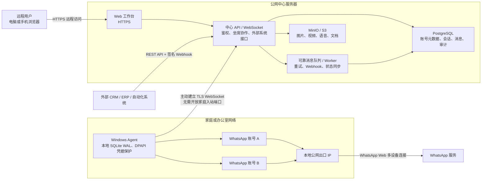

# RelayDesk

## 部署迁移兼容性与故障诊断

启动时会重复执行渠道迁移。`089_conversation_email.sql` 与 `114_livechat_transcript_content_type.sql` 均允许 `livechat_transcript`，避免已有会话记录邮件导致重启时约束校验失败；不删除或改写已有邮件。迁移失败时 API／Worker 错误包含失败文件名、原始 SQLSTATE 和异常原因。

生产部署每次启动失败及回滚前会输出服务状态、API／PostgreSQL 等服务日志和 API 容器健康状态，回滚失败会明确报告。数据库迁移不会自动回退；仍依赖 `whatsapp_accounts` 的旧版本不能用于回滚已升级为 `channel_accounts` 的数据库，不应手动改回表名或删除邮件。此修复需部署新提交；不会自动修复服务器上已经运行的旧镜像。

回归：在 `services/api` 运行 `npm test`、`npm run build`。真实 PostgreSQL 回归需设置 `TRANSCRIPT_PG_BIN` 为本机 PostgreSQL bin 目录，运行 `node --import tsx --test test/transcript-migration.postgres.test.ts`；测试自行创建并清理独立临时数据库，不连接业务数据库，验证旧约束可复现故障、修复后连续迁移保留正文与记录、非法类型仍被拒绝。部署诊断测试以模拟 Docker 验证回滚前日志顺序与退出码；使用系统 Bash，也可通过 `DEPLOY_TEST_BASH` 指定可执行文件。

## LiveChat 会话记录邮件模板

管理员在“系统设置 → LiveChat → 新增／编辑渠道 → 会话记录邮件模板”中独立配置邮件主题、正文、单条消息格式及客服部门，支持变量插入、固定测试数据预览和恢复默认。后台“发送会话记录”与访客“结束会话并发送记录”使用原访客所属渠道的同一模板，不使用合并后的其他渠道配置。无需修改已有网站嵌入代码。

正文使用 `{{messages}}` 按时间顺序生成聊天记录，客户消息左对齐、客服消息右对齐并使用浅色气泡；每条记录上方显示姓名与时间。模板输入为纯文本，保留换行，不接受自定义 HTML；变量和消息内容统一转义。完整变量、取值规则及 API 配置见 [LiveChat 邮件模板说明](docs/livechat-transcript-template.md)。

部署需同步更新工作台、API 和 Worker 并重启。启动迁移 `115_livechat_transcript_template.sql` 新增渠道模板 JSON 字段，旧渠道自动使用默认模板；旧客户端不提交模板时保留已有配置。主题、正文与渠道 Provider 在入队时保存快照，修改模板不会改变已经排队的邮件。

验证：在 `services/api` 下运行 `npm test`、`npm run build`；根目录运行 `npm run lint`、`npm test`、`node scripts/test-livechat-settings-browser.mjs` 和 `node scripts/test-livechat-transcript-browser.mjs`。浏览器回归使用固定测试数据与模拟 API，不向真实客户发信。上线前仍需在真实 SMTP／Resend 及目标邮件客户端验收。

## LiveChat 快捷引导消息

管理员在“系统设置 → LiveChat → 新增／编辑渠道”中配置快捷引导消息，支持逐条添加、修改、删除及上下调整顺序。每个渠道最多 50 条，每条最多 500 字，删除全部问题即可关闭，旧渠道默认不显示。

访客首次打开、尚未发送首条消息时，会在欢迎语下看到这些问题。点击后将对应原文作为首条消息发送；沿用现有姓名和有效邮箱必填规则，资料不完整时先提示补全，所选问题保留在消息栏中。发送中／失败待重试、已有会话、已结束或凭证过期时不显示引导，不自动翻译自定义问题。发送与重试沿用现有访客权限、幂等 ID、统一收件箱、AI 和归因流程。

部署需同步更新工作台、API 和 Worker 并重启；启动迁移 `113_livechat_starter_messages.sql` 为渠道新增有序 JSON 配置。旧客户端更新渠道时若不提交 `starterMessages` 则保留原配置，提交空数组则清空。已有网站嵌入代码无需修改，刷新网页后读取配置。

验证：`services/api` 下运行 `npm test`、`npm run build`；根目录运行 `npm run lint`、`npm test`、`node scripts/test-livechat-settings-browser.mjs` 和 `node scripts/test-livechat-browser.mjs`。浏览器脚本使用真实组件／嵌入脚本与模拟 API，不访问真实访客或 Provider。

## Google Ads 广告归因与转化回传

LiveChat 嵌入脚本可采集 `gclid`、`gbraid`、`wbraid`，首次开聊锁定最近一次广告访问。后台“转化事件”显式标记合格线索、成交线索或已付款订单时，通过独立 Worker 回传 Google Ads；保留原有 GA4 并分别显示状态。原 LiveChat 中的 Email 沟通沿用归因，独立 Email 会话必须由坐席手动确认原 LiveChat 来源，同邮箱仅提供候选、不自动关联。两种入口共用 Ads 去重规则。

管理员在“系统设置 → LiveChat → Google Ads”授权并按渠道配置客户 ID 和转化动作 ID；默认关闭，不补发历史。部署需配置 `GOOGLE_ADS_CLIENT_ID`、`GOOGLE_ADS_CLIENT_SECRET`，同步更新工作台、API 和 Worker 并执行启动迁移 `112_google_ads_attribution.sql`。Ads 同意独立于 GA4：未设置按默认启用策略处理，明确拒绝后停止上传并清理点击标识。请求接收、异步处理成功和最终 Ads 归因并非同一状态，未知上传结果不会自动重发。

渠道面板中的启用开关、Ads 客户 ID、可选 MCC 管理账号 ID，以及合格线索／成交线索／购买三个转化动作 ID 的用途、格式示例和保存注意事项，见 [渠道配置项说明](docs/google-ads-attribution.md#渠道配置项说明)。OAuth 已授权不代表渠道回传已启用。

上述标签后的问号图标可通过鼠标悬停、键盘聚焦或手机点击查看用途与获取步骤，支持 Escape 和点击外部关闭；不会提交或修改配置。浏览器回归运行 `node scripts/test-livechat-conversions-browser.mjs`，包含浮层交互和窄屏边界验证，使用模拟 API。

账号 ID 从 Google Ads 的账号菜单获取，动作 ID 从各转化动作详情页获取；具体入口、创建离线动作的步骤及防止 ID 混用的说明，见 [获取客户 ID 和管理账号 ID](docs/google-ads-attribution.md#获取客户-id-和管理账号-id) 和 [获取三个转化动作 ID](docs/google-ads-attribution.md#获取三个转化动作-id)。

Client ID 和 Client Secret 从 Google Cloud 的 **Google Auth Platform → Clients → Create client → Web application** 创建结果中获取，不是 Ads 客户 ID 或 API Key。完整的 Cloud 项目、API 启用、同意屏幕、凭据创建、回调地址和服务器配置步骤，以及 CMP 接口、Email 关联、回传状态、隐私边界与测试方式见 [Google Ads 广告归因与离线转化](docs/google-ads-attribution.md)。真实广告账号联调仍需部署方完成。

## LiveChat 访客会话失效处理

会话结束或凭证过期后，“开始新会话”（Start a new chat）以渠道主题色的实底按钮显示，提供独立留白、至少 44px 点击高度及键盘焦点样式；点击后仍需确认，原有会话重开与历史保留规则不变。浏览器回归 `node scripts/test-livechat-browser.mjs`（先在 `services/api` 运行 `npm run build`）覆盖桌面、390px 和 320px 窄屏的按钮布局、键盘确认与取消，以及原有重开流程。

LiveChat 首次访问且访客尚未明确开启聊天时不会请求历史消息；首条消息成功发送后才开始 `/livechat/:id/messages` 轮询。后续访问会复用已开启的访客身份并继续轮询。访客凭证过期或被清理后，嵌入窗口会停止轮询并提示访客开始新会话，避免宿主网站控制台持续出现 `401 Unauthorized`。点击“开始新会话”后会清理本地会话状态；再次发送首条消息后恢复轮询。

## UI 标准与组件验收

UI 治理基线见 [UI 稳定性标准](docs/ui-standards.md)，项目开发约定见 [AGENTS.md](AGENTS.md)。统一组件位于 `app/ui/`，包含按钮、字段、弹窗、抽屉、浮层与异步状态；使用 React、lucide-react 和浏览器原生 dialog/popover，不新增生产依赖。新样式限定为 `rd-` 命名空间，不改变存量业务选择器。

运行 `npm run dev` 后访问 `/ui-lab`，可操作独立的组件验收页；仅使用固定测试数据和模拟保存结果，不读取真实客户或调用业务 API。本轮提供治理底座，旧界面仍需分模块迁移，不代表历史 UI 已全部符合标准。原生浮层需现代浏览器支持。

基础验证：`npm run lint`、`npm test`。组件浏览器回归：`npm run test:ui`，需本机可解析 Playwright 及 Chromium；覆盖桌面、手机与低高度视口，截图输出到 `outputs/ui-lab/`。真实缩放、软键盘和跨浏览器验收要求见标准文档。

网站品牌图使用根目录的 `relaydesk-logo.png`：`public/relaydesk-logo-512.png` 保留完整图案和文字，`public/relaydesk-icon-{32,64,180,192,512}.png` 为从原图裁出的标志，分别用于浏览器图标、页面、Apple 图标及其他图标用途。工作台、公开页面与浏览器标签共用该标志；更新源图后需重新生成这些尺寸并重新构建部署。

## 多实例邮件 Provider 与渠道配置

会话邮箱的“编辑”表单在对应邮箱卡片下方展开；切换到另一邮箱时只显示当前邮箱的编辑表单。每个邮箱分别提供“启用收件”和“启用发件”，保存后独立生效，卡片同时显示两个方向的状态。关闭收件会停止该邮箱后续的 Worker 同步，并禁用“立即同步”，不删除历史邮件或同步游标；恢复后从原游标继续（Gmail 游标失效仍沿用既有恢复规则）。关闭发件会将该邮箱从发件选项中排除，禁止使用它提交新的会话邮件或主动邮件；不会关闭渠道独立配置的邮件 Provider。普通已排队邮件仍按原配置快照发送，主动邮件执行前会再次检查发件开关。密码邮箱保存或测试连接时仅验证已启用方向的连接；两个方向均停用时不执行 IMAP/SMTP 连接验证，连接字段仍需按现有格式填写。Google API 仍仅用于收件，开启发件不授予 Gmail 发信权限，实际发信仍需 Provider。

API 和 Worker 启动时自动执行 `108_mailbox_direction_switches.sql`，新增 `receive_enabled`、`send_enabled`；旧邮箱的两个方向均继承原 `enabled` 值，重复迁移不会覆盖新设置。旧接口请求只提交 `enabled` 时仍同时控制两个方向；新请求使用 `receiveEnabled`、`sendEnabled`，兼容字段 `enabled` 保存为两者任一启用。重新授权保留已有收发开关。部署需同步更新工作台、API 和 Worker 并重启，不能仅更新前端。浏览器回归可运行 `node scripts/test-gmail-label-settings-browser.mjs`，验证编辑定位、独立开关及 Gmail 标签刷新回显，使用模拟 API，不修改真实邮箱。

“系统设置 → 邮件发送 → 会话邮箱配置”的“映射渠道”支持选择 WhatsApp 或 Live Chat 渠道，密码／应用密码和 Microsoft OAuth 两种验证方式均适用。渠道选项显示类型及名称，仅有 Live Chat 渠道时也可直接新增邮箱。Microsoft OAuth 邮箱编辑时仍不可变更映射渠道或邮箱地址；重新授权沿用原渠道。此调整需要更新工作台和 API，不需要新增数据库迁移。

管理员在“系统设置 → 邮件发送”可分别新增多个 SMTP 和 Resend 实例，每个实例拥有独立名称、发件人、密钥及启用状态。密钥继续加密保存，编辑时留空保留原值；可向测试邮箱发送测试邮件。SMTP 启用保存时会验证连接。可将一个已启用实例设为工作区默认，启用其他实例不会停用它。

在同页“渠道邮件 Provider”中，为每个 WhatsApp、Messenger 或 LiveChat channel 独立选择已保存并启用的实例，再点击该行“保存”。选择“工作区默认”取消独立绑定。会话邮件、订单/产品邮件、主动邮件及 LiveChat 会话记录使用该路由。显式绑定的实例停用或缺少密钥时拒绝新邮件入队，不会静默改用其他实例。

对话邮件编辑区的“发件邮箱”显示该渠道实际生效的 Provider 配置名称和发件地址（包含工作区默认回退），而不是固定显示“渠道邮件 Provider”。渠道存在可用 Provider 时不再列出会被其覆盖的会话邮箱作为发件选项；会话邮箱仍用于收信和邮件线程关联。普通坐席只能读取有权限渠道的发件名称、地址，不会获得 Provider 密钥。

发送使用选定实例的发件人及凭据；会话邮箱仍负责收信、线程关联，Provider 未填写 Reply-To 时会话邮件使用该邮箱作为 Reply-To。主动邮件仍要求渠道的主要邮箱和客户主要邮箱；未独立绑定的旧渠道保留 Microsoft OAuth 及发件地址不匹配时的邮箱 SMTP 回退。未绑定且无工作区默认时，会话邮件使用邮箱自身 SMTP/OAuth，订单/产品邮件及 LiveChat 记录返回未配置错误。已排队邮件保持原配置快照，不受之后切换 Provider 影响。

API 和 Worker 启动时自动执行 `103_email_provider_instances.sql`，将旧 SMTP/Resend 配置一次性导入新实例表，并保留原默认服务和加密密钥，不删除旧表或历史邮件。部署需同步更新前端、API 和 Worker 并重启服务；新部署仍使用完整数据库初始化流程。

验证：在 `services/api` 运行 `npm test`、`npm run build`；根目录运行 `npm run lint`、`npm test`，与 CI 的工作台校验保持一致。浏览器回归运行 `node scripts/test-email-provider-settings-browser.mjs`，使用模拟 API，不向真实邮箱发信。可选临时数据库验证设置 `EMAIL_PROVIDER_PG_BIN` 为 PostgreSQL bin 目录后，在 `services/api` 运行 `node --import tsx --test test/email-provider-routing.postgres.test.ts`，不连接业务数据库。

## 会话模式与时间线合并

### 邮件统一存储与邮箱关联

Email 历史按“渠道账号 + 客户资料中的邮箱地址”读取，不再把来信分配给某一个访客会话。同一渠道内多个 Live Chat 或其他单人会话设置相同邮箱时，都可在 Email 模式看到同一份收发邮件；正文、HTML、附件和同步去重记录只保存一份。邮箱匹配忽略大小写及首尾空格，客户资料中的非主要邮箱也参与读取。发件仍由所选会话、收件地址及其渠道的 Provider／SMTP 配置决定，发件来源仅保留为审计信息。

共享范围限于原渠道账号，不因邮箱相同跨渠道共享；合并时间线仅包含各已授权成员渠道内的邮箱邮件。客户邮箱变更后，Email 历史按当前邮箱重新关联，不会复制或搬移历史邮件。新来信会更新同邮箱会话的列表摘要、未读数并取消其待执行的主动跟进；邮件不会出现在 Live Chat／WhatsApp 消息模式，网站访客公开接口也不能读取共享邮件。该关联是后台坐席工作规则，不是邮箱所有权验证，给客户添加邮箱前应确认资料准确。

API 和 Worker 启动时自动执行 `110_shared_email_archive.sql`：为历史邮件建立地址索引、解除收件与单一会话的归属，保留原邮件 ID、时间、正文与附件。删除单个会话或联系人不会连带删除邮箱档案；邮件归档仍受原渠道权限和渠道生命周期约束。收件同步起点与 Gmail 标签规则不变，不自动回填邮箱中尚未归档的旧信。部署时需同步更新并重启 API、Worker，再刷新工作台；迁移会刷新历史会话摘要，大库请预留迁移时间。已因同邮箱联系人重复而失败的收件可在部署后使用原有“立即同步”重试，不需要重新授权或修改标签。

验证：在 `services/api` 执行 `npm test`、`npm run build`；可设置 `EMAIL_ARCHIVE_PG_BIN` 为 PostgreSQL bin 目录，运行 `node --import tsx --test test/shared-email-archive.postgres.test.ts` 验证独立临时数据库中的共享、隔离、迁移幂等、资料变更与删除保留，不连接业务数据库。

后台单人会话提供 Email、WhatsApp、Live Chat 三种消息模式。各模式仅显示本类型的历史和后续消息，并使用对应发送区域；同一渠道产生的邮件不会混入 WhatsApp 或 Live Chat 模式。切换时文字草稿按会话及模式分别保留，引用与分页重置；正在上传、翻译或确认附件时需先完成或取消操作。

会话邮箱映射到 Live Chat 渠道不等于发件人具有网站访客身份。没有实际 Live Chat 访客身份的纯邮件会话只启用 Email，列表和标题显示 `Email · 渠道名称`，联系人详情显示“邮件联系人”，不显示访客在线状态，也不启用 Live Chat 回复或会话记录导出。后续与真实 Live Chat 会话合并后，才可在同一时间线切换 Live Chat，并向真实访客成员回复；不会为邮件联系人自动创建访客身份。渠道映射、坐席权限和邮件发送配置不变。

API 和 Worker 启动时自动执行 `109_livechat_email_identity.sql`，修正无访客身份、已有邮件且没有非邮件消息的旧 Live Chat 误分类，并更新新会话类型判定。真实访客、混合历史、消息正文、附件、坐席归属及已有时间线关联保持不变。部署需同步更新工作台、API 和 Worker 并重启，再刷新页面；仅更新前端不能修正数据库中已有的错误类型。

Email 模式要求成员客户资料中存在邮箱，且其 channel 配置了可用的邮件发送 Provider（含工作区默认）或启用的会话邮箱。仅配置 Provider 也可发送邮件，无需虚构会话收信邮箱；收信仍需要实际会话邮箱及既有收信配置。显式绑定的 Provider 停用或不可用时仍拒绝入队。多个成员满足条件时可选择邮件接收人，邮件及附件使用对应成员的渠道。

WhatsApp 模式要求已有原始／合并的 WhatsApp 成员，或客户资料中设置 WhatsApp 国际号码或用户名。只有资料、尚无 WhatsApp 成员时，首次切换会选择可发送的 WhatsApp 渠道，查找或创建对应会话并关联到当前时间线；存在多个渠道时需手动选择。Live Chat 模式要求已有原始／合并的 Live Chat 成员，不根据邮箱或电话号码创建网站访客身份。WhatsApp 的模板及回复窗口限制保持不变。

在统一收件箱按住 Shift 点击单人会话即可进入多选，之后直接点击其他会话切换选中状态。选中至少两个会话后，点击列表上方的“合并”，选择主会话并确认；“取消”可退出多选。每次最多选择 50 个会话。

支持 Email、WhatsApp、Live Chat 单人会话跨类型、跨 channel 合并；同类型仅支持 Live Chat，不支持 Email 与 Email、WhatsApp 与 WhatsApp，也不支持群会话及 Messenger。服务端会展开已有成员后再次校验，避免通过连续合并绕过限制。合并后列表仅显示主会话，每种模式内按原始消息时间排列，相同时间用消息 ID 稳定排序并分页。源会话后续收到的消息及未读数也会汇总到主会话。非管理员需拥有全部成员 channel 的读取权限；权限收回后不能继续读取整组时间线及列表摘要。

此功能建立独立的时间线关联，不删除、搬移或改写原消息，也不合并联系人身份、访客凭证和发送队列。客户资料及会话操作仍以主会话为准。LiveChat 人工回复默认选择最近来信的原访客（按原始时间及消息 ID 判断，不受历史分页影响），输入区“回复给”可手动切换合并成员；编辑文字、准备图片或确认翻译期间不会自动切换，手动选择在当前页面保持。引用消息时回复其原成员，文字、邮件、图片、附件和重试均使用对应原会话及渠道，不因主会话类型不同而改发给主联系人。带客户变量的快捷回复使用接收人的资料。LiveChat 访客仍只能读取自身会话，不会获得其他访客的历史，也不会收到向其他成员发送的消息。

此次模式升级需要同步更新工作台、API 和 Worker 并重启。API／Worker 启动时自动执行 `106_conversation_origin_mode.sql`，回填并固定原始会话类型，之后编辑客户邮箱或 WhatsApp 资料不会改变合并规则；已有合并关系不需要重建，不自动转发或补发历史消息。可运行 `node scripts/test-conversation-modes-browser.mjs` 验证桌面和手机的模式隔离、发送函数、草稿恢复及切换条件；`node scripts/test-timeline-reply-browser.mjs` 检查接收人选择、编辑期间目标冻结及隔离收信。均使用模拟 API，需要 Playwright 及 Chromium，截图分别位于 `outputs/conversation-modes/` 和 `outputs/timeline-merge/`。

合并后的 AI 接管模式和“回复时切换为”设置统一由主会话控制，成员的新入站消息按主会话模式触发 AI；自动回复及审批草稿仍发送给该消息所属的原联系人，不会发送给其他成员。Live Chat 标签下隐藏“回复时切换为”，网站访客来信不应用该主动触达设置，完全接管不会因此自动降级；判断依据为入站消息的实际渠道，不受主会话类型影响，也不排除同一 Live Chat 渠道下的 Email 消息。切换回 Email 或 WhatsApp 后仍使用原有设置，不清除已保存值。AI 聊天上下文、记忆、任务归属和身份保持独立；主会话的 AI 面板汇总成员草稿与运行记录。人工发送消息或暂停 AI 会暂停整组的自动回复，并取消成员待执行的回复与跟进任务。已有合并关系无需重新合并，此修复需同步更新工作台、API 和 Worker 并重启，无需数据库迁移，不自动补发历史消息。其他模式的完全接管后切换规则保持不变；需要持续完全接管时，将“回复时切换为”也设为完全接管。

已有主会话可以继续参与时间线合并。已参与时间线合并的会话可以由管理员或主管删除；删除事务会先解除 `conversation_timeline_merges` 关联，再删除指定原会话及其可安全清理的媒体文件，不会连带删除其他成员的消息。删除主会话后，其余成员恢复独立展示；删除源会话后，主会话保留其他成员，摘要同步刷新。付款请求、待发送消息或邮件的删除保护保持不变，失败时关联清理与删除一并回滚。已参与时间线合并的会话仍不能转移账号或通过旧入口合并联系人身份；本功能暂不提供拆分入口。API 和 Worker 启动时自动执行 `102_conversation_timeline_merges.sql` 和 `104_allow_timeline_conversation_delete.sql`；删除接口修复需更新并重启 API，迁移规则变更需同步更新并重启 Worker，不应仅更新前端。新部署仍需按现有流程初始化完整数据库。

验证：根目录 `npm test` 包含模式条件、消息过滤、多选交互及查询边界回归测试；`services/api` 下运行 `npm test` 和 `npm run build`，模式接口与 Provider-only 发信测试为 `test/conversation-modes.test.ts`。可选浏览器检查 `node scripts/test-timeline-merge-browser.mjs` 使用模拟 API 验证桌面和手机布局。可选真实数据库测试在 `services/api` 下设置 `TIMELINE_PG_BIN` 为 PostgreSQL 的 bin 目录，再运行 `node --import tsx --test test/timeline-merge.postgres.test.ts test/conversation-modes.postgres.test.ts`；仅创建临时实例并自动清理，验证合并、原始类型迁移幂等及模式过滤，不连接业务数据库。以上不能替代真实账号收发联调。

## LiveChat 网站渠道

LiveChat 与 WhatsApp、Messenger 共用账号权限、统一收件箱、客户资料、认领与关闭、翻译、订单、AI Agent 和知识库配置，但使用独立的网站访客收发通道。每个 LiveChat 渠道都对应一个独立账号，可分别分配坐席、Agent 和知识库。首版支持匿名文字、图片和文件，不支持音视频、WhatsApp 模板、黑名单、跨账号转移或匿名身份合并。

坐席打开工作台时，有权限的 LiveChat 渠道收到访客新消息（包括首次发起聊天）会播放提示音。标签页标题会在原标题和 `New message from 渠道名称` 之间交替；合并会话显示实际收信渠道的名称。切回工作台会恢复原标题，正在查看工作台时标题闪动约 8 秒。提醒不受收件箱筛选影响，不会因加载历史或消息重试而重播，也不需要系统通知授权。

首次打开工作台后，先点击页面或按键以允许浏览器播放提示音；页面静音或音频被浏览器阻止时，仍会更新标题。实时连接中断期间的消息会按原有机制同步，但不会补放提醒。此功能需同步更新工作台和 API 并重启 API，无需数据库迁移。可运行 `node scripts/test-livechat-alert-browser.mjs` 使用模拟实时事件检查标题和提示音触发（需 Playwright 和 Chromium）。

### 创建与嵌入

新增与编辑渠道共用独立表单样式，桌面端将语言与入口位置并排显示，窄屏自动改为单列；内容区域独立滚动，标题和取消、保存按钮保持可见。主题色同时显示色块和十六进制色值。保存期间禁用表单，失败后保留填写内容并在弹窗内显示错误；支持 Tab 焦点循环及非保存期间按 Escape 关闭。此调整仅涉及工作台前端，不修改保存接口或数据库。

1. 管理员进入 **系统设置 → LiveChat → 新增渠道**，填写名称、自定义图标（可选的 HTTPS 图片地址）、访客界面语言、欢迎语、主题色、左下角或右下角入口位置，以及允许嵌入的域名。各渠道可独立选择简体中文、繁体中文、英语、日语、西班牙语或葡萄牙语，覆盖访客按钮、输入提示、状态、错误提示和时间显示；不会更改工作台语言或自动翻译消息。欢迎语留空时使用对应语言的默认欢迎语，已填写的欢迎语和渠道名称保持原文。未设置语言时默认英语，已有明确语言配置保持不变；修改语言后，访客刷新网站即可应用，无需更换嵌入代码。
聊天窗口左上角优先显示该渠道的自定义图标；未设置、清除配置或图片加载失败时，使用渠道名称去除首尾空白后的首字母（英文字母转大写），不再固定显示 RelayDesk 的 R。图片应使用可公开访问的 HTTPS 地址，不能包含账号密码；访客浏览器直接加载图片且不发送 Referer，部署方需确保图片服务可用并考虑其访问日志。修改后刷新嵌入页面生效，无需更换嵌入代码。

2. 白名单按完整 origin 精确匹配，例如 `https://example.com`、`https://shop.example.com`；不同协议、子域名或端口需要分别配置。不能填写路径、通配符或普通公网 HTTP 地址；仅本机 `localhost`、`127.0.0.1` 和 `[::1]` 允许 HTTP 开发测试。
3. 点击渠道的“嵌入代码”，将生成的脚本加入网站公共模板或自定义 HTML 区域。WordPress、Shopify 或自建网站均可使用同一段 JavaScript，不需要安装专用插件。框架客户端动态注入脚本时，应在页面挂载完成后执行；同一页面重复加载同一渠道脚本只创建一个窗口，不同渠道仍可独立加载。
4. 在现有账号权限中给坐席分配该 LiveChat 账号；在 **AI Agent** 中选择该账号并分别指定知识库、自动回复权限和新会话的默认接管模式。仅启用 Agent 并不等于允许自动回复，仍遵循现有人工接管与审批规则。

```html
<script async src="https://客服域名/livechat/embed.js" data-channel="复制得到的公开渠道UUID"></script>
```

脚本地址默认使用工作台当前 origin；前后端分开部署时，前端构建应设置 `NEXT_PUBLIC_RELAY_API_URL` 为公网 API origin。公开渠道 UUID 不是密钥。脚本使用 Shadow DOM 和独立 iframe 隔离样式；网络请求由宿主页面发起，访客凭证不会放入 iframe URL。若宿主网站有 CSP，需要在 `script-src`、`connect-src`、`frame-src` 中允许客服服务的 HTTPS origin。禁止反向代理为 `/livechat/` 增加 `X-Frame-Options: DENY/SAMEORIGIN` 或覆盖 API 返回的 `frame-ancestors` 白名单。

### 访客会话与消息

- 访客收到新坐席回复时，展开或收起的 LiveChat 都会尝试播放提示音，并让网站标签页在原标题和 `New message from 渠道名称` 之间交替；名称来自渠道配置，不是坐席名。回到标签页时恢复原标题；在前台收到回复时，标题约 8 秒后自动恢复。刷新加载的历史消息和访客自己发送的消息不提醒。浏览器可能要求先点击网页或聊天窗口才能播放声音，未允许播放时仍会提示标题。上线只需更新并重启 API，再刷新访客页面；`/livechat/embed.js` 公共缓存最多 5 分钟，无需更换嵌入代码。
- 工作台的 LiveChat 会话列表、聊天顶部和联系人详情使用访客心跳显示状态，不再使用渠道账号连接状态：可见标签页为“在线”，仅剩隐藏标签页为“离开”，没有有效连接为“离线”，工作台读取失败为“状态未知”。宿主页面每 10 秒上报心跳，后台每 5 秒读取；关闭页面尽力立即上报，断网、崩溃或浏览器冻结等未能上报的情况，最后心跳 45 秒后过期，非零延迟且不是身份或在场证明。
- “当前浏览页面”仅显示有效、可见标签页上报的同源 origin/路径；支持普通跳转及 SPA 路径变化（约 0.5 秒检测），无需访客再次发消息。多个标签页分别记录，优先最近更新的可见页面；全部隐藏、离线或读取失败时不展示历史地址作为当前页面。“最近消息页面”继续保留发消息时的历史快照；查询参数、片段和 URL 账号密码不采集。
- 此功能需要同步更新工作台和 API，重启 API 自动执行 `105_livechat_presence.sql`（Worker 的共享启动迁移也包含此文件）；访客须刷新已打开的网站以加载新嵌入脚本，脚本公共缓存最多 5 分钟。不修改既有客户、消息或会话，不需要更换嵌入代码。
- 状态回归：根目录运行 `node scripts/test-livechat-presence-browser.mjs` 检查真实前端 Hook 的轮询、页面更新、离开/离线、读取失败及桌面/手机布局（模拟 API）；先构建 API 后运行 `node scripts/test-livechat-browser.mjs` 检查真实嵌入脚本的首次心跳、SPA 跳转、普通跳转和关闭上报。可选数据库测试在 `services/api` 下设置 `LIVECHAT_PG_BIN` 为 PostgreSQL bin 目录后运行 `node --import tsx --test test/livechat-presence.postgres.test.ts`，仅创建临时实例，验证多标签优先级、乱序心跳、超时及迁移幂等，不连接业务数据库。

- 客服消息左侧沿用窗口左上角的渠道图标（未设置或加载失败时显示渠道名称首字母）；访客消息的 `Me` 头像位于消息右侧最外侧，发送中和失败消息保持相同位置。客服消息的回复按钮紧邻气泡右侧，访客消息的回复按钮紧邻气泡左侧；表情、图片和附件工具位于消息输入框上方。
- 消息气泡在头像所在方向显示同色尖角（客服向左、访客向右），尖角的竖直位置对齐头像中心，长文本、引用和附件不会改变其位置。
- 选择回复消息后，引用预览显示在输入区域内、表情/图片/附件工具栏正上方，位于结束会话按钮下方；可通过预览右侧按钮取消回复。
- 发送消息、放大或还原窗口、收起后再次展开时，消息列表自动滚动到最新消息；普通收信同步不会打断向上翻阅历史，首次聊天的资料表单不会被自动滚动跳过。
- 窗口顶部右侧提供放大全屏／还原图标和 `×` 收起按钮。PC 端（视口宽度大于 600px）放大时仅扩展高度，上下保留 8px 边距，保持原浮窗宽度（最大 390px）及左右停靠位置，方便访客同时浏览网站；窄屏（不超过 600px）保持铺满可视区域并保留四周 8px 边距。还原后恢复浮窗尺寸；`×` 仅收起窗口，不结束会话。当前页面收起后再打开保留放大状态，刷新后恢复普通浮窗，渠道主题色和界面语言保持不变。
- 发送按钮与消息输入框顶部对齐。窗口展开/收起状态保存在宿主网站的 `localStorage`，同一浏览器、同一网站 origin、同一渠道跨页面跳转和刷新后保持；首次访问默认收起，不同网站或渠道互不影响。浏览器禁止或清理本地存储后无法恢复该状态。
- 访客无需注册。首次聊天需填写姓名、有效邮箱和首条消息（必填），公司名、WhatsApp 为选填；点击“开始对话”后在同一个事务中创建独立客户、保存资料并发送首条消息，附件在开始会话后可用。已有会话刷新后直接恢复聊天，不反复要求填写资料，也不会按邮箱自动合并联系人或覆盖坐席编辑过的资料。消息进入统一收件箱和现有 Agent 流程。
- 服务端记录首次及最近发消息时的 IP、浏览器 User-Agent；宿主脚本随消息提交浏览器语言、IANA 时区和页面 origin/路径，不采集页面查询参数、片段或 Cookie。后台对话右侧“网站访客信息”显示这些资料；公司、邮箱和选填 WhatsApp 同时进入客户资料。浏览器语言和时区不覆盖坐席设置的客户偏好语言或时区。环境信息为浏览器自报，IP 也可能为代理出口，均不能作为身份验证依据。
- 随机访客凭证保存在宿主网站的 `localStorage`，服务端只保存 SHA-256 摘要；按渠道、宿主 origin 和访客隔离，不依赖第三方 Cookie。凭证有效期为创建后 180 天，过期后可在窗口开始新匿名会话；原记录仍由客服保留。
- 同一浏览器刷新可恢复历史，清理站点数据、隐私模式、换浏览器、换网站 origin 或换设备会产生独立身份，不自动合并。不要把访客凭证作为公开配置或加入日志。
- 结束会话后点击“开始新会话”，有效访客凭证保持不变，直接进入消息输入界面，不再填写姓名、邮箱、公司或 WhatsApp；新消息仍归属后台原客户，不覆盖坐席修改过的资料。窗口从新的展示分界开始，不再显示之前的聊天，刷新、跨页面和历史分页也不会重新显示旧消息；后台完整历史与现有 transcript 生成逻辑保留。展示分界仅用于前端呈现，不是数据删除或新增权限边界，按宿主 origin 和渠道保存在本地，不额外缓存客户资料。凭证过期时才创建新身份并重新填写资料；网络错误不会直接更换身份。
- 窗口支持展开、收起、未读数量、历史分页、常用表情、图片与附件发送、粘贴或拖放文件、发送前预览和说明文字、图片消息内联预览/放大/下载、普通附件授权下载，以及发送失败重试。选择附件后不会立即发送，访客可先移除或补充说明，再点击发送。每 4 秒增量同步，恢复网络后补齐消息；未确认消息在宿主网站本地保存，刷新后可用原消息 ID 重试并在服务端去重。本地存储被浏览器禁用时，刷新恢复不可用。
- 访客发送立即请求 API，不等待上述 4 秒轮询。工作台通过现有 WebSocket 接收入站会话更新，当前会话消息与列表摘要并行加载；连接不可用时每 5 秒兜底校准（正常连接下仍每 60 秒校准），连接建立或页面恢复可见时立即补齐，且不会重叠执行校准请求。此间隔不是实际送达时间保证；若仍有明显延迟，应检查 `/api/v1/events/ws` 的代理升级、API 请求耗时、数据库锁与连接池以及 Worker/AI Provider 状态，区分收件箱显示和 AI 回复耗时。
- 访客可分别选择“结束会话”或“结束会话并发送记录”。前者直接关闭当前会话，不依赖邮件配置；后者确认后由服务端按时间生成安全的纯文本/HTML transcript（包含已接收及已发布的聊天消息、附件文件名，不附带文件或重复收入邮件记录），通过已启用的邮件 Provider 异步发送到客户当前主邮箱，并在邮件成功入队后关闭会话。窗口提示“已入队”而非“已送达”，实际结果以后台邮件发送状态为准；邮件 Provider 未配置或入队失败时不会关闭。普通消息发送不依赖邮件配置。有待重试消息或正在上传附件时不能结束会话。两个动作都使用按访客和模式隔离的幂等请求 ID，网络确认丢失或刷新后重试不会重复关会话或重复入队；结束状态及模式在当前浏览器保存，刷新仍可查看原记录。关闭后可通过“开始新会话”重新接入，客服保留原历史。
- 部署包含 `114_livechat_transcript_content_type.sql` 启动迁移，用于允许 `livechat_transcript` 邮件类型进入统一邮件队列；更新 API 和 Worker 后重启服务即可自动执行，已有邮件和会话数据不受影响。
- 后台 LiveChat 对话顶部的邮件图标可主动“发送会话记录”，弹窗显示访客和当前主邮箱，发送不会关闭或重新打开会话。管理员及拥有该渠道读取、发送权限的坐席可操作；无需配置会话收信邮箱。沿用渠道绑定的邮件 Provider，未绑定时使用工作区默认，绑定不可用时拒绝入队。合并时间线可在弹窗选择原访客，只导出该原会话的记录，不包含其他访客内容、内部备注或邮件气泡。成功入队后在时间线生成邮件记录，实际发送状态由现有 Worker 更新；入队不代表送达。网络失败可重试，浏览器允许 sessionStorage 时关闭弹窗或刷新后仍沿用原请求 ID，避免重复入队；清理存储、换标签页或换设备不保证复用该 ID。
- 后台发送接口为 `POST /api/v1/conversations/:id/transcript`，请求包含 UUID `clientSendId` 和可选的 `targetConversationId`（必须为当前时间线中可访问的 Live Chat 成员，可以属于其他 channel），仅接受已登录用户。复用现有邮件表和 Worker，记录及发件配置均来自指定原访客；部署需更新工作台和 API 并重启 API。API 回归在 `services/api` 运行 `node --import tsx --test test/livechat-transcript.test.ts test/livechat.test.ts test/email-provider-routing.test.ts`；浏览器回归运行 `node scripts/test-livechat-transcript-browser.mjs`，使用模拟 API，不向真实邮箱发信。
- 坐席和 AI 回复都进入持久出站队列，由 API Worker 发布到访客消息流；“已发送”表示已发布，不代表访客已读。访客发新消息会重新打开已关闭会话；LiveChat 没有 WhatsApp/Messenger 的 24 小时回复窗口限制。
- 访客“添加附件”仅支持 PDF、STEP、STP、IGES、IGS、X_T、DWG、DXF 或 ZIP，扩展名不区分大小写，不再接受 TXT 等其他文件。独立“添加图片”仍支持 PNG、JPEG、WebP，拖放和粘贴也使用相同类型限制。单文件不超过 10 MB。访客上传检查图片、PDF 和 ZIP 的文件签名；CAD 文件按扩展名校验，不依赖浏览器 MIME，也不代表已解析或验证 CAD 内容。坐席媒体库及出站类型限制保持原规则。文件读取要求有效访客凭证及当前会话中的消息引用，不提供公开对象存储地址。未发送附件仍占对象存储空间，运维需监控并安排孤立对象清理；`delete_after` 标记本身不会删除对象。更新需重建并重启 API，访客刷新嵌入页面；无需数据库迁移。
- 停用渠道立即阻止公开接入和新消息，重新启用后原凭证仍受有效期约束。归档需要二次确认，归档后不能通过设置界面恢复；保留原账号、历史客户、会话和审计记录，但停止嵌入访问及发送，已有待发消息由 Worker 标为失败。

### GTM / GA4 转化追踪

1. 在 **系统设置 → LiveChat → 编辑渠道** 填入宿主网站对应的 GA4 Web 数据流 Measurement ID（`G-…`）。坐席需要把 `purchase` 等转化事件从服务端回传到 GA4 时，还要填写该**同一个 Web 数据流**的 Measurement Protocol API secret。获取方式：
   1. 打开 Google Analytics 管理后台，进入 **管理 → 数据收集和修改 → 数据流**（部分界面直接显示 **管理 → 数据流**）。
   2. 选择 Measurement ID 与渠道中所填 `G-…` 相同的 **Web 数据流**。
   3. 打开 **Measurement Protocol API secrets**，点击 **Create**，填写便于识别的名称（例如 `RelayDesk LiveChat`）并创建。
   4. 复制生成的 **Secret value**，粘贴到 LiveChat 渠道的 **GA4 API Secret** 字段并保存。不要把它误当成 Measurement ID、Google Cloud API key 或 OAuth Client Secret。

   这个 API secret 仅用于服务端 Measurement Protocol 回传坐席记录的转化事件；访客首聊的 `generate_lead` 由宿主网站的 GTM/Google tag 处理，不需要把 API secret 配到前端。该密钥具有向对应 GA4 数据流发送数据的能力，只保存在服务端，绝不可写入网页、嵌入代码或 GTM。若怀疑泄漏，应在该 Web 数据流的 **Measurement Protocol API secrets** 页面撤销旧密钥、创建新密钥，并更新 LiveChat 渠道配置。修改或清空 Measurement ID 会清除旧密钥；Measurement ID 不变且 API secret 留空则保留已保存的密钥。
2. 在宿主 GTM 创建名为 `generate_lead` 的**自定义事件**触发器，可按 `livechat_channel_id` 筛选渠道。绑定同名 GA4 事件标签，可传入 `lead_source` 和 `livechat_event_id`；只绑定一份标签。服务端确认首条消息已保存后才推送；打开窗口、校验失败、后续发送或同一访客结束后重开均不计新线索。跨页去重依赖宿主浏览器的本地存储，清理或禁用存储不保证跨页去重。部署前已存在的会话不补报。
3. 将网站同意管理平台（CMP）和 Google tag 接好，再同步分析状态和实际 Client ID。以下示例中的 `readSiteAnalyticsConsent` 为你的网站函数，返回 `granted`、`denied` 或 `unset`；未初始化时返回 `unset`。**LiveChat 将 `unset` 按默认启用分析处理，只有明确的 `denied` 才会停止后台 GA4 回传；GTM/Google tag 的 Consent Mode 仍由宿主网站控制，必须与此默认策略保持一致。**这意味着 CMP 尚未初始化期间可能按启用状态处理分析，请确认这符合你的网站隐私与同意策略；若要在访客选择前禁用分析，CMP 应在未选择时返回 `denied`。不要直接读取 Cookie 或猜测访客选择。

```js
const livechatChannel = "替换为公开渠道 UUID";
const livechatMeasurementId = "G-XXXXXXXXXX";
function syncLivechatConsent() {
  const consent = readSiteAnalyticsConsent();
  const livechat = window.RelayDeskLiveChat;
  if (!livechat) return;
  if (consent === "denied") {
    livechat.setAnalytics(livechatChannel, {consent});
    return;
  }
  if (!window.gtag) {
    livechat.setAnalytics(livechatChannel, {consent});
    return;
  }
  window.gtag("get", livechatMeasurementId, "client_id", clientId => {
    if (readSiteAnalyticsConsent() === consent) {
      livechat.setAnalytics(livechatChannel, {consent, measurementId: livechatMeasurementId, clientId});
    }
  });
}
// 通过 GTM 的 relaydesk_livechat_ready 自定义事件执行此函数，
// 并在 Google tag 初始化完成及 CMP 同意状态变化时再次执行。
```

在 **收件箱 → LiveChat 会话 → 右侧客户资料 → 转化事件** 可记录合格/不合格线索、跟进、成交/未成交、自定义事件和 `purchase`。合并时间线可以选择原访客；管理员和拥有该渠道读取、发送权限的坐席可操作。购买只能关联同渠道、同原访客的全额付款订单，不计算沙盒、部分付款或待确认付款。同一订单只记录一次，GA4 使用内部订单 ID 和商品小计，运费单独发送。LiveChat 事件载荷不包含姓名、邮箱、消息、IP 或访问页面；不要把个人资料写入自定义事件名称，也不要在宿主 GTM 的标签里把表单内容映射成事件参数。

明确拒绝分析同意（`denied`）、未获得该数据流的 Client ID 或未配置密钥时，坐席事件只保留在工作台，不会在补配置后自动补发；`unset` 沿用上述默认启用策略。GA4 HTTP 2xx 只表示 Google 接收请求；超时或 Worker 中断会标为结果不确定，不自动重发。升级需同步更新工作台、API 和 Worker（启动自动执行 `111_livechat_ga4_conversions.sql`），并允许 Worker 通过 HTTPS 访问 Google Analytics。发布前使用 GTM Preview 验证首聊和拒绝分析同意场景，用测试 GA4 数据流确认坐席事件、购买指标和关键事件设置。

本地验收：根目录运行 `node scripts/test-livechat-conversions-browser.mjs` 验证工作台、`node scripts/test-livechat-browser.mjs`（先构建 API）验证宿主推送。设置 `LIVECHAT_PG_BIN` 后在 `services/api` 运行 `node --import tsx --test test/livechat-analytics.postgres.test.ts`，使用临时 PostgreSQL 验证权限、购买去重和撤回同意，不使用真实 GA4。

#### 没有 CMP 时：仅通过 GTM 接入

如果宿主网站已经安装 **GTM 容器（`GTM-...`）**、配置好对应的 **Google tag（`G-...`）**，并已嵌入 LiveChat，则可以只在 GTM 中完成以下配置，无需再修改宿主网站源码。只有 Google tag 不等于已安装 GTM；缺少容器或 LiveChat 嵌入脚本时，仍需先完成安装。不要重复安装已有 Google tag 或 LiveChat 脚本。

Client ID 是宿主网站 Google tag 为每个浏览器访客使用的分析标识，不是 GA4 后台的固定配置，也不是 Measurement ID、API secret 或 Google OAuth Client ID。**不能在渠道里填写一个全站共用的 Client ID**，否则会混淆访客。当前 LiveChat 嵌入脚本提供同步接口，但不会自行读取 Client ID；需要宿主网站或 GTM 调用以下桥接。

此流程适用于没有 CMP、且部署方已确认采用默认启用分析策略的网站，不代表免除隐私或同意要求。`unset` 只影响 LiveChat 的处理策略，不会把 Google Consent Mode 改为 `granted`；若网站其他标签已设置拒绝分析，不能用此流程覆盖或绕过。已有 CMP 的网站应使用上一节真实状态同步方案，并在状态变化时重新同步，不使用固定 `unset`。

1. **核对渠道与 Google tag**：在 LiveChat 渠道中保存与宿主网站相同的 Measurement ID。Google tag 需在读取 Client ID 前完成初始化；保留网站已有触发及同意规则，不额外发送重复的 `page_view`。后台回传坐席事件还需配置同一数据流的 API secret，但该密钥绝不能放入 GTM。
2. **建立 GTM 变量**：在“变量 → 用户定义变量 → 新建”创建下表变量。数据层变量使用版本 2。

   | GTM 变量名称 | 类型 | 数据层变量名或常量值 |
   | --- | --- | --- |
   | `LC Channel ID` | 数据层变量 | `livechat_channel_id` |
   | `LC Measurement ID` | 数据层变量 | `livechat_measurement_id` |
   | `LC Analytics Consent` | 常量 | `unset` |

3. **建立就绪触发器**：新建“自定义事件”触发器，事件名称精确填写 `relaydesk_livechat_ready`。LiveChat 配置加载完成后会在宿主 `dataLayer` 推送该事件及对应渠道的公开 UUID、Measurement ID；不是渠道名称，也无需手工填写 UUID。
4. **建立同步标签**：新建“自定义 HTML”标签，命名为 `LiveChat - Sync Analytics`，粘贴以下代码，并绑定第 3 步的触发器。此标签不要配置为每页只触发一次，以免同页多个渠道只同步第一个。

```html
<script>
(function () {
  var channel = "{{LC Channel ID}}";
  var measurementId = "{{LC Measurement ID}}";
  var consent = "{{LC Analytics Consent}}";
  var livechat = window.RelayDeskLiveChat;
  if (!livechat || !/^[a-f0-9-]{36}$/i.test(channel) ||
      !/^G-[A-Z0-9]+$/.test(measurementId) || consent !== "unset") return;

  window.dataLayer = window.dataLayer || [];
  var googleCommand = window.gtag || function () {
    window.dataLayer.push(arguments);
  };
  googleCommand("get", measurementId, "client_id", function (clientId) {
    if (typeof clientId !== "string" ||
        !/^[0-9]{1,20}\.[0-9]{1,20}$/.test(clientId)) return;
    livechat.setAnalytics(channel, {
      consent: consent,
      measurementId: measurementId,
      clientId: clientId
    });
  });
})();
</script>
```

此代码通过现有 Google tag 命令队列读取 Client ID，不会安装新的 Google tag，也不会手工解析 `_ga` Cookie。没有全局 `window.gtag` 时会向默认 `dataLayer` 排入命令，但仍依赖已加载且配置了对应数据流的 Google tag；仅有命令队列不保证取得标识。使用自定义数据层名称的站点需按实际名称调整，不应直接套用默认 `dataLayer` 示例。

5. **建立首聊事件标签**：再创建数据层变量 `LC Lead Source`（`lead_source`）和 `LC Event ID`（`livechat_event_id`）。创建“自定义事件”触发器，名称精确填写 `generate_lead`，并加条件 `LC Lead Source` 等于 `livechat`，避免捕获网站其他来源的同名事件。创建 GA4 事件标签，选择已有 Google tag 对应的数据流（或填写同一 Measurement ID），事件名称为 `generate_lead`，绑定该触发器。事件参数可映射 `lead_source` → `{{LC Lead Source}}`、`livechat_event_id` → `{{LC Event ID}}`、`livechat_channel_id` → `{{LC Channel ID}}`。多渠道使用不同数据流时应按渠道分别筛选并路由，不把全部渠道发到同一数据流。
6. **避免重复统计**：同一个 LiveChat 首聊事件只绑定一份 GA4 发送标签；若已有通用 `generate_lead` 标签，应调整其条件或复用，避免两份同时触发。不需要额外监听 Start Chat 的按钮点击；LiveChat 已在姓名、邮箱、初始消息校验且首条消息保存成功后推送事件。不要将姓名、邮箱、消息等个人资料添加为事件参数。
7. **Preview 验收并发布**：连接 GTM Preview 后刷新宿主页面，确认 `relaydesk_livechat_ready` 的两个 ID 正确、同步标签触发且 Google tag 已初始化。用新浏览器身份提交一次首聊，确认后台该访客出现 Client ID、`generate_lead` 的 GA4 标签只触发一次，并在 GA4 DebugView（启用调试时）或实时报告核对接收结果。刷新或同一访客结束后重开不应再产生首聊事件。检查通过后提交并发布 GTM 容器；只保存工作区不会让普通访客使用新配置。

若后台仍显示缺少 Client ID，依次检查：GTM 是否已发布、同步标签是否在就绪事件触发、Google tag 是否初始化且 Measurement ID 与渠道一致、`get` 回调是否返回有效值，以及浏览器拦截或 Google Consent Mode 是否限制分析。标签显示“已触发”不等于回调成功或已同步到后台。配置完成后，旧访客需重新访问网站触发同步；已经只记录在工作台的转化不会自动补发。浏览器首聊 `generate_lead` 与后台 `purchase` 等 Measurement Protocol 回传是两条独立发送路径，应分别验收。

#### 有 CMP 时：宿主网站与 GTM 的配合

以后接入 CMP 时，**替换无 CMP 的固定 `unset` 同步标签，不要让两套标签并行运行**。CMP 同时负责两条独立链路：更新 Google Consent Mode，以及把分析选择同步给 LiveChat。只让 Google tag 获得同意状态，不会自动通知 LiveChat；反过来，`setAnalytics` 也不会更新 Google 的同意状态。

已有 CMP 的官方 GTM 模板、网站插件能够提供状态读取和变更回调时，可通过其集成功能和 GTM 完成桥接，不一定要改网站模板；否则需要在宿主网站接入 CMP SDK 的回调。不同 CMP 的 API、分类名称和事件名称不同，下文的 `SiteAnalyticsConsent`、`site_analytics_consent_changed` 和 `site_google_tag_ready` 是**本文约定的自定义适配接口，不是 CMP 或 RelayDesk 内置功能**，必须实际接好才能工作。

1. **先配置 CMP 与 Google Consent Mode**：使用 CMP 官方支持的 GTM 同意模板，在 Consent Initialization 阶段建立默认状态，并按真实选择更新 `analytics_storage`；广告相关同意类型按网站实际用途独立配置，不能因允许分析就全部授权。使用 GTM 模板时通过 Consent API 管理状态，不用自定义 HTML 标签模拟 Google 的同意初始化。本节自定义 HTML 仅用于 LiveChat 桥接。
2. **定义分析状态映射**：本节选择“未明确允许前不启用 LiveChat 分析”的部署策略。将 CMP 中的分析类别明确允许映射为 `granted`，拒绝、撤回、尚未选择、读取失败或 CMP 尚未初始化均映射为 `denied`。这不改变 LiveChat 产品对 `unset` 的默认启用逻辑，而是宿主主动传入 `denied`；如果要采用其他默认策略，必须自行确认并与 CMP 和 Google 配置保持一致。
3. **安装状态适配器**：先安装下面的桥接，再加载 LiveChat。它可以放入 GTM Initialization 标签，但需要通过标签顺序等方式保证先于 LiveChat 加载标签执行，不能依赖两个独立标签恰好按顺序触发。如果 LiveChat 直接写在网站模板中，应把适配器放在它之前，或把 LiveChat 加载统一交给 GTM 管理。桥接本身不能被 `analytics_storage` 拒绝条件阻止执行，否则无法通知 LiveChat 撤回同意。适配器不读取 Cookie、不自动授权，也不会安装 Google tag。

```html
<script>
(function () {
  if (window.SiteAnalyticsConsent) return;
  var consent = "denied";
  var revision = 0;
  var channels = {};

  function sync(channel, measurementId) {
    var livechat = window.RelayDeskLiveChat;
    if (!livechat) return;
    var currentRevision = revision;
    // 先同步当前状态且不带旧 ID；拒绝时不读取 Client ID。
    livechat.setAnalytics(channel, {
      consent: consent,
      measurementId: measurementId
    });
    if (consent !== "granted") return;
    window.dataLayer = window.dataLayer || [];
    var command = window.gtag || function () {
      window.dataLayer.push(arguments);
    };
    command("get", measurementId, "client_id", function (clientId) {
      if (revision !== currentRevision || consent !== "granted") return;
      if (typeof clientId !== "string" ||
          !/^[0-9]{1,20}\.[0-9]{1,20}$/.test(clientId)) return;
      livechat.setAnalytics(channel, {
        consent: "granted",
        measurementId: measurementId,
        clientId: clientId
      });
    });
  }
  function syncAll() {
    revision += 1;
    Object.keys(channels).forEach(function (channel) {
      sync(channel, channels[channel]);
    });
  }
  window.SiteAnalyticsConsent = {
    update: function (value) {
      consent = value === "granted" ? "granted" : "denied";
      syncAll();
    },
    register: function (channel, measurementId) {
      if (!/^[a-f0-9-]{36}$/i.test(channel) ||
          !/^G-[A-Z0-9]+$/.test(measurementId)) return;
      channels[channel] = measurementId;
      sync(channel, measurementId);
    }
  };
  window.addEventListener("site_analytics_consent_changed", function (event) {
    window.SiteAnalyticsConsent.update(event.detail);
  });
  window.addEventListener("site_google_tag_ready", syncAll);
})();
</script>
```

4. **接入真实 CMP 回调**：在 CMP SDK 就绪时读取当前分析选择（包括上次保存的选择），以及每次允许、拒绝、撤回时，调用 `window.SiteAnalyticsConsent.update("granted")` 或 `.update("denied")`。必须先安装适配器再读取初始状态和注册回调，不要只订阅未来变化而漏掉已保存的同意。若通过统一事件桥接，则派发 `window.dispatchEvent(new CustomEvent("site_analytics_consent_changed", {detail: "granted"}))`；拒绝时 detail 改为 `"denied"`。事件与直接调用二选一，不重复执行。应在 CMP 更新 Google Consent Mode 后再通知桥接；Google tag 真正初始化后再派发 `window.dispatchEvent(new Event("site_google_tag_ready"))`，补一次读取，不能把“脚本开始下载”当作初始化完成。此事件只需更新桥接，不重新配置 Google tag 或重复发送 `page_view`。
5. **将 LiveChat 就绪事件接入桥接**：复用上一节的 `LC Channel ID`、`LC Measurement ID` 数据层变量，以及 `relaydesk_livechat_ready` 自定义事件触发器；将原 `LiveChat - Sync Analytics` 标签内容替换为以下代码。每个渠道就绪都需要执行，不设置每页只执行一次。标签也不能被分析拒绝条件拦截，因为需要在未允许时同步 `denied`。移除原 `LC Analytics Consent = unset` 常量在同步标签中的使用。

```html
<script>
if (window.SiteAnalyticsConsent) {
  window.SiteAnalyticsConsent.register(
    "{{LC Channel ID}}", "{{LC Measurement ID}}"
  );
}
</script>
```

6. **控制首聊事件发送**：继续复用上一节 `generate_lead` 及 `lead_source = livechat` 的筛选，但为该 GA4 事件标签增加“分析明确允许”的限制（例如 Additional Consent Checks 要求 `analytics_storage`）。默认未选和拒绝时不得发送该标签；桥接先同步 `denied`，LiveChat 也会停止推送首聊事件。不要仅依赖 Google tag 内置 Consent Mode 检查来实现“拒绝时完全不发分析请求”，Advanced Consent Mode 在拒绝时仍可能发送无 Cookie 信号。此处限制只针对 LiveChat 首聊标签，其他网站标签遵循自身策略。聊天本身无需分析同意，仍应允许提交姓名、邮箱及消息。
7. **以后从无 CMP 切换**：在同一次 GTM 发布中停用固定 `unset` 的旧同步代码，启用 CMP 初始化、适配器、就绪注册及真实回调；先用 Preview 核对执行顺序再发布。只改 GTM 不能更新已经打开、尚未重新加载容器的页面，需刷新页面后验收。若宿主网站无法保证桥接在访客可操作 LiveChat 前同步状态，必须调整脚本加载顺序或暂缓加载窗口；否则现有 LiveChat 默认 `unset` 策略可能在同步前按启用处理分析。

桥接在每次选择变化时递增版本，旧的 `client_id` 回调即使在“允许 → 撤回 → 再允许”之后才返回，也不会覆盖最新选择；多渠道分别保留渠道与数据流映射。撤回会通知服务端清除当前分析标识，但仍依赖访客网络和会话授权成功，不能承诺请求失败、访客已离开或在途 Google 请求立即撤销；它不会删除历史工作台事件或已送达 GA4 的数据，也不替代数据删除流程。

发布前至少验证下表，检查 Google 同意状态、宿主网络、LiveChat `/analytics` 请求和后台展示，而不只看标签“已触发”。本节示例是可替换的接入模板，不代表仓库已内置任何特定 CMP。

| 场景 | 预期 |
| --- | --- |
| 首次访问，尚未选择或 CMP 未就绪 | LiveChat 注册后同步 `denied`，不调用 `get client_id`，可正常聊天，不发送首聊 GA4 标签 |
| 已有允许记录，刷新或跨页面 | CMP 初始读取恢复 `granted`，Google tag 就绪后重新取得并同步各渠道 Client ID |
| 点击允许 | 更新 Google 状态，再同步 LiveChat，取得 ID；之后新访客的首聊只发送一次 |
| 拒绝或撤回 | 同步 `denied`，不再读 ID，成功同步后后台不得继续用原 ID 发新事件 |
| 允许后立即撤回，再允许 | 旧回调被丢弃，只接受最新状态对应的 ID；最终拒绝时不允许旧回调重新授权 |
| Google tag 加载慢或被拦截 | 不伪造 ID，不反复创建 Google tag；真正就绪后可补同步，失败仍可聊天 |
| 拒绝期间已首聊，随后允许 | 不补报拒绝期间的首聊，也不补发此前只保存在工作台的坐席事件 |
| 同页多个渠道 | 各自就绪、同步及数据流路由独立，不能串用 Client ID 配置或遗漏第二个渠道 |

官方参考：[网站 Consent Mode](https://developers.google.com/tag-platform/security/guides/consent)、[GTM 同意模板与 Consent API](https://developers.google.com/tag-platform/tag-manager/templates/consent-apis)、[Google tag 的 get 命令](https://developers.google.com/tag-platform/gtagjs/reference#get)。

### 安全与部署

API 和 Worker 启动时执行 `097_livechat_schema.sql`、`098_livechat_language.sql`、`099_livechat_visitor_profile.sql`、`100_livechat_icon.sql` 和 `101_livechat_end_requests.sql`，使用数据库会话锁串行化启动迁移；迁移新增渠道枚举及渠道、访客、限流、幂等结束请求表，并为旧渠道补充默认界面语言、访客环境字段及可选渠道图标，不删除原渠道数据。旧访客仍可直接聊天，环境信息在下次发消息时补充，不追溯历史 IP。新部署仍需执行现有完整数据库初始化流程。生产环境需要可供宿主网站访问的 HTTPS 地址、PostgreSQL、私有 S3/MinIO 存储，以及持续运行的 API 和 Worker。仓库 Nginx 已代理 `/livechat/`，允许 11 MB 请求体以容纳 multipart 开销。

公开 API 同时校验 origin、渠道状态及独立访客凭证。来源白名单防止浏览器从未授权网站嵌入，但不等同于用户认证，不能防止脚本客户端伪造 Origin，因此还需边缘防滥用和容量监控。默认按每渠道 IP 每分钟 600 次、每访客历史读取每分钟 120 次、每访客附件操作与结束会话合计每分钟 120 次、每访客发送每分钟 30 次、每渠道 IP 发消息每分钟 120 次、每访客上传每分钟 10 次且每天 100 次限流；文字最多 10,000 字符。历史读取与附件额度独立，但仍受渠道 IP 总额度约束，附件故障不会单独耗尽访客收信额度。

图片预览下载失败后停止自动重试，在图片位置显示点击重试入口；其他消息仍正常轮询，不会因每轮重绘反复下载失败图片。上传失败保留所选附件和说明，访客可重试或移除附件。网络恢复或历史读取限流解除后，轮询继续补齐消息并清除对应的收信错误提示，不更换访客身份、不删除聊天记录。部署需更新并重启 API；宿主脚本缓存最长 5 分钟，访客刷新嵌入页面后使用新的窗口资源。

附件在 iframe 内通过 `file.arrayBuffer()` 异步读取，再通过 `postMessage` 转移字节缓冲区、文件名和 MIME；宿主重建内存 Blob/FormData 后上传，不再跨域传递本地 File 引用。宿主仍校验非空字节、10 MB 上限及允许的 MIME，服务端继续校验身份、来源和文件签名。文件读取或上传失败后恢复发送控件并保留附件和说明，由访客手动重试，不提示上传正在自动重试。该兼容性调整只需部署并重启 API，无数据库迁移；需等待脚本缓存失效或清除对应 CDN 缓存后刷新嵌入页面。上线仍需在 Chrome、Firefox、Safari/Edge 实测上传成功、图片显示及选图后的交互，不能仅凭构建通过认定兼容性问题已解决。

反向代理后应配置 `TRUSTED_PROXY_CIDRS` 为实际代理的 IP/CIDR（逗号分隔），保证按真实客户端 IP 限流；默认留空不信任转发头。不要设为任意地址或无条件信任全部代理，也不要仅凭请求头判断客户端 IP。Docker 网络部署应固定或限制代理所在网段并限制 API 直连访问，再填写对应 CIDR；如有 CDN，应由入口代理校验 CDN 来源并规范化转发头。`CORS_ORIGIN` 继续用于工作台，LiveChat 的跨域来源单独从各渠道白名单读取。

访客环境及联系方式仅通过现有身份验证和账号权限下的客户/会话详情接口提供，不放入公开配置、历史消息或附件接口。未确认的首条消息及联系方式会随待发消息短暂保存在宿主网站本地存储，确认发送后清除；部署方应在网站隐私声明中说明联系方式及环境信息的收集用途、保存期限和处理流程，并根据适用要求取得必要同意。归档渠道保留历史资料，不等于删除个人数据。

### 验证

渠道设置界面可运行 `node scripts/test-livechat-settings-browser.mjs`，需要本机可解析 Playwright 及 Chromium；使用真实组件、经 Tailwind 编译的全局样式和模拟 API，覆盖桌面、手机及低高度窗口的新增、编辑回填、必填校验、POST/PUT 保存、错误保留、取消、键盘焦点与布局检查。截图位于 `outputs/livechat-settings/`，不连接业务数据库，不替代真实渠道保存联调。

后端测试：在 `services/api` 运行 `npm test` 和 `npm run build`。前端构建：在根目录运行 `npm run build`。可选浏览器验收脚本为 `node scripts/test-livechat-browser.mjs`，需要先构建 API，并在本机提供 Playwright 和 Chromium；脚本使用两个临时网站及模拟 API 验证真实嵌入资源，截图写入 `outputs/livechat/`。模拟测试不能替代真实数据库、对象存储、权限分配和 AI Provider 的端到端验收，上线前应另行验证这些连接以及原 WhatsApp/Messenger 收发。

浏览器脚本另覆盖跨域字节上传、本地磁盘图片的文件名/MIME/字节一致性、无效或超限载荷拒绝、文件读取失败与上传断线后的附件保留及手动重试。默认使用 Chromium；PowerShell 可先设置 `$env:LIVECHAT_TEST_BROWSER='firefox'` 或 `'webkit'` 后运行同一脚本（需安装对应 Playwright 浏览器），完成后删除该环境变量以恢复默认。WebKit 模拟测试不能代替真实 Safari 验收。

## 系统特色与核心能力

RelayDesk 是一套面向跨境销售、外贸客服和私域客户运营团队的自托管消息与成交工作台。系统把 WhatsApp、Facebook Messenger、客户资料、产品目录、报价订单、AI 翻译、素材、支付与跟进任务放在同一个界面中，帮助坐席从“收到咨询”一路完成“理解客户、推荐产品、发送目录、创建订单、发起收款和持续跟进”，减少在翻译工具、表格、图片编辑器和多个聊天窗口之间反复切换。

### 1. 快速合成并发送产品目录

- **团队共享产品库**：集中维护产品名称、唯一 SKU、描述、品牌、分类、供应商链接、内部备注、图片、重量、币种、Shipping Class、标签、规格变体及按采购数量变化的阶梯价格。产品资料可被所有有权限的坐席复用，修改产品库不会反向改写已经保存的历史订单。
- **批量导入、导出与维护**：支持通过 CSV 一键导入和导出产品；可批量调整价格、标签、分类、Shipping Class、标题和 SKU，适合快速整理规模化商品目录。
- **产品卡片即时生成**：坐席可在当前会话中搜索并多选产品，把实时产品资料合成为适合发送给客户的 PNG 产品卡片。卡片可包含产品图、名称、SKU、价格、阶梯价格、描述等信息，发送前仍可调整本次图片说明。
- **可视化卡片模板**：管理员或主管可配置产品卡片的画布尺寸、组件、顺序、样式和默认说明模板，使用 `{{productCount}}`、`{{productNames}}`、`{{productName}}`、`{{sku}}` 等变量统一团队输出，同时保留每次发送时的灵活性。
- **拼图式产品目录**：批量勾选产品后，可按可视化拼图模板自动排版并生成多页产品目录素材。模板支持产品图片、产品文字、自定义文字和背景等图层，能够调整位置、尺寸、层级及页面布局，无需坐席临时使用外部制图软件。
- **共享素材库**：生成后的目录图片会进入团队素材库，记录模板、产品快照、页数、创建人和创建时间，可预览单页、下载单图或打包下载 ZIP，方便团队长期复用同一套销售物料。
- **灵活发送方式**：从会话内打开素材库后，可跨多个素材批次选择最多 10 张图片，选择“逐个发送”，或按横向/竖向“拼接发送”；系统会保持素材库及页码顺序，并在进入可靠消息队列前确认处理结果。
- **多渠道交付**：产品卡片与目录既可通过 WhatsApp 发送，也可根据联系人保存的邮箱加入邮件发送队列；启用会话翻译后，随图说明可先自动翻译、预览确认，再与图片一起发给客户。

### 2. AI 双向翻译与多语言沟通

- **按会话独立设置语言**：每位坐席可为不同客户分别设置“客户语言”和“坐席语言”，偏好保存在服务端并跨浏览器同步，适合一个团队同时服务多个国家和地区。
- **来信保留原文并显示译文**：收到的文本、媒体说明和语音消息可翻译为坐席熟悉的语言；界面保留客户原文，并在其下方展示译文，便于核对语气、专有名词和上下文。
- **发信先预览、后发送**：坐席输入自己的语言后，系统先生成目标语言译文并允许人工修改；只有确认译文后，消息才会进入发送队列，避免未经检查的 AI 内容直接发给客户。
- **语音转写与翻译**：支持对收到的 WhatsApp 语音进行转写并翻译；OGG/Opus 等语音会在服务端临时转换为 Provider 支持的格式，原始媒体保持不变。转写原文和不同目标语言的译文会缓存，减少重复调用。
- **图片说明与业务内容翻译**：普通文字、产品卡片说明、素材目录说明、订单发送内容和 WhatsApp Status 文案都可以复用翻译预览流程，让多语言能力真正进入销售操作，而不只是单独的翻译窗口。
- **可替换 AI Provider**：管理员可配置 OpenAI 或同时兼容 `/chat/completions`、`/audio/transcriptions` 的服务，分别指定文字翻译与语音转写模型；API Key 使用系统数据加密密钥保存。
- **AI 文字转语音**：支持 OpenAI、ElevenLabs、Azure Speech 及 OpenAI-compatible TTS，将坐席输入的文字生成语音并作为 WhatsApp 语音消息发送；可配置模型、音色、语速和语气。若同时启用翻译，可先确认译文，再基于确认后的内容生成语音。

### 3. 从会话直接创建和发送订单

- **聊天内创建订单**：坐席无需离开客户会话即可创建订单草稿，可从团队产品库搜索商品，也可按需添加临时商品；支持多个商品、数量、阶梯单价、附加费用、客户可见说明和团队内部备注。
- **历史订单快照**：订单保存产品名称、SKU、单价等快照，后续产品库修改不会改变历史订单，便于追溯当时发送给客户的报价和成交条件。
- **地址与运费计算**：联系人可保存多个收货地址，创建订单时直接选择；系统可按产品重量、Shipping Class、目的国家或地区和运费模板计算建议运费，并允许坐席确认或调整。
- **多币种支持**：工作区可配置可用币种、基准币种和汇率，也可从公共汇率服务刷新汇率，为跨境报价和订单金额计算提供统一基础。
- **可配置订单编号**：管理员可以使用年份、月份、日期和当日序号变量定义订单编号规则，并指定业务时区；编号在订单创建时固化，规则变化不会影响历史订单。
- **多种订单发送格式**：订单可按文字、完整图片或 PDF 发送到会话，支持发送和重新发送。管理员可分别维护三种格式的模板、字段顺序、状态标题和展示内容，使报价单与订单通知保持统一品牌样式。
- **订单全局管理**：除联系人详情中的订单记录外，系统还提供集中订单列表，可搜索、筛选、查看详情、编辑订单、更新业务状态，并按最新订单状态筛选会话，例如未创建订单、待付款、已付款、处理中、已发货、已完成或已取消。
- **付款请求闭环**：可配置多个付款方式及付款 Profile。PayPal 订单能够生成付款链接、发送到 WhatsApp、刷新付款状态或按最新模板重新生成；手动付款方式可向客户发送预设付款说明，形成从报价到收款的连续流程。

### 4. 统一收件箱与客户关系管理

- **多账号、多渠道统一接待**：在同一个工作台处理本地 WhatsApp Web 账号、Meta WhatsApp Business Cloud API 账号和 Facebook Messenger Pages，会话仍按渠道及账号隔离权限和数据。
- **完整消息形态**：支持文本、图片、视频、语音和文件等媒体消息，并提供引用回复、发送中/已发送/已送达/已读/失败/待确认状态、失败消息人工重发及异常消息清理。
- **高效会话操作**：支持分页与实时增量更新、关键词搜索、日期范围、账号、标签、客户阶段和最新订单状态筛选；可收藏、认领、关闭、标记已读，并在同渠道账号之间转移会话及联系人关联。
- **客户 360° 资料**：联系人详情集中展示别名、电话和邮箱联系方式、主要邮箱、语言、标签、团队共享备注、个人提醒、生日、特殊日期、收货地址、订单历史、邮件活动、AI 会话摘要和已提取客户事实。
- **团队协作与权限**：提供管理员、主管和坐席角色、账号级访问范围、会话认领、共享标签与备注、个人提醒及审计记录，降低多人同时服务同一客户时的信息断层。
- **快捷回复与媒体复用**：快捷回复支持搜索、文本和媒体类型，可插入联系人等上下文变量；团队还可复用账号媒体库、产品卡、目录素材和订单模板，加快高频回复。

### 5. AI Agent、知识库与聊天记忆

- **按账号配置销售或客服 Agent**：可为每个 WhatsApp 账号单独设置人设、工作语言、营业时间、置信度阈值、跟进规则及允许使用的知识库。
- **企业知识库**：支持上传 PDF、DOCX、TXT、Markdown 和结构化常见问答；文档解析后通过 PostgreSQL/pgvector 建立混合检索索引，只有状态为可用的内容才会进入 Agent 上下文。
- **上下文感知回复**：Agent 可读取联系人资料、团队备注、聊天记忆、近期消息、订单摘要和授权知识，生成更贴近客户与当前交易阶段的回复或草稿。
- **人工接管与风险控制**：退款、支付、投诉升级、订单修改或置信度不足等情形不会自动回复；坐席发送消息后会进入人工接管，需明确恢复 Agent。自动发送能力按工具权限单独授权，默认优先采用人工审批。
- **持续客户记忆**：系统维护滚动会话摘要和带来源的客户事实；坐席可以修正、删除或重新整理记忆，同时完整历史消息仍保留在原始消息表中。

### 6. 任务、提醒与自动跟进

- **统一任务中心**：普通待办和定时消息共用列表、甘特图以及月/周/日历视图，可设置负责人、开始时间、截止时间、进度、重复规则和前置任务。
- **AI 个性化消息草稿**：定时消息可在执行前读取联系人资料、聊天记忆、近期消息、订单摘要和知识库，根据任务要求生成个性化草稿。
- **审批优先的自动化**：消息任务默认进入人工审批；只有主管或管理员明确授予 `queue_message` 工具权限后才允许自动加入发送队列。
- **生日、纪念日和节日运营**：Worker 可根据联系人生日、特殊日期和账号启用的内置节日提前创建任务，并在草稿生成时读取最新上下文，避免长期预生成文案过时。
- **个人提醒与客户跟进**：坐席可直接在会话中设置个人提醒，任务状态会与“我的提醒”协同展示，帮助团队持续跟进未付款、待确认或需要再次联系的客户。

### 7. 状态内容、素材与邮件触达

- **WhatsApp Status 管理**：可使用账号媒体库中的图片或视频创建状态内容，编写或翻译文案并安排发布时间，由后台 Worker 按计划发布和记录执行状态。
- **素材集中管理**：媒体文件统一进入对象存储，产品图片、拼图目录、会话附件、订单文件和状态素材可在对应业务流程中复用。
- **邮件补充触达**：系统支持 SMTP 与 Resend Provider，产品卡片或订单可发送到联系人一个或多个邮箱，并在会话资料中查看邮件活动，适合同时通过聊天和邮件交付正式资料。

### 8. 可靠发送、开放集成与自托管

- **离线可恢复的可靠队列**：发送请求会先持久化到 PostgreSQL，再派发给在线 Agent。Agent 或网络离线时消息保留在队列中，恢复后继续处理；`clientMessageId`、事件 ID 和 WhatsApp 消息 ID 用于幂等与去重。
- **明确处理不确定状态**：如果连接在 WhatsApp 可能已经接受消息、但 Agent 尚未取得确认的窗口中断，系统会标记为 `uncertain` 并停止自动重试，交由人工确认，避免客户收到重复消息。
- **边缘 Agent 架构**：Windows Agent 或 Linux Docker Agent 主动通过加密 HTTPS/WSS 连接中心服务器，家庭或办公室网络通常不需要公网 IP、端口映射或内网穿透；WhatsApp 会话凭据保留在 Agent 本地并受到平台加密机制保护。
- **REST API 与签名 Webhook**：外部 CRM、ERP 或自动化系统可使用 API Key 调用 `/api/v1`，消息发送支持稳定的客户端幂等 ID；Webhook 使用 HMAC-SHA256 签名、事件 ID 去重和失败重试机制。
- **自托管与数据掌控**：中心平台由 Web、API、Worker、PostgreSQL、Redis 和 MinIO/S3 组成，可通过 Docker Compose 部署；账号元数据、客户资料、消息、订单、任务、审计与媒体均由部署方自行管理。
- **安全配置**：Provider API Key、Meta 凭据和支付凭据加密保存，敏感值不会通过常规读取接口返回明文；系统提供角色权限、账号访问范围、设备凭据撤销、审计日志和受签名保护的 Webhook。

### 典型成交工作流

1. 客户通过 WhatsApp 或 Messenger 发来咨询，消息进入统一收件箱。
2. 系统按当前会话设置显示 AI 译文；坐席查看客户资料、历史摘要、标签、订单和提醒。
3. 坐席从产品库选择相关商品，快速生成产品卡片或多页拼图目录，并将说明翻译为客户语言后发送。
4. 客户确认商品后，坐席在会话内创建包含商品、数量、费用、地址、运费和付款方式的订单。
5. 系统按配置模板生成文字、图片或 PDF 订单并发送；需要在线收款时生成并发送 PayPal 付款链接。
6. 订单状态、付款进度和后续提醒持续保存在客户会话中；任务中心负责待办、定时跟进、生日和节日触达。

## 任务中心

RelayDesk 现在提供统一的普通任务与定时消息中心，包含列表、甘特图和月/周日历视图。消息任务可使用联系人资料、备注标签、聊天记忆、近期消息、订单摘要与已授权知识库生成个性化草稿；默认需要人工审批，只有主管或管理员明确授予 `queue_message` 权限后才可自动发送。

生日、联系人特殊日期及账号启用的内置节日会由 Worker 提前创建任务，并在草稿提前期到达后读取最新上下文。所有任务仍归属 WhatsApp 账号并使用 PostgreSQL、现有 Worker 和可靠出站队列；数据库升级由 `034_task_center.sql` 在 API 启动时自动应用。

> Windows Agent 的安装包发布、注册、扫码和断网恢复验收见 [`docs/windows-agent.md`](docs/windows-agent.md)。VPS 已上线后，建议先按该文档用测试 WhatsApp 账号完成一轮端到端验证，再接入正式账号。

## Docker Relay Agent

RelayDesk 也提供带浏览器管理界面的 Linux Docker Agent。每个容器只绑定一个 WhatsApp 账号，二维码、连接状态和重新配对操作可在本地网页完成；会话凭据和待同步事件会持久化在 Docker volume 中。

1. 在 RelayDesk 的 **设置 → Agent 管理** 生成一个 15 分钟有效的一次性注册码。
2. 在服务器上复制 `apps/agent/compose.yaml` 和 `apps/agent/.env.docker.example`，然后把示例文件另存为本地私有的 `.env`。不要直接修改仓库里的示例文件；`.env` 里至少填写 `RELAY_CENTRAL_URL`、`RELAY_ENROLLMENT_CODE`、`RELAY_ACCOUNT_ID` 和 `RELAY_MASTER_KEY`。
3. 执行 `docker compose pull && docker compose up -d`。
4. 管理界面默认只绑定服务器本机 `127.0.0.1:8788`。如果你不打算把 8788 端口直接暴露到公网，建议先建立 SSH 隧道，再在本机浏览器访问本机地址：

   ```bash
   ssh -L 8788:127.0.0.1:8788 <user>@<server>
   ```

   隧道建立后，在本机浏览器打开 `http://127.0.0.1:8788` 扫码。

完整部署、升级、代理和安全访问说明见 [`docs/docker-agent.md`](docs/docker-agent.md)。镜像由 GitHub Actions 发布到 `ghcr.io/samlau0086/relaydesk-agent:latest`。

## 远程连接方式与部署架构

RelayDesk 采用“公网中心服务器 + 家庭/办公室 Windows Agent”的边缘执行架构。你在外部访问中心服务器上的 Web 工作台，中心服务器负责身份验证、消息存储、API、队列和坐席协作；真正连接 WhatsApp 并执行收发操作的是家里或办公室电脑上的 Windows Agent。

Windows Agent 会主动向中心服务器建立加密的 HTTPS/WSS 出站连接，因此家庭网络通常不需要公网 IP、端口映射或内网穿透。只需确保 Windows Agent 能访问中心服务器，并保持后台运行。



### 消息流向

发送消息时：

1. 远程用户或外部系统把发送请求提交到中心 API。
2. 中心服务器先将消息和发送命令持久化，再通过 WSS 派发给对应的 Windows Agent。
3. Windows Agent 使用目标账号的本地 WhatsApp 会话完成发送，并把发送、送达、已读或失败状态同步回中心服务器。
4. 如果 Agent 或家庭网络离线，命令保留在中心队列；Agent 恢复连接后继续按顺序处理。

接收消息时：

1. WhatsApp 消息先到达运行对应账号的 Windows Agent。
2. Agent 先写入本地 SQLite WAL，再同步到中心服务器。
3. 中心服务器事务落库后确认同步游标，并实时更新 Web 工作台及签名 Webhook。
4. 如果中心服务器暂时不可达，Agent 会保留未确认事件并在恢复后重传；中心通过事件 ID 和 WhatsApp 消息 ID 去重。

### IP 归属

- WhatsApp 连接使用 Windows Agent 所在网络的公网出口 IP，而不是中心服务器 IP。
- 多个 WhatsApp 账号运行在同一台 Windows Agent 上时，通常共用该电脑所在网络的公网出口 IP。
- 账号分布在不同电脑、不同住宅或不同办公室网络时，会分别使用各自网络的出口 IP。
- 如需更强隔离，可以为不同账号部署独立 Agent、Windows 虚拟机或稳定的独立网络出口。
- 不建议频繁切换代理、地区或出口 IP；账号网络环境应尽量稳定并符合实际使用地点，以降低 WhatsApp 风控风险。

### 安全边界

- WhatsApp 会话凭据保存在 Windows Agent 本地，通过 Windows DPAPI 保护，不上传到中心服务器。
- Agent 只主动连接中心服务器，不监听公网端口；中心使用一次性注册码登记 Agent，并换取可撤销的设备凭据。
- 公网只需暴露经过 HTTPS/WSS 反向代理的 Web/API；PostgreSQL、Redis 和 MinIO 不应直接暴露到互联网。
- 中心服务器故障不会改变 WhatsApp 账号的网络出口，但会暂时影响远程操作；Agent 会继续保存待同步事件。
- Windows Agent 关机、退出登录或家庭断网期间无法实时收发；恢复后会处理仍可由 WhatsApp 多设备协议交付的事件和中心待发送队列。

### 推荐部署示例

```text
云服务器（固定域名 + HTTPS）
├─ RelayDesk Web / API / Worker
├─ PostgreSQL
├─ Redis
└─ MinIO

家里 Windows 电脑
└─ RelayDesk Agent
   ├─ WhatsApp 账号 A
   ├─ WhatsApp 账号 B
   └─ 主动连接 wss://relay.example.com/agent/ws

远程访问
└─ https://relay.example.com
```

RelayDesk 是一个自托管的 WhatsApp 与 Facebook Messenger 多账号消息聚合平台。它由中心 Web/API、持久任务 Worker、PostgreSQL、Redis、对象存储以及运行在 Windows 上的本地 WhatsApp Agent 组成。

> RelayDesk 同时支持本地 WhatsApp Web 多设备账号和 Meta 官方 Cloud API 账号。请只用于获得授权的业务会话，不要发送垃圾消息或未经同意的营销内容。

### Meta WhatsApp Business Cloud API

管理员可在“系统设置 → WhatsApp API”填写 WABA ID、Phone Number ID、长期 Access Token 和 Meta App Secret。凭据在 PostgreSQL 中加密保存，保存后不会通过 API 返回明文。

1. 在部署环境设置 `META_GRAPH_API_VERSION`（例如 `.env.example` 中的版本），生产环境缺少该变量时 API 会拒绝启动。
2. 添加账号后复制一次性显示的 Verify Token。
3. 在 Meta App 中将 Callback URL 设置为 `https://你的域名/api/v1/meta/whatsapp/webhook`，并订阅 WhatsApp 消息事件。
4. 完成 Webhook challenge 后，在设置页测试凭据并同步已审核模板。

Cloud API 新会话必须通过已审核模板发起。客户回复后会开启 24 小时服务窗口，窗口内可发送普通文本和媒体；窗口关闭后，RelayDesk 会在入队前阻止普通消息并引导坐席选择模板。

### Facebook Messenger Pages

推荐使用“系统设置 → Messenger Pages → 使用 Facebook 连接 Pages”的 OAuth 流程。管理员登录 Facebook 后可一次勾选多个 Page；RelayDesk 会读取并加密保存对应 Page Token、验证 Page 身份，并自动调用 `/{PAGE_ID}/subscribed_apps` 订阅消息事件。每个 Page 仍会成为独立渠道账号，拥有独立联系人、会话、权限和回复窗口，但会与 WhatsApp 一起显示在统一收件箱。

#### 准备条件

- 登录 [Meta for Developers](https://developers.facebook.com/apps/)，创建或选择一个已启用 Messenger 与 Facebook Login for Business 的 Meta App。
- 操作人必须拥有目标 Facebook Page 的管理权限，并能授权该 App 管理 Page 消息。
- 生产接收普通客户消息前，App 需要切换到 Live 模式，并按 Meta 要求完成业务验证、隐私政策及 `pages_messaging` 等权限审核。Development 模式通常只允许 App 角色和测试人员使用。
- RelayDesk API 必须能通过公网 HTTPS 访问；Meta 无法回调 `localhost`、内网地址或需要登录的 URL。

#### 首次配置 Facebook OAuth

1. 在 Meta App Dashboard 添加 **Facebook Login for Business**，创建一个 Login Configuration。
2. 在该 Configuration 中请求以下权限：
   - `pages_show_list`
   - `pages_messaging`
   - `pages_manage_metadata`
   - `pages_read_engagement`
3. 在 Facebook Login for Business 的 Valid OAuth Redirect URIs 中添加 RelayDesk 设置页显示的 OAuth Redirect URI，例如：
   - `https://你的 API 域名/api/v1/meta/messenger/oauth/callback`
4. 在 Meta App 的 Messenger Webhooks 中选择 `Page` 对象，填写 RelayDesk 显示的：
   - Callback URL：`https://你的 API 域名/api/v1/meta/messenger/webhook`
   - Verify Token：保存 OAuth 应用配置时 RelayDesk 一次性显示的值
5. 在 RelayDesk 的“系统设置 → Messenger Pages”填写：
   - **Meta App ID**：来自“App settings → Basic”
   - **Meta App Secret**：同一页面点击 Show 后取得
   - **Login for Business Configuration ID**：来自 Facebook Login for Business 的 Configuration
6. 保存后点击“使用 Facebook 连接 Pages”，使用拥有目标 Page 管理权限的 Facebook 账号登录，勾选一个或多个 Page，再在 RelayDesk 确认连接。

OAuth 回调只短暂使用 User Access Token 来读取 `/me/accounts`，不会长期保存它。候选 Page Token 在短期授权会话中加密保存，选定后才写入渠道账号；授权会话会过期并被清理。Page echo 通过 `messages` 字段返回，因此自动订阅的字段是 `messages`、`message_deliveries` 和 `message_reads`，不需要单独订阅已不适用的 `message_echoes` 字段。

#### Meta App 审核与上线

- App 处于 Development 模式时，通常只有 App 角色、测试人员及其可管理 Page 能完成授权和测试。
- 对外上线前，将 App 切换到 Live，完成 Meta 要求的业务验证、数据处理说明、隐私政策、服务条款和用户数据删除页面。
- 为上述 Page 权限申请 Advanced Access/App Review，并在审核说明中展示“Facebook 登录 → 选择 Page → 收发 Messenger 消息”的完整录屏。
- OAuth 不能替你在 Meta Dashboard 首次登记 Webhook Callback URL 和 Verify Token；这是 App 级别的一次性配置。后续新增 Page 会由 RelayDesk 自动完成 Page 订阅。

#### 手动凭据（仅作兼容回退）

如果 Meta App 暂时无法启用 Facebook Login for Business，可展开设置页中的“高级：手动添加 Page 凭据”，按以下方法逐 Page 添加。

1. **Page ID**
   - 打开目标 Facebook Page，在 Page 的“关于/About”或“Page transparency/主页透明度”区域查找数字 Page ID。
   - 也可以在 Meta App 的“Messenger → Messenger API Settings（Messenger API 设置）→ Access Tokens”区域连接 Page 后查看其 Page ID。
   - Page ID 是纯数字标识，不是 Page 用户名，也不是浏览器地址中的自定义短名称。

2. **Page Access Token**
   - 在 [Meta App Dashboard](https://developers.facebook.com/apps/) 打开对应 App。
   - 进入“Messenger → Messenger API Settings → Access Tokens”。
   - 点击“Add or remove Pages”，选择目标 Page 并完成 Facebook 授权。
   - 在目标 Page 行点击“Generate Token/生成 Token”，确认所需权限后立即复制生成的 **Page Access Token**。
   - 不要填写普通 User Access Token、App Access Token 或 WhatsApp Token。若 Meta 只签发短期 Token，应按 [Meta Access Token 文档](https://developers.facebook.com/docs/facebook-login/guides/access-tokens/)换成长效凭据后再用于生产。

3. **Meta App Secret**
   - 在同一个 Meta App 中进入“App settings/应用设置 → Basic/基本”。
   - 在“App Secret”旁点击“Show/显示”，通过账号验证后复制。
   - 多个 Page 使用同一个 Meta App 时可以使用同一个 App Secret；它用于验证 `X-Hub-Signature-256`，不能使用 App ID 代替。

4. **Webhook Verify Token**
   - Verify Token 不是从 Meta 获取的凭证。登录 RelayDesk 后进入“系统设置 → Messenger Pages → 高级：手动添加 Page 凭据”，填写渠道显示名称、Page ID、Page Access Token 和 Meta App Secret，然后点击添加。
   - RelayDesk 会生成并且只显示一次 Verify Token，请立即保存。遗失后可在该 Page 的管理项中重置，并同步更新 Meta Webhook 配置。

#### 配置 Meta Webhook

1. 在 RelayDesk 添加 Page 后，先点击“测试凭据”；确认 Page ID、Token 和 App Secret 属于同一 App/Page 配置。
2. 回到 Meta App Dashboard，进入 Messenger 的 Webhooks 设置并选择 `Page` 对象。
3. 填写以下内容：
   - Callback URL：`https://你的 API 域名/api/v1/meta/messenger/webhook`
   - Verify Token：RelayDesk 添加 Page 时一次性显示的 Verify Token
4. 点击“Verify and Save/验证并保存”，然后订阅 `messages`、`message_deliveries` 和 `message_reads`；message echo 会作为 `messages` 事件中的 `message.is_echo` 返回。
5. 确认目标 Page 已订阅到该 App；每个要接入的 Page 都需要授权、在 RelayDesk 中单独添加并完成 Page 订阅。
6. 从非管理员/非测试账号向 Page 发送一条消息，确认 RelayDesk 的“最近 Webhook 时间”已更新且统一收件箱出现 `Facebook · Page 名称` 会话。

凭据保存后 RelayDesk 不会通过 API 返回 Token 或 App Secret 明文。若 Page 管理员权限被移除、账号修改密码、App 权限被撤销或 Token 失效，请在 Meta 重新生成 Page Access Token，并在 RelayDesk 的 Page 设置中更新后再次测试。官方流程如有界面变化，以 [Messenger Platform 文档](https://developers.facebook.com/docs/messenger-platform/)和 [Meta Webhooks 文档](https://developers.facebook.com/docs/graph-api/webhooks/)为准。

Messenger 不允许 RelayDesk 主动创建客户会话。首版支持文本、图片、视频、音频、文件、引用回复和送达/已读状态；不处理 quick reply、postback、reaction 或 referral。

## 已实现能力

- 中文四栏共享收件箱，会话筛选、搜索、联系人详情、新建单个号码会话、离线状态与发送排队反馈。
- 多坐席角色、账号权限、联系人、会话、消息、回执、标签、备注和审计数据模型。
- `/api/v1` 登录、账号/会话/消息查询、幂等发送、媒体上传、API Key、Webhook 和 Agent 注册接口。
- Web 左侧 Agent 管理页可查看设备版本、协议、在线状态、同步游标与绑定账号，并支持注册、重命名、撤销和删除。
- 中心与 Agent 的版本化 WebSocket 协议；PostgreSQL 发件箱与本地 SQLite WAL 共同提供至少一次传输和幂等落库。
- Windows Electron Agent、DPAPI 保护的本地主密钥、按账号子进程、扫码配对、断网重连和串行发送。
- Webhook HMAC-SHA256 签名、24 小时重试、人工重放；不确定发送会停止自动重试以避免重复消息。
- Docker Compose 单节点部署、健康检查、PostgreSQL/MinIO 持久卷和备份脚本。

## 本地启动

### 工作台预览

工作台不再注入演示账号、联系人或消息。页面必须登录中心 API，并只展示 PostgreSQL 中由 Windows Agent 同步的真实数据；没有会话时会显示真实空状态。若 Web 与 API 不同域，请在构建 Web 时设置 `NEXT_PUBLIC_RELAY_API_URL`，同时确保 API 的 `CORS_ORIGIN` 指向工作台域名。

历史版本曾通过 `002_seed_demo.sql` 写入 `Pharah House` 等演示记录。当前版本已移除该种子，并在中心 API 启动时自动删除这些固定 ID 的旧记录；不会删除真实账号或消息。

```powershell
npm install
npm run dev
```

访问 `http://localhost:3000`。

### 完整中心平台

复制 `.env.example` 为 `.env`，替换所有密码和密钥，然后执行：

```powershell
docker compose up --build -d
```

- 工作台：`http://localhost:3200`
- API：`http://localhost:8080`
- 健康检查：`http://localhost:8080/health`
- OpenAPI：`http://localhost:8080/api/v1/openapi.json`

首次启动会使用 `.env` 中的 `ADMIN_EMAIL` 和 `ADMIN_PASSWORD` 创建管理员。

### AI Agent、知识库与聊天记忆

管理员可在“系统设置 → AI Agent”中配置独立的 OpenAI/OpenAI-compatible Provider，并为每个 WhatsApp 账号设置人设、语言、营业时间、置信度阈值、24/72 小时跟进规则和可用知识库。功能默认关闭；只有完成 Provider 与知识库配置并明确开启账号后才会运行。

“系统设置 → 知识库”支持 PDF、DOCX、TXT、Markdown 和结构化常见问答。原始文档保存在 MinIO，后台 Worker 解析并通过 PostgreSQL/pgvector 建立混合检索索引。状态显示为“可用于回答”后，文档才会进入 Agent 上下文；删除文档或问答会同步移除检索内容。

Agent 只会在置信度达标、引用有效知识且不涉及退款、支付、投诉升级或订单修改时自动发送。其余结果会作为坐席草稿展示。坐席发送任何消息后，该会话进入人工接管并取消待跟进任务，必须在会话顶部手动点击“恢复 Agent”。客户回复、会话关闭/归档、成交或流失也会取消后续跟进。

联系人详情会展示滚动会话摘要和带来源的客户事实。事实可由坐席修改或删除；“重新整理”会排队重建摘要。完整消息历史仍保存在原有 `messages` 表中。

数据库升级会在 API 启动时自动应用 `014_ai_agent.sql`。部署使用带 pgvector 的 PostgreSQL 17 镜像；现有数据库卷会原地新增表和索引，不会清除历史会话。

### AI 双向翻译

管理员进入“系统设置 → AI 翻译”后，可配置 OpenAI 或同时实现 `/chat/completions`、`/audio/transcriptions` 的 OpenAI 兼容服务，并分别指定文字翻译与语音转写模型。OpenAI 的默认语音转写模型为 `gpt-4o-mini-transcribe`。翻译与文字转语音 Provider 相互独立；翻译服务同一时间只允许启用一个 Provider，API Key 使用 `DATA_ENCRYPTION_KEY` 加密保存，仅经过身份验证的管理员可在设置页重新载入、显示或复制。

坐席可在会话输入区附件按钮右侧为当前会话开启 AI 翻译，并分别选择“收到消息译为”和“发送消息译为”的语言。每个会话拥有独立配置，偏好按“坐席 + 会话”保存在 PostgreSQL 中，会随同一坐席账号跨浏览器同步。收到的纯文本保留原文并在下方显示译文；收到的语音可从播放器下方手动触发转写与翻译，WhatsApp 的 OGG/Opus 语音会在服务端临时转为 Provider 支持的 MP3，原始媒体保持不变。文字译文按“消息 + 目标语言”缓存，语音转写按消息缓存且译文同样按目标语言缓存，跨浏览器不会重复调用已生成结果。发出文本先生成可编辑预览，只有确认后才会进入可靠消息队列。附件说明、图片 OCR 和新建会话首条消息不会自动翻译。

### AI 文字转语音

管理员登录 Web 工作台后，进入左下角“系统设置 → AI 语音 Provider”配置服务。当前支持 OpenAI、ElevenLabs、Azure Speech，以及实现 `/audio/speech` 的 OpenAI 兼容接口。API Key 使用 `DATA_ENCRYPTION_KEY` 加密保存到 PostgreSQL，仅经过身份验证的管理员可在设置页重新载入、显示或复制；不需要在 `.env` 中保存 Provider API Key。

进入任意会话后，点击输入框右侧的麦克风按钮，可以输入最多 4096 个字符并设置语速和语气。中心 API 会通过当前启用的 Provider 生成 OGG/Opus 或 MP3 音频、保存到媒体库，再通过现有的可靠消息队列交给 Windows Agent；Agent 会将它作为 WhatsApp 语音消息发送。系统同一时间只允许启用一个 Provider。

### Windows Agent

Agent 安装包以 `apps/agent/package.json` 的版本为准。版本文件合入 `main` 后，GitHub Actions 会构建并校验安装包内的版本徽标、renderer、preload 桥接和固定用户数据目录，然后自动创建对应的 `agent-v*` GitHub Release。不要从旧 Release 下载 `v0.1.0/v0.1.1`；已注册设备的 SQLite、凭据和账号数据固定保存在 `%APPDATA%\@relaydesk\windows-agent`，覆盖升级不会清除。

```powershell
cd apps/agent
npm install
npm run dev
```

管理员登录 Web 工作台后，点击左下角“设置”，即可创建 15 分钟有效的一次性注册码。也可以直接调用 `POST /api/v1/agents/enrollment`。把注册码粘贴到 Agent，注册后即可添加 WhatsApp 账号并扫码。

生成 Windows 安装包：

```powershell
cd apps/agent
npm ci
npm run package:win
```

安装包输出到 `apps/agent/release/`。推送 `agent-v<package.json version>` 标签会由 GitHub Actions 构建安装包、生成 SHA-256 校验文件并创建 GitHub Release；详细发布和测试流程见 [`docs/windows-agent.md`](docs/windows-agent.md)。

## 外部系统调用

创建 API Key 后，以 `Authorization: Bearer rdk_...` 调用接口。发送消息必须提供已有账号、已有会话和稳定的 `clientMessageId`：

```bash
curl -X POST http://localhost:8080/api/v1/messages \
  -H "Authorization: Bearer $RELAY_API_KEY" \
  -H "Content-Type: application/json" \
  -d '{
    "accountId":"10000000-0000-4000-8000-000000000001",
    "conversationId":"30000000-0000-4000-8000-000000000001",
    "clientMessageId":"crm-order-20260713-001",
    "type":"text",
    "text":"您好，您的订单已经发出。"
  }'
```

成功返回 `202 Accepted`。相同账号和 `clientMessageId` 重试时返回同一平台消息，不会重复排队。

Web 工作台点击“消息中心”标题右侧的 `+` 可以新建单个号码会话。号码必须包含国家或地区代码；中心会创建或复用联系人与会话，并将首条文本消息写入可靠发送队列。该入口不支持一次提交多个号码。

Webhook 请求包含：

- `x-relay-event-id`：全局事件 ID；接收方应据此去重。
- `x-relay-timestamp`：Unix 时间戳。
- `x-relay-signature`：`sha256=HMAC(secret, timestamp + "." + rawBody)`。

## 可靠性边界

Agent 收到的 WhatsApp 事件先写入本地 SQLite WAL，中心事务提交后才确认游标；每条事件携带原始游标，重复批次通过 Agent 游标、事件 ID 以及 `(account_id, whatsapp_message_id)` 唯一约束消除。发送命令先写 PostgreSQL，只有 Agent 与对应 WhatsApp 账号都在线时才派发；断线前明确未执行的命令会恢复为 `queued`，不会标记失败。若进程在 WhatsApp 可能已经接受消息后中断，则标记为 `uncertain` 并要求人工确认。

中心按事件逐条事务提交并返回连续确认游标，单条异常不会回滚整批或阻塞后续回复；无正文的 WhatsApp 协议占位事件会被安全忽略。Agent 会在本机加密保存近期已发送消息内容，供 WhatsApp 的消息重试请求使用，避免接收端长期显示“正在等待此消息，这可能需要一段时间”。

首次扫码的历史消息只按 WhatsApp 多设备协议实际提供的范围尽力导入。系统无法保证 WhatsApp 从未向关联设备投递的消息，也无法保证完整旧历史。

## 目录

- `app/`：Web 工作台。
- `services/api/`：中心 API、Agent WebSocket 与后台 Worker。
- `apps/agent/`：Windows Electron Agent。
- `packages/protocol/`：中心与 Agent 的版本化协议类型。
- `infra/postgres/`：数据库迁移。
- `compose.yaml`：单节点生产部署。

## 备份、恢复与更换宿主机

以下命令用于 Linux 服务器的 Bash，请使用具有目录访问权限和 Docker 权限的账号。默认中心部署目录为 `/opt/relaydesk/current`，Compose 项目名为 `relaydesk`；Docker Agent 部署目录为 `/opt/relaydesk-agent`，项目名为 `relaydesk-agent`。实际路径、项目名、数据卷名或端口不同，必须先替换。命令需按顺序执行，任一步失败后先排查，不要继续恢复或启动。

### 备份范围与容量规划

| 内容 | 默认位置或名称 | 用途 |
| --- | --- | --- |
| 中心部署文件 | `/opt/relaydesk` | 当前及历史代码、Compose、`shared/.env`、版本软链接 |
| PostgreSQL | `relaydesk_postgres-data` | 用户、联系人、消息、订单、任务及系统配置 |
| MinIO | `relaydesk_minio-data` | 图片、语音、附件、产品及知识库素材 |
| Redis | `relaydesk_redis-data` | Redis 持久化状态 |
| Docker Agent 配置 | `/opt/relaydesk-agent` | `.env`、`compose.yaml`、代理等本地配置 |
| Docker Agent 数据 | `relaydesk-agent_relay-agent-data` | 设备凭据、WhatsApp 会话、SQLite 与待同步事件 |

- 保留原来的 `DATA_ENCRYPTION_KEY` 和 Agent 的 `RELAY_MASTER_KEY`，否则对应加密数据可能无法解密。迁移时同时保留数据库、JWT、MinIO/S3 凭据，稳定后再单独安排密钥轮换。
- 外部 S3、其他位置的绑定挂载、额外 Agent、宿主机反向代理、HTTPS 证书、Cloudflare Tunnel、1Panel 配置、防火墙和其他应用数据需另行备份；此处不是整机备份。
- 按未压缩数据大小规划备份空间，图片、视频和压缩附件不要预期明显缩小。备份不会释放原数据占用；同盘备份还会额外占空间。新机还需预留数据解压、镜像拉取和构建空间。
- 备份含密钥和客户数据，目录权限应为 `0700`，传输使用 SSH，并在受控或加密存储中另留离机副本，不得提交到 Git。
- `docker export` 不能替代业务数据卷备份；无需复制整个 `/var/lib/docker` 或 `/var/lib/containerd`。

先检查空间、卷名和实际挂载；命令均为只读：

```bash
df -h /opt /var/lib/docker
sudo du -sh /opt/relaydesk /opt/relaydesk/current/ /opt/relaydesk/shared/ /opt/relaydesk-agent
docker volume ls
docker ps -a --format 'table {{.Names}}\t{{.Status}}'
docker inspect relaydesk-postgres-1 relaydesk-minio-1 relaydesk-redis-1 relaydesk-agent-agent-1 \
  --format '{{.Name}} {{json .Mounts}}'

docker volume ls -q | while IFS= read -r volume; do
  path="$(docker volume inspect --format '{{.Mountpoint}}' "$volume")"
  printf '\n数据卷：%s\n' "$volume"
  sudo du -sh "$path"
done
```

### 旧服务器停机冷备

适用于同 CPU 架构、兼容系统环境、相同 PostgreSQL 主版本的迁移。优先保持原应用版本及数据库、MinIO、Redis、Agent 镜像版本，不要同时升级。迁移前记录实际镜像 ID/digest；尤其不要默认新机拉到的 Agent `latest` 与旧机相同。需要完全保留本地镜像时可另外用 `docker image save` 导出、在新机 `docker image load` 导入，并计入容量。

先暂停自动部署和业务写入，确认 Agent 待同步事件已同步，等待正在发送的消息结束。停止 Agent 后再停止中心，禁止直接打包正在写入的 PostgreSQL 或 SQLite 数据目录。中心停机后也不应有外部程序继续写入数据库或对象存储。

下列代码默认中心和 Docker Agent 都在旧机。没有本机 Docker Agent 时，删去 Agent 的检查、停止、目录打包及卷名；多个 Agent 需逐一处理。在同一个 Bash 会话中执行，记下打印的备份目录。

```bash
set -euo pipefail
umask 077
BACKUP_DIR="$(mktemp -d /var/tmp/relaydesk-backup-XXXXXXXX)"
echo "备份目录：$BACKUP_DIR"

docker pull alpine:3.22
test -f /opt/relaydesk/current/compose.yaml
test -f /opt/relaydesk-agent/compose.yaml
for volume in relaydesk_postgres-data relaydesk_redis-data relaydesk_minio-data relaydesk-agent_relay-agent-data; do
  docker volume inspect "$volume" >/dev/null
done

# 仅记录镜像引用与 ID，不导出包含环境密钥的完整 inspect
docker ps -a --format '{{.Names}} {{.Image}}' > "$BACKUP_DIR/container-images.txt"
docker image ls --digests --no-trunc > "$BACKUP_DIR/image-manifest.txt"
readlink -f /opt/relaydesk/current > "$BACKUP_DIR/current-release.txt"

(cd /opt/relaydesk-agent && docker compose -p relaydesk-agent stop)
(cd /opt/relaydesk/current && docker compose -p relaydesk stop)

# 将自定义 WEB_PORT 等启动参数另外记入私有运维记录
# 完整备份保留 current 和各版本的软链接；不要给 tar 添加 -h
tar -czpf "$BACKUP_DIR/deployment.tar.gz" -C /opt relaydesk
tar -czpf "$BACKUP_DIR/agent-deployment.tar.gz" -C /opt relaydesk-agent

for volume in relaydesk_postgres-data relaydesk_redis-data relaydesk_minio-data relaydesk-agent_relay-agent-data; do
  docker run --rm \
    --mount "type=volume,src=$volume,dst=/source,readonly" \
    --mount "type=bind,src=$BACKUP_DIR,dst=/backup" \
    alpine:3.22 \
    sh -ec "cd /source && tar -czpf /backup/$volume.tar.gz ."
done

(
  cd "$BACKUP_DIR"
  sha256sum ./*.tar.gz container-images.txt image-manifest.txt current-release.txt > SHA256SUMS
  sha256sum -c SHA256SUMS
)
du -sh "$BACKUP_DIR"
```

复制整个备份目录到新机，再单独留存离机副本。以下目标账号和 IP 需替换，目标目录应为专用私有目录：

```bash
scp -r "$BACKUP_DIR" 用户名@新服务器IP:/var/tmp/
```

正式迁移时旧机保持停止，防止快照之后再产生写入。仅做日常备份而不换机时，校验成功后先启动中心、健康检查通过后再启动 Agent：

```bash
cd /opt/relaydesk/current
# 按原部署值设置；默认是 3200
export WEB_PORT=3200
docker compose -p relaydesk up -d --wait --wait-timeout 180
curl -fsS "http://127.0.0.1:$WEB_PORT/health"
(cd /opt/relaydesk-agent && docker compose -p relaydesk-agent up -d)
```

### 旧机空间不足时通过 SSH 流式导出

可以用下面方式替代上述落盘导出：先完成版本记录与停机步骤，将部署归档、Agent 配置和四个数据卷直接输出到新机。下面示例在旧机 Bash 执行，目标使用具有写权限的真实 SSH 账号；确认 SSH 主机指纹及身份认证正常后再开始。

```bash
set -euo pipefail
REMOTE=用户名@新服务器IP
REMOTE_BACKUP="/var/tmp/relaydesk-backup-$(date -u +%Y%m%dT%H%M%SZ)"
ssh "$REMOTE" "umask 077; mkdir '$REMOTE_BACKUP'"
tar -czpf - -C /opt relaydesk | ssh "$REMOTE" "umask 077; cat > '$REMOTE_BACKUP/deployment.tar.gz'"
tar -czpf - -C /opt relaydesk-agent | ssh "$REMOTE" "umask 077; cat > '$REMOTE_BACKUP/agent-deployment.tar.gz'"

for volume in relaydesk_postgres-data relaydesk_redis-data relaydesk_minio-data relaydesk-agent_relay-agent-data; do
  docker volume inspect "$volume" >/dev/null
  docker run --rm \
    --mount "type=volume,src=$volume,dst=/source,readonly" \
    alpine:3.22 sh -ec 'cd /source && tar -czpf - .' \
    | ssh "$REMOTE" "umask 077; cat > '$REMOTE_BACKUP/$volume.tar.gz'"
done

scp "$BACKUP_DIR/container-images.txt" "$BACKUP_DIR/image-manifest.txt" \
  "$BACKUP_DIR/current-release.txt" "$REMOTE:$REMOTE_BACKUP/"
ssh "$REMOTE" "cd '$REMOTE_BACKUP' && sha256sum ./*.tar.gz container-images.txt image-manifest.txt current-release.txt > SHA256SUMS && sha256sum -c SHA256SUMS"
echo "新机备份目录：$REMOTE_BACKUP"
```

该方式沿用前面停机准备阶段创建的 `BACKUP_DIR`；只保存很小的版本记录，不在旧机落地大归档。所有管道必须成功；中断后产生的文件不能视为完整备份，需要重新导出。新机生成的校验和用于后续完整性核验，不等于独立比对了旧机源文件；恢复前还应对每个归档执行 `tar -tzf 归档文件 >/dev/null` 检查可读性。

### 新服务器恢复

先安装 Docker Engine、Compose、`tar` 和 `curl`，核对版本兼容性。暂停自动部署，不要先启动一个空的生产系统。下面命令要求 `/opt/relaydesk`、`/opt/relaydesk-agent` 和四个目标卷均不存在；若存在则停止核对，不能覆盖已有数据。只恢复可信的自有备份。

```bash
set -euo pipefail
BACKUP_DIR=/var/tmp/relaydesk-backup-实际编号
cd "$BACKUP_DIR"
sha256sum -c SHA256SUMS
for archive in ./*.tar.gz; do
  tar -tzf "$archive" >/dev/null
done

test ! -e /opt/relaydesk && test ! -L /opt/relaydesk
test ! -e /opt/relaydesk-agent && test ! -L /opt/relaydesk-agent
for volume in relaydesk_postgres-data relaydesk_redis-data relaydesk_minio-data relaydesk-agent_relay-agent-data; do
  if docker volume inspect "$volume" >/dev/null 2>&1; then
    echo "目标数据卷已存在，请停止并检查：$volume" >&2
    exit 1
  fi
done

docker pull alpine:3.22
tar -xzpf "$BACKUP_DIR/deployment.tar.gz" -C /opt
tar -xzpf "$BACKUP_DIR/agent-deployment.tar.gz" -C /opt
test -f /opt/relaydesk/current/.env
test -f /opt/relaydesk-agent/.env

for volume in relaydesk_postgres-data relaydesk_redis-data relaydesk_minio-data relaydesk-agent_relay-agent-data; do
  if [ "$volume" = relaydesk-agent_relay-agent-data ]; then
    project=relaydesk-agent
    logical_volume=relay-agent-data
  else
    project=relaydesk
    logical_volume="${volume#relaydesk_}"
  fi
  docker volume create \
    --label "com.docker.compose.project=$project" \
    --label "com.docker.compose.volume=$logical_volume" "$volume"
  docker run --rm \
    --mount "type=volume,src=$volume,dst=/target" \
    --mount "type=bind,src=$BACKUP_DIR,dst=/backup,readonly" \
    alpine:3.22 \
    sh -ec "cd /target && tar -xzpf /backup/$volume.tar.gz"
done

cd /opt/relaydesk/current
# 使用原部署端口，不能直接假设一定是 3200
export WEB_PORT=3200
docker compose -p relaydesk config --quiet
docker compose -p relaydesk up -d --build --wait --wait-timeout 180
docker compose -p relaydesk ps
curl -fsS "http://127.0.0.1:$WEB_PORT/health"
```

中心验证通过并确认旧 Agent 已停止后，在 Agent 的 `compose.yaml` 中使用之前记录的兼容镜像版本或 digest（必要时先导入镜像），再启动：

```bash
cd /opt/relaydesk-agent
docker compose -p relaydesk-agent config --quiet
docker compose -p relaydesk-agent up -d
docker compose -p relaydesk-agent ps
docker compose -p relaydesk-agent logs --tail=100 agent
```

恢复失败时保留备份和报错日志，不要盲目删除数据卷重试。若新机已产生业务写入，不能直接启动旧机当作无损回退，应先停写并核对数据差异。

### 数据库逻辑备份及现有脚本

跨 CPU 架构迁移或计划升级 PostgreSQL 时，不使用上述 PostgreSQL 原始卷恢复，应另用 `pg_dump` / `pg_restore`，并验证扩展和版本兼容。数据库逻辑备份不包含媒体、Agent 数据及配置密钥，它们仍需单独备份。

以下示例在旧中心目录执行，可在 PostgreSQL 在线时导出；迁移最终快照仍需停止 API、Worker、Agent 和其他写入方，保持数据库与媒体的业务一致性。自定义格式可用 `pg_restore` 恢复：

```bash
umask 077
cd /opt/relaydesk/current
docker compose -p relaydesk exec -T postgres sh -ec \
  'pg_dump -U "$POSTGRES_USER" -d "$POSTGRES_DB" --format=custom --no-owner' \
  > /var/tmp/relaydesk-postgres.dump

# 先检查归档目录可读取，不能替代实际恢复演练
docker compose -p relaydesk exec -T postgres pg_restore --list \
  < /var/tmp/relaydesk-postgres.dump
```

逻辑恢复必须使用单独准备的空数据库，目标已安装兼容的 pgvector，且 API/Worker 未启动。默认 Compose 的首次初始化会执行迁移，不能把它已建表的业务数据库当成空库。确认目标库为空后，在目标中心目录执行：

```bash
docker compose -p relaydesk exec -T postgres sh -ec \
  'pg_restore -U "$POSTGRES_USER" -d "$POSTGRES_DB" --no-owner --no-privileges --exit-on-error --single-transaction' \
  < /var/tmp/relaydesk-postgres.dump
```

仓库已有 [`infra/backup/backup.sh`](infra/backup/backup.sh)：使用 `pg_dump` 生成数据库自定义格式备份，通过 `mc mirror` 复制当前 Bucket，并删除超过 30 天的脚本备份。它需要运行环境预装 `pg_dump`、`mc`，正确配置数据库/S3 环境变量及持久化 `/backup`。该脚本尚未接入默认 Compose 调度，不包含 `.env`、Redis 和 Agent 数据，也不是跨数据库和媒体的原子快照；不能单独作为完整换机备份。不要在唯一备份副本上未经核对就执行带保留期删除的脚本。

### 切换与恢复验收

1. 配置新机 HTTPS 代理、证书、Tunnel 和防火墙，优先保留原域名；切换 DNS/Tunnel 前先验证新机。若更换域名，更新 `PUBLIC_API_URL`、`CORS_ORIGIN`、OAuth 回调及外部 Webhook 配置，并单独安排 Agent 重新接入。当前 Docker Agent 会校验中心地址与注册时保存的地址一致，仅修改 `RELAY_CENTRAL_URL` 会拒绝启动，不能视为已完成地址迁移。
2. 更新 GitHub production 的 VPS 地址、SSH 用户/密钥、端口及部署路径；核对 Secrets 与恢复的 `.env` 一致，尤其是 `DATA_ENCRYPTION_KEY`，避免下次部署覆盖正确配置。
3. 验证登录、客户/消息/订单数据、历史媒体、加密 Provider 配置、Agent 在线状态和测试账号收发。检查积压消息、定时任务、自动回复和 Webhook；Worker 启动后可能处理积压任务。
4. 确认稳定前保留旧机停机状态和离机备份，禁止新旧两套生产实例及同一 Agent 身份同时运行。健康检查成功不等于完整业务恢复成功。
5. Windows Agent 需退出应用后备份 `%APPDATA%\@relaydesk\windows-agent`。其密钥受 Windows DPAPI 保护，复制到其他电脑或用户不能保证解密；换机前同步待发送事件，准备重新注册和扫码，不能把中心备份当成 Windows 会话备份。

## 磁盘占用排查与清理

部署目录大小不等于项目总占用。镜像、构建缓存、容器日志、业务卷、宿主机绑定目录及系统日志可能位于不同位置；同一服务器上的其他应用也需按归属检查。

### 只读定位大目录和 Docker 占用

```bash
df -h /
sudo du -xhd1 / 2>/dev/null | sort -h
sudo du -xhd1 /var /var/lib /opt /root /home /usr /tmp 2>/dev/null | sort -h
sudo du -xhd1 /opt/relaydesk /opt/1panel /var/log 2>/dev/null | sort -h
sudo journalctl --disk-usage

docker system df
# 详细列表可能很长，需要时再执行
docker system df -v
docker ps -a --size --format 'table {{.Names}}\t{{.Image}}\t{{.Status}}\t{{.Size}}'
docker_root="$(docker info --format '{{.DockerRootDir}}')"
printf '\nDocker 数据目录：%s\n' "$docker_root"
sudo du -xhd1 "$docker_root" 2>/dev/null | sort -h
sudo du -xhd1 /var/lib/containerd 2>/dev/null | sort -h
```

使用 containerd image store 的安装可能将镜像内容和快照存放在 `/var/lib/containerd`，只检查 `/var/lib/docker` 会漏掉大头。Docker 镜像共享层及构建缓存可能重叠，不能简单相加各镜像 SIZE、缓存和可回收量；实际释放量以清理前后的 `df` 为准。`docker ps --size` 不包含数据卷和容器日志全部占用。若 `df` 与目录统计仍有较大差异，可在安装了 `lsof` 的环境用 `sudo lsof +L1` 检查已删除但仍被进程打开的文件，再按对应服务处理。

### 按类别清理

先确保没有自动部署、镜像拉取或构建任务运行，再按需执行以下命令。保留交互确认，逐项查看结果，不需要为了清缓存停止业务容器。

```bash
# 优先清理超过七天未使用的构建缓存
docker builder prune -a --filter 'until=168h'

# 若仍需释放空间，可改为清理全部未使用构建缓存
# 与上一条是按需选择的范围，不必固定重复执行
docker builder prune -a
```

构建缓存可以重新生成，但后续构建可能变慢、重新下载依赖，需要保证构建依赖仍可取得。如果有其他独立 Buildx builder，需要分别核对其缓存和清理范围。

```bash
# 删除创建超过七天、没有任何运行或停止容器引用的镜像
docker image prune -a --filter 'until=168h'
```

镜像的七天按创建时间计算，不是最后使用时间。该命令保留被容器引用的镜像，不删除业务卷，但会删除符合条件的旧版本本地回退镜像；无法重新拉取或构建的镜像应先导出留存。不要把清理范围扩大成删除运行中的其他项目。

若旧系统 journal 日志无需保留，可先另存需要的排障记录，然后执行以下命令。它会不可逆地删除较旧的归档日志；活动日志和元数据会使最终占用与设定容量存在差异：

```bash
sudo journalctl --rotate --vacuum-size=500M
sudo journalctl --disk-usage
```

容器日志应通过 Docker 日志轮转限制容量，配置变更需要安排容器重建后生效；不要直接删除或手动修改 Docker 管理中的日志文件。历史发布目录应先核对 `readlink -f /opt/relaydesk/current`，保留当前和必要的回退版本；1Panel 网站、备份、数据库和绑定挂载必须确认归属后单独处理，不提供按目录大小直接删除的命令。

不要手动删除 `/var/lib/docker`、`/var/lib/containerd`，不要将 `docker compose down -v`、`docker volume prune` 或 `docker system prune -a --volumes` 作为日常清理步骤。停止容器、未挂载的数据卷仍可能保存唯一的业务数据；`minio-init` 成功退出属于正常初始化行为。

清理后检查空间和服务状态，再进行实际业务验证：

```bash
df -h /
docker system df
docker ps --format 'table {{.Names}}\t{{.Status}}'
```

定期检查磁盘容量、构建缓存、镜像保留策略和日志轮转；清理频率按实际增长速度安排，不应以固定可释放容量作为保证。

## 上线检查

GitHub Actions 自动部署到 VPS 的准备步骤、Secrets 配置、HTTPS 反向代理和回退说明见 [`docs/vps-deployment.md`](docs/vps-deployment.md)。

### Outlook / Live / Hotmail 邮箱 OAuth 配置

会话邮箱支持通过 Microsoft OAuth 连接 Outlook.com、Live 和 Hotmail 个人邮箱。Microsoft Entra 应用注册、OAuth 授权和邮件收发本身通常不需要购买付费版 Entra；只需注册应用并创建客户端密码。详细说明见 [`docs/microsoft-mailbox-oauth.md`](docs/microsoft-mailbox-oauth.md)。

1. 打开 [Microsoft Entra 管理中心](https://entra.microsoft.com/)，进入 **Entra ID → 应用注册 → 新注册**。
2. “支持的账户类型”选择 **任何组织目录中的账户和个人 Microsoft 账户**，以支持 Outlook.com、Live 和 Hotmail 个人账号。
3. 在“重定向 URI”中选择 **Web**，填写部署后的完整地址：

   ```text
   https://你的域名/api/v1/mailboxes/microsoft/callback
   ```

4. 创建应用后，在“概览”复制 **应用程序（客户端）ID**；在 **证书和密码 → 新建客户端密码** 中创建密码，并只复制密码的“值”。
5. 在应用的 API 权限中添加 Microsoft Graph/Exchange OAuth 所需的委托权限：`IMAP.AccessAsUser.All`、`SMTP.Send` 和 `offline_access`。邮箱本身还需要允许 IMAP。
6. 在 Outlook.com 中允许 IMAP：
   - 登录 [Outlook.com](https://outlook.live.com/) 并打开右上角 **设置**（齿轮）。
   - 进入 **邮件 → 转发和 IMAP**。
   - 在 **POP 和 IMAP** 区域，将 **允许设备和应用使用 IMAP** 切换为开启，然后点击 **保存**。
   - 如果看不到“转发和 IMAP”，先完成 Microsoft 账户安全验证；个人邮箱默认可能关闭 POP/IMAP，必须先打开才会接受外部客户端连接。
   - 如果首次连接被 Microsoft 标记为异常，打开 [Microsoft 账户近期活动](https://account.live.com/activity)，找到对应的 IMAP 登录记录并选择 **这是我**，然后重新授权。

   RelayDesk 使用 OAuth，不需要把 Microsoft 账户密码填入邮箱配置。Outlook.com 的标准连接参数为：IMAP `outlook.office365.com:993`（SSL/TLS），SMTP `smtp-mail.outlook.com:587`（STARTTLS），认证方式为 OAuth2/Modern Auth。

7. 如果使用本仓库的 GitHub Actions VPS 部署：
   - 在 GitHub 仓库进入 **Settings → Environments → production → Environment variables**，新增 `PUBLIC_API_URL`，值为公网 API 地址，例如 `https://wsdesk.geekmt.com`。
   - 同一位置配置 `CORS_ORIGIN`，通常填写 Web 工作台地址；如果 Web 和 API 使用同一域名，可填写 `https://wsdesk.geekmt.com`。
   - 添加生产环境变量 `MICROSOFT_MAIL_CLIENT_ID`，值为客户端 ID。
   - 添加生产 Secret `MICROSOFT_MAIL_CLIENT_SECRET`，值为客户端密码的“值”。
   - 重新运行部署流程。工作流会把配置写入 API 和邮件 Worker 的服务器环境，不会发送到浏览器。
8. 部署完成后，在 **系统设置 → 邮件发送 → 会话邮箱配置 → 新增邮箱** 中选择 **Microsoft OAuth (Outlook / Live / Hotmail)**，填写邮箱地址，并在“映射渠道”选择 WhatsApp 或 Live Chat 渠道，然后点击授权。

如果是手动或本地 Docker 部署，在项目根目录 `.env` 中配置：

```env
PUBLIC_API_URL=https://wsdesk.geekmt.com
CORS_ORIGIN=https://wsdesk.geekmt.com
```

生产环境必须使用公网 HTTPS 回调地址，且 Microsoft Entra 中登记的地址必须与 `PUBLIC_API_URL` 生成的回调地址完全一致：
`https://你的域名/api/v1/mailboxes/microsoft/callback`。修改这些变量后需要重新部署或重启 API 和 Worker。不要把 Client Secret 提交到代码仓库或前端环境变量中。

### Gmail 标签收件配置

会话邮箱也支持通过 Google OAuth 和 Gmail API 只读收件。此方式适用于 Cloudflare Email Routing 将域名邮件转发至 Gmail，并由 Gmail 过滤器自动加标签的场景。Gmail API 仅负责读取来信；发件仍使用渠道邮件 Provider，未配置 Provider 时 Gmail OAuth 邮箱不能发信。

#### 获取 Client ID 和 Client Secret

这两项凭据在 Google Cloud 中创建，不是 Gmail 登录密码、应用密码或 Cloudflare API Token，也不是在 RelayDesk 设置页面中填写。

1. 打开 [Google Cloud Console](https://console.cloud.google.com/)，在顶部项目选择器中创建或选择一个项目；后续操作均使用此项目。
2. 进入 **API 和服务（APIs & Services）→ 库（Library）**，搜索 **Gmail API** 并点击 **启用（Enable）**。
3. 进入 **Google Auth platform → Branding（品牌信息）**，点击 **Get started**（首次配置时），填写应用名称（例如 RelayDesk）、用户支持邮箱和开发者联系邮箱。
4. 在 **Audience（目标对象）** 中，个人 Gmail 或组织外账号选择 **External（外部）**；仍处于 **Testing（测试）** 状态时，在 **Test users（测试用户）** 中添加实际用于收件授权的 Gmail 地址。仅供符合条件的 Google Workspace 组织内部使用时才选择 Internal。
5. 在 **Data Access（数据访问）→ Add or remove scopes（添加或移除范围）** 中添加 `https://www.googleapis.com/auth/gmail.readonly`，保存。该权限用于读取邮件原文及标签，不申请 Gmail 发信权限。
6. 进入 **Clients（客户端）→ Create client（创建客户端）**，应用类型选择 **Web application（Web 应用）**，不要选择 Desktop app、API key 或 Service account。名称可填写 RelayDesk Gmail。旧版控制台也可从 **API 和服务 → 凭据 → 创建凭据 → OAuth 客户端 ID** 进入。
7. 在 **Authorized redirect URIs（已获授权的重定向 URI）** 中添加完整回调地址，而不是只填写 JavaScript origin：

   ```text
   https://你的域名/api/v1/mailboxes/google/callback
   ```

8. 创建后复制 **Client ID（客户端 ID）** 和 **Client Secret（客户端密钥）**，安全保存；Client ID 通常以 `.apps.googleusercontent.com` 结尾。若下载客户端 JSON，对应字段分别为 `web.client_id` 和 `web.client_secret`；本项目只需配置这两个值，不需要上传 JSON 文件。

#### 长期使用：发布到生产环境与 Google 验证

**Publish app（发布应用）不等于通过 Google 验证，也不等于发布 RelayDesk 代码。** Google Auth platform 的 Audience 控制 Testing / In production；Branding 的品牌验证及发布、Data Access 的权限验证是另外的流程。控制台按钮和审核要求可能调整，请以同一 Google Cloud 项目的实际提示和下方官方文档为准。

先根据使用范围选择路径：

| 使用场景 | 发布与验证注意事项 |
| --- | --- |
| 短期开发联调 | External + Testing，并添加 Test users；本项目请求 Gmail 权限，测试状态下签发的刷新令牌在 7 天后过期，每天同步不会延长该期限。 |
| 仅本人或少量本人认识的用户自用 | 可将 External 应用切换到 In production，以避免后续令牌受到 Testing 的固定 7 天限制。符合 Google 个人使用例外时可能无需提交完整验证，但仍可能显示未验证应用警告并受未验证用户上限等限制；不是面向公众开放的替代方案。 |
| 仅同一 Google Workspace / Cloud Identity 组织内部使用 | 符合条件时可选 Internal，按组织管理员策略授权；个人 Gmail 和组织外账号不属于 Internal。是否适用验证例外需核对 Google 规则，不能仅因邮箱使用自有域名就认为是组织内部应用。 |
| 向外部客户、公众或不符合例外的用户提供服务 | 需要完成适用的品牌验证及受限权限验证；本项目服务端读取并归档 Gmail 邮件，若不符合例外，还应按 Google 要求完成安全评估及后续定期复核。不能仅点击 Publish app 就当作正式审核通过。 |

`https://www.googleapis.com/auth/gmail.readonly` 是 **Restricted scope（受限权限）**，不是普通登录权限。Google 授权允许应用读取该 Gmail 邮箱中的邮件，不提供“仅授权一个标签”的权限边界；所选标签只是 RelayDesk 的同步筛选规则。不要向用户宣称 Google 从权限层面只允许读取某个标签。当前需要读取邮件原文及附件，不能为了避开审核直接改成 `gmail.metadata`，也不应扩大到 `mail.google.com` 或增加发信权限。

##### 发布前准备清单：名称、Logo、域名与页面

以下是部署方需要准备的材料，不表示本仓库已经提供对应公开页面。页面路径是规划示例，必须实际创建、部署并用未登录浏览器验证后再填入 Google；不能把不存在的地址或后台登录页作为公开应用首页。

| 材料 | 需要准备的内容与注意事项 |
| --- | --- |
| 应用名称 | 例如 `RelayDesk` 或实际运营品牌；与首页、Logo、授权界面及审核材料一致，不冒充 Google 官方产品。 |
| App logo | 使用有权使用的独立品牌图形，不使用 Gmail / Google 图标或其修改版。建议先准备正方形 512 × 512 PNG 母版（这是制作建议，不是 Google 强制尺寸），缩小后仍可辨识，避免细小文字；上传格式、大小和尺寸按 Branding 当前提示导出。上传 Logo 不代表品牌已验证；如需在同意屏幕展示品牌，应按控制台完成品牌验证及发布。 |
| 用户支持邮箱 | 有人维护且可接收外部邮件的地址，用于授权和产品支持；不要填写无人处理的地址。 |
| 开发者联系邮箱 | 可持续接收 Google 审核、安全和复核通知，建议团队共同维护，人员离职后仍可处理。 |
| 公开应用首页 | 例如 `https://relay.example.com/about`；无需登录即可访问，清晰展示应用名称、运营方、产品用途、Gmail 收件功能、支持联系方式，以及隐私政策链接；有服务条款时也链接到条款。不能仅有登录按钮、空白页或与应用无关的公司介绍。 |
| 隐私政策 | 例如 `https://relay.example.com/privacy`；与应用首页使用同一域名，公开可访问，并在首页和 OAuth Branding 中链接。必须说明实际访问、使用、存储、共享和删除 Google 用户数据的方式，详见下方内容清单。 |
| 服务条款 | 例如 `https://relay.example.com/terms`；品牌验证中的条款链接为可选项，但对外运营建议准备，说明运营主体、授权使用、用户责任、服务限制、终止及联系渠道；如填写则必须可访问且内容真实。 |
| 数据删除与撤销指引 | 可放在隐私政策或独立帮助页；列明如何撤销 Google 授权、停止同步，以及如何申请删除已归档邮件和附件。提供实际可用的联系或操作渠道，不虚构自动删除按钮。 |
| 域名所有权 | 在 Google Search Console 验证相关域名，验证账号应具备该 Cloud 项目的 Owner / Editor 权限；将首页、隐私政策、条款和 OAuth 回调等使用的相关顶级私有域名登记到 Authorized domains，例如 `example.com`，不是完整 URL 或路径。子域名、跨域 API 和页面地址需一起核对。 |
| 权限用途说明及演示 | 说明为什么需要 `gmail.readonly`、为何更小权限不能完成原文和附件归档；准备不含真实客户数据的授权、选标签及新邮件进入会话的完整演示。需要审核时提供审核团队可访问的录屏及按要求提供的测试方式。 |

公开首页可按以下顺序编写内容，不需要修改现有工作台的首屏或放开后台权限：

1. 应用名称、Logo、实际运营主体及客服工作台的简短介绍。
2. Gmail 集成用途：管理员连接转发目标 Gmail，选择业务标签，将新邮件归档到有权限的客服渠道；Cloudflare 转发和 Gmail 过滤器由用户另行配置。
3. 权限与限制：请求 Gmail 只读权限，标签为应用筛选规则，不通过 Gmail API 发信；不自动修改 Gmail 标签，不删除 Gmail 原邮件。
4. 数据流：Google Gmail → 自托管 API / Worker → 数据库及附件对象存储 → 经授权的工作台坐席；另行配置的发信 Provider 不等于 Gmail 授权。
5. 隐私政策、可选服务条款、支持邮箱和撤销授权／删除数据指引链接。

隐私政策至少应按实际部署情况说明以下内容，不能仅复制通用“我们重视隐私”模板：

- 运营主体、适用服务、联系邮箱和政策更新日期。
- 访问的数据类型：授权邮箱身份、标签列表、同步记录，以及被导入邮件的发件人／收件人、主题、正文、附件等；区分 Google 权限可访问范围与应用实际同步范围。
- 数据用途：业务邮件归档、联系人匹配、线程关联及客服处理；如实际启用 AI 翻译、摘要、Agent 等功能，应单独说明其处理范围，不能一概声称邮件永不交给第三方。
- 存储与安全：实际部署区域、数据库、对象存储、备份、刷新令牌加密及坐席权限；不要声称所有邮件正文都已加密，除非部署方确实实施并验证。
- 第三方与访问者：实际使用的主机／存储服务商、AI Provider、可访问数据的授权人员，以及用途和必要限制；是否向发信 Provider 传递内容按实际启用功能披露。
- 保留与删除：明确业务数据和备份各自的实际保留期限、删除申请渠道和处理方式；撤销 Google 授权不会自动删除 RelayDesk 中已经归档的邮件，停止同步与删除存档是不同操作。没有自动清理机制时不得承诺自动定期删除。
- 撤销方式：在 Google 账号的第三方应用连接管理中撤销授权，并联系部署管理员停止同步或处理存档删除；重新连接需再次授权。
- Google User Data Policy 及 Limited Use：在实际合规的前提下明确声明遵守相关要求；不得将 Gmail 数据用于广告定向、出售，或用于超出政策允许范围的通用 AI／机器学习模型训练或改进。启用 AI 前核查供应商的数据使用、保留及训练条款，不得仅凭“兼容 API”就视为满足 Google 要求。

##### 从 Testing 切换到 In production

1. 打开创建 Client ID 的同一 Google Cloud 项目，确认 Gmail API 已启用。长期生产建议与开发／测试使用不同项目，避免测试期间的品牌、权限或回调修改影响正式授权。
2. 检查 **Google Auth platform → Branding** 的名称、支持邮箱、开发者联系邮箱和相关页面；按适用要求准备及验证 Authorized domains，公开页面必须能直接通过 HTTPS 打开。
3. 在 **Data Access** 中核对只申请实际需要的 `gmail.readonly`；在 **Clients → Web application** 核对正式回调 `${PUBLIC_API_URL}/api/v1/mailboxes/google/callback`。公开应用首页可以与后台路径分开，不能把首页地址填成回调地址。
4. 进入 **Audience → Publishing status**，点击 **Publish app（发布应用）** 并确认，核对最终状态为 **In production**。这一步改变 OAuth 发布状态，不会自动创建公开网页，也不会替你部署 API / Worker。
5. 如需验证，在 **Branding** 按当前界面完成 **Verify Branding** 和 **Publish branding**；品牌修改可能先保存为 Draft Branding，不代表用户已看到更新。再到 **Verification Center / Data Access** 按提示提交受限权限验证、用途说明、演示及其他材料。若符合个人或组织内部使用例外，按例外规则执行，而不是提交虚假的公众产品信息。
6. 不符合验证例外且服务端存储或传输受限数据时，安排 Google 认可评估方的安全评估（CASA）及后续要求的定期复核；可能涉及费用和较长周期，不预设点击发布即可免费通过或固定审核完成时间。
7. 保持原 Client ID / Client Secret 时，仅修改 Google 发布状态通常不需要改服务器环境变量。若实际更换项目或客户端，按下方部署步骤更新 API 和 Worker 配置，重新部署，并为各会话邮箱重新授权；不要为了发布随意轮换客户端或 `DATA_ENCRYPTION_KEY`。
8. 发布后在 RelayDesk 对测试阶段已连接的每个 Gmail 会话邮箱执行一次 **重新授权**，确保使用生产状态下新签发的刷新令牌；不要假设旧测试令牌会自动获得新的有效期。核对原标签，再发一封新邮件，验证“立即同步”和后续 Worker 自动收件。重新授权会重置同步起点，原归档保留，但授权中断期间的邮件不保证自动补入，需另行核查处理。

##### 自用不提交审核，会影响使用吗？

仅连接自己的 Gmail，或仅供少量本人认识的用户使用时，符合 Google 个人使用验证例外的应用可以不提交完整权限审核。是否符合例外需按实际授权用户和用途判断，不能仅凭网站不开放注册就认定符合条件；个人使用例外也不免除 Google 用户数据政策等要求。

| OAuth 状态 | 不提交完整审核时的使用影响 |
| --- | --- |
| External + Testing | 测试状态签发的 Gmail 刷新令牌在 7 天后过期，届时 RelayDesk 自动收件会中断，需要重新授权；每天同步不会延长期限。 |
| External + In production，且符合个人使用例外 | 不受 Testing 的固定 7 天限制，可以按例外规则自用；仍可能显示未验证应用警告并受未验证用户上限等限制，不保证令牌永久有效。 |
| 向外部客户提供各自 Gmail 的连接能力，且不符合验证例外 | 不能将自用例外推广到对外服务，需完成适用的品牌、权限验证及安全评估。 |

客户只是发送邮件到你的业务邮箱，不等于客户授权使用了你的 Google OAuth 应用；应区分邮件往来对象与实际连接 Gmail 的 Google 授权用户。同时，是否符合例外仍需结合整个应用的使用范围核对，不应仅按发件人数判断。

符合自用例外时，先到 **Audience → Publishing status** 确认 **In production**，再按上方步骤为测试阶段连接的邮箱重新授权并验证新邮件同步，不必仅为了消除 Data Access 的审核提示而提交完整审核。**In production、未验证与符合例外是不同概念**：生产状态本身不是验证豁免或通过审核的证明；账号策略、授权撤销及令牌失效仍可能影响收件。

##### Data Access 审核页面如何填写

Data Access 中出现 **Your app requires verification**，以及用途说明、视频链接的必填红框，表示受限权限审核材料尚未完善，不代表 Gmail 收件配置失败。这个页面也不能证明当前已处于 In production；发布状态需到 Audience 单独查看。符合验证例外时先按上一节判断，不必为了填完红框而提供虚假材料。

确需提交审核时，按实际部署填写以下内容，并以当前控制台及官方要求为准：

1. **What features will you use?**：选择与实际邮件客户端、CRM 或邮件处理效率功能相符的用途。下拉选项名称可能变化，按当前选项含义选择，不选择尚未实现或与实际用途无关的分类。
2. **How will the scopes be used?**：说明具体读取哪些数据、如何用于用户功能、为何更小权限不足，以及实际存储和第三方处理情况。下面提供基础用途说明，提交前按部署实际情况补充，不能把示例当作完整合规声明。
3. **Demo video: how will the scopes be used?**：按当前页面要求提供审核人员可访问的 YouTube 演示链接。录制完整 OAuth 授权流程和实际使用权限的功能，将 Google 同意屏幕切换为英文，展示应用名称及申请权限；如出现未验证应用提示，按审核要求如实展示。
4. 保存材料后进入 **Verification Center**，补齐品牌、域名、公开页面、权限用途等要求，再提交审核。保存表单不等于已经提交或通过审核。不符合例外且服务端处理受限数据时，还需按 Google 要求完成安全评估和后续定期复核，不保证免费或固定审核时长。

权限用途说明示例：

> RelayDesk 使用 gmail.readonly，允许获授权用户连接 Gmail 并选择一个业务标签。系统读取标签列表，只将同步起点之后、带有所选标签的新邮件正文和附件导入有权限的客服渠道，用于业务邮件归档、联系人匹配和会话处理。邮件原文和附件是这些功能所必需，只有元数据的权限无法完成归档。标签是应用同步筛选条件，不是 Google 授权范围限制；本 Gmail 收件集成不发送邮件、不修改标签、不删除 Gmail 原邮件。邮件发送由另行配置的 Provider 或 SMTP 完成。

如果启用了 AI 翻译、摘要或其他第三方处理，应另行如实说明实际数据流及用途，不能据此示例宣称邮件绝不交给第三方。

建议演示顺序：RelayDesk 会话邮箱配置发起连接 → 完整 Google 授权流程 → 返回系统选择标签 → 向测试邮箱发送一封匹配标签的新邮件 → 立即同步并展示对应渠道的正文与附件 → 用标签外邮件验证不会导入。录制使用测试数据，不展示 Client Secret、令牌、密码或真实客户邮件；不要为录屏临时向生产用户扩大权限。

完整的 [Google OAuth 验证演示视频规划](docs/google-oauth-verification-demo.md) 包含录制前准备、约 5–7 分钟的分镜与中文旁白参考、测试邮件脚本、标签外与去重检查、上传检查清单及常见录制问题。时长与分镜是制作建议，不是 Google 强制要求；正式提交前按实际部署和最新审核要求调整。

##### 生产注意事项与验收

- 7 天过期指的是测试状态签发的 OAuth 刷新令牌，不是 Gmail 邮箱、Cloudflare 转发或 Gmail 标签失效；令牌失效会中断 RelayDesk 收件，需要重新授权，已归档消息不会因此自动删除。
- In production 不代表令牌永久有效。用户撤销授权、涉及 Gmail 权限的账号密码变化、长期未使用、令牌数量限制或管理员策略等仍可能使令牌失效。监控邮箱同步错误，并保留重新授权的运维流程。
- 未验证的外部应用可能存在警告和用户上限；不要要求普通客户绕过安全警告，也不要通过反复创建项目规避验证或上限。只有确认应用及域名确实由本人控制时，才评估个人自用例外。
- 标签规则不隔离 Gmail 授权范围，建议使用专用业务 Gmail 而非混有私人邮件的主邮箱；谨慎分配渠道权限，并检查误打标签是否会把私人邮件归档给坐席。
- 对外发布前确认隐私政策与真实的数据流、AI 功能、第三方处理及删除能力一致。当前功能实现不等于已获得 Google 认证，也不保证自动满足全部合规要求；新增权限、修改品牌／域名或数据用途后需按 Google 要求重新检查或验证。
- 验收时用未登录窗口打开首页、隐私政策及填写的条款链接；核对域名所有权、生产状态和适用的验证状态；逐邮箱检查重新授权、标签选择、新业务邮件导入、标签外对照邮件不导入及已有存档仍可访问。不要仅以第一次授权成功作为长期稳定的证明。

官方参考：[品牌验证、公开页面及验证例外](https://developers.google.com/identity/protocols/oauth2/production-readiness/brand-verification)、[受限权限验证与安全评估](https://developers.google.com/identity/protocols/oauth2/production-readiness/restricted-scope-verification)、[Gmail 权限分类](https://developers.google.com/workspace/gmail/api/auth/scopes)、[刷新令牌有效期](https://developers.google.com/identity/protocols/oauth2#expiration)、[Google Workspace 用户数据与 Limited Use 政策](https://developers.google.com/workspace/workspace-api-user-data-developer-policy)。

#### 配置到 RelayDesk 部署环境

使用本仓库 GitHub Actions VPS 部署时，在仓库 **Settings → Environments → production** 中设置：

| 配置区域 | 名称 | 值 |
| --- | --- | --- |
| Environment variables | `GOOGLE_MAIL_CLIENT_ID` | Google 客户端 ID |
| Environment secrets | `GOOGLE_MAIL_CLIENT_SECRET` | Google 客户端密钥 |
| Environment variables | `PUBLIC_API_URL` | 公网 API 地址，例如 `https://wsdesk.geekmt.com`，不含回调路径 |
| Environment variables | `CORS_ORIGIN` | Web 工作台 origin，同域部署可与 `PUBLIC_API_URL` 相同 |

保存后重新运行 **Deploy to VPS** 部署流程（`.github/workflows/deploy-vps.yml`）。流程会将 Google 凭据写入服务器 `.env`，供 API 和 Worker 读取；只在 GitHub 保存变量、不重新部署不会生效。不要只手改 Actions 管理的服务器 `.env`，后续部署会按 GitHub 配置重新生成该文件。

手动或本地 Docker 部署时，在与 `compose.yaml` 同目录的私有 `.env` 中填写（没有 `.env` 时先按首次部署说明从 `.env.example` 创建，保留其他已有配置）：

```env
GOOGLE_MAIL_CLIENT_ID=你的客户端ID.apps.googleusercontent.com
GOOGLE_MAIL_CLIENT_SECRET=你的客户端密钥
PUBLIC_API_URL=https://wsdesk.geekmt.com
CORS_ORIGIN=https://wsdesk.geekmt.com
```

修改后在该目录执行 `docker compose up -d --force-recreate api worker`，使两个容器重新读取环境；仅执行 `docker compose restart` 不会更新已有容器的环境变量。非 Docker 部署应通过服务管理器向 API 和 Worker 进程传入相同配置，再重启两个进程；当前 API 直接读取进程环境，不会自行加载 `.env` 文件。

公网回调由 `PUBLIC_API_URL` 生成。例如上述配置对应 `https://wsdesk.geekmt.com/api/v1/mailboxes/google/callback`，必须与 Google Cloud 登记的 URI 完全一致，包括协议、域名、端口和路径；生产环境使用 HTTPS。本机开发可登记 `http://localhost:8080/api/v1/mailboxes/google/callback` 并设置相应 `PUBLIC_API_URL`。

不要把 Client Secret 提交到仓库、放入 `NEXT_PUBLIC_*` 前端变量、粘贴到聊天或写入 README。已有授权的刷新令牌使用 `DATA_ENCRYPTION_KEY` 加密，配置 Google 凭据时不要更换该加密密钥。

#### 给指定域名的来信自动加 Gmail 标签

以下示例假设 Cloudflare 已将 `support@example.com`、`sales@example.com` 的来信转发到 `yourname@gmail.com`，希望统一添加 `RelayDesk-example` 标签。请替换成自己的真实地址；这里匹配的是客户**发给你的域名邮箱**的邮件，不是客户的发件域名。

1. 在电脑浏览器登录实际接收转发邮件的 Gmail（本例为 `yourname@gmail.com`）。先从另一个邮箱向 `support@example.com` 发一封测试邮件，确认 Cloudflare 转发正常；如需整个域名的任意地址都接收，还必须在 Cloudflare 配置相应地址或 Catch-all，Gmail 过滤器不会创建 Cloudflare 转发规则。
2. 在 Gmail 搜索框按所需范围输入以下一种查询，先搜索并检查结果。多个地址时优先显式列举地址，便于核查：

   | 收件范围 | Gmail 搜索条件 |
   | --- | --- |
   | 指定一个收件地址 | `to:support@example.com` |
   | 指定多个收件地址，包含抄送 | `{to:support@example.com to:sales@example.com cc:support@example.com cc:sales@example.com}` |
   | 按收件域名初步筛选，包含抄送 | `{to:(@example.com) cc:(@example.com)}` |

   整域示例是 Gmail 搜索条件，不是正则表达式或严格的邮箱域名边界校验；必须用实际邮件检查有无漏选或误选，要求精确范围时使用明确的地址列表。不要写 `from:example.com`（那是筛选发件人），也不要把 `to:*@example.com` 当作可靠的通配符规则。不要仅按 `to:yourname@gmail.com` 筛选，否则可能把个人 Gmail 来信也归入业务标签。

3. 点击搜索框右侧的 **显示搜索选项**；可将完整查询粘贴到 **包含字词**，其他条件留空，点击 **创建过滤器**。也可通过 **设置 → 查看所有设置 → 过滤器和屏蔽的地址 → 创建新的过滤器** 进入。
4. 勾选 **应用标签**，选择 **新建标签** 并填写 `RelayDesk-example`（或选择已有标签）。如果希望搜索结果中的已有邮件也出现在该标签下，必须同时勾选底部的 **同时将此过滤器应用于匹配的会话**，再点击 **创建过滤器**；如果只希望给今后收到的新邮件加标签，则不勾选该项。是否勾选“跳过收件箱（归档）”按个人习惯决定；本系统按所选标签而不是收件箱筛选。不要勾选“删除”，也不必为了业务标签关闭 Gmail 的垃圾邮件防护。
5. 在 RelayDesk 完成下方 Google 授权，并从邮箱列表选择同名的 `RelayDesk-example` 标签。界面显示标签名称，服务端保存 Gmail 返回的标签 ID；只创建 Gmail 过滤器而未在 RelayDesk 选择标签，不会启用该标签的收件同步。
6. 在选好标签**之后**，从其他邮箱发送一封新的测试邮件到域名地址，确认 Gmail 自动显示目标标签，再在 RelayDesk 点击“立即同步”检查会话。另向个人 Gmail 地址或不在规则中的地址发送对照邮件，确认没有误加标签。首次连接或切换标签不回填历史邮件，因此不要仅用选择标签之前的旧测试邮件判断同步是否正常。

**密送或转发后匹配不到时：** `to:` / `cc:` 基于邮件的收件人字段，并非 SMTP 信封收件人的完整记录；密送等场景可能没有原始域名地址。打开该封邮件右上角 **更多 → 显示原始邮件** 检查实际投递信息，可先搜索 `deliveredto:support@example.com` 验证是否匹配；只有实际匹配时才将它加入过滤器（例如 `{to:support@example.com deliveredto:support@example.com}`）。不要假设 Cloudflare 转发后一定保留该地址供 `deliveredto:` 搜索，也不要直接用最终 Gmail 地址替代而扩大范围。若原始地址未保留，应先调整可区分业务邮件的转发方案，再建立规则。

**搜索有结果，但点击标签没有相同的旧邮件：** 搜索匹配不等于邮件已被加标签。创建过滤器时若没有勾选 **同时将此过滤器应用于匹配的会话**，已有邮件不会因此自动补上标签。可进入 Gmail **设置 → 查看所有设置 → 过滤器和屏蔽的地址**，找到对应规则，点击 **修改 → 继续**，确认勾选 **应用标签** 并选择目标标签，再勾选 **同时将此过滤器应用于匹配的会话**，点击 **更新过滤器**。完成后重新打开标签检查已有邮件。

给 Gmail 历史邮件补标签与 RelayDesk 首次连接时的历史回填是两回事；不要把补标签当作历史导入方式。若只想整理 Gmail 中的旧邮件，建议先补标签，再在 RelayDesk 连接邮箱或选择收件标签，之后使用新发的测试邮件验证同步。

修改规则可进入 Gmail **设置 → 查看所有设置 → 过滤器和屏蔽的地址 → 修改**。多个域名需要分流到不同渠道时，建议使用各自独立的标签并分别验证；当前一个会话邮箱配置只选择一个收件标签，不会根据 Gmail 标签自动创建或切换渠道。

官方参考：[创建 Gmail 过滤器](https://support.google.com/mail/answer/6579?hl=zh-Hans)、[Gmail 搜索运算符](https://support.google.com/mail/answer/7190?hl=zh-Hans)。

#### 授权与常见问题

1. 完成部署后，在 **系统设置 → 邮件发送 → 会话邮箱配置 → 新增邮箱** 选择 **Google OAuth (Gmail API 收件)**，填写转发目标 Gmail 地址及 WhatsApp 或 Live Chat 渠道，然后登录对应 Google 账号授权。
2. 授权完成后，在邮箱列表的标签下拉框中选择 Gmail 自动过滤器使用的标签。保存后只同步此时之后新进入所选标签的邮件；切换标签也会从切换时开始，不回填标签中的历史邮件。

刷新或重新进入设置页时，会自动加载 Gmail 标签名称并恢复已保存的选中项；加载期间或读取失败时仍显示已保存标签的 ID，不代表配置被清除。读取失败会显示错误，可聚焦下拉框重试。刷新页面与重新选择同一个标签均不会重置同步起点，无需为恢复标签显示反复保存或重新授权。

Google 账号必须与配置的邮箱地址一致。授权只请求 `gmail.readonly`；如果 Google OAuth 同意屏幕仍处于测试状态，需将授权 Gmail 地址加入测试用户。若授权被撤销或刷新令牌失效，可在邮箱列表点击“重新授权”。

- 提示“请先配置 Google OAuth Client ID 和 Client Secret”：API 进程读取到的两个变量至少有一个为空，检查配置位置与部署环境，重新部署或重建 API 和 Worker 容器；仅修改 `.env.example` 无效。
- Google 提示 `redirect_uri_mismatch`：核对 Web 应用客户端的重定向 URI 与 `PUBLIC_API_URL` 生成的完整回调地址。
- 提示应用处于测试阶段或账号无权访问：检查 Audience 的用户类型，并将实际 Gmail 地址加入测试用户。
- 外部应用处于 Testing 且请求 Gmail 权限时，测试状态签发的刷新令牌在 7 天后过期；每天同步不会延长该期限。长期使用请按上方“长期使用：发布到生产环境与 Google 验证”操作，区分个人自用例外和对外服务审核；发布后为已有会话邮箱重新授权。生产状态不是令牌永久有效或已通过验证的保证，不要通过扩大权限解决授权问题。

官方参考：[配置 OAuth 同意屏幕](https://developers.google.com/workspace/guides/configure-oauth-consent)、[Web 服务端 OAuth 凭据及回调](https://developers.google.com/identity/protocols/oauth2/web-server)、[刷新令牌有效期](https://developers.google.com/identity/protocols/oauth2#expiration)。

1. 首次部署时替换 `.env` 的示例数据库、JWT、数据加密、管理员和对象存储密钥；恢复或迁移时保留备份对应的原密钥。
2. 使用 HTTPS 反向代理暴露 Web/API，并限制 MinIO 与 PostgreSQL 只在内部网络访问。
3. 按“备份、恢复与更换宿主机”备份数据库、媒体、Agent 数据及配置，完成一次恢复演练，并按“磁盘占用排查与清理”检查容量。
4. 先用测试 WhatsApp 账号灰度验证固定 Baileys 版本，再接入正式账号。
5. 配置 Agent 离线、账号掉线、发送失败、Webhook 积压、磁盘容量和备份失败告警。
